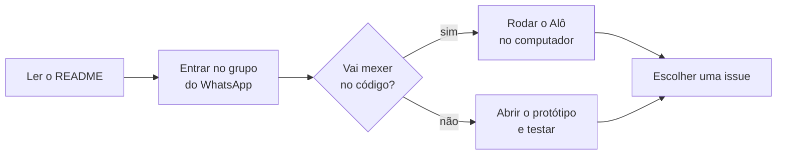
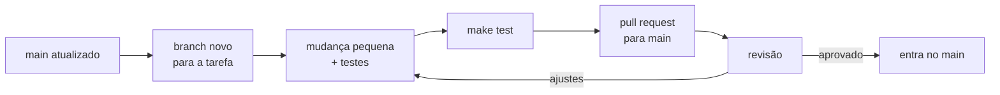

# Como contribuir com o Alô

Que bom que você chegou. O Alô é uma alternativa brasileira ao WhatsApp, gratuita, de código
aberto (AGPL-3.0) e com criptografia de ponta a ponta. É feito por voluntários e organizado
sem hierarquia, como um projeto de código aberto: as decisões são discutidas às claras, nas
issues e no grupo, e quem faz o trabalho tem voz. O Kaio é o fundador e coordena o projeto.

Este guia mostra quem pode ajudar, por onde começar, como funcionam as tarefas e como mandar
uma mudança.

**Nesta página**

- [Quem pode ajudar](#quem-pode-ajudar)
- [Primeiros passos](#primeiros-passos)
- [Como funcionam as tarefas (issues)](#como-funcionam-as-tarefas-issues)
- [Como mandar uma mudança (branch e pull request)](#como-mandar-uma-mudança-branch-e-pull-request)
- [Regras que não se negociam](#regras-que-não-se-negociam)
- [Onde conversar](#onde-conversar)
- [Código de conduta](#código-de-conduta)

---

## Quem pode ajudar

Não é preciso programar para ajudar. Hoje o projeto precisa de:

| Área | O que dá para fazer |
|---|---|
| **Desenvolvimento** | App em Flutter (Android e web), servidor (Synapse, Docker Compose), o serviço de entrada `alo-id` (TypeScript no Node 26) e o site `usealo.app` (Worker da Cloudflare). |
| **Testes e QA** | Usar o app e o protótipo, achar erros, escrever roteiros de teste, testar em celulares diferentes, conferir acessibilidade (fonte grande, leitor de tela). |
| **Banco de dados e infraestrutura** | PostgreSQL, Redis, escala para milhões de pessoas, monitoramento, teste de carga (etapa M7 do [roadmap](docs/roadmap.md)). |
| **Design** | Telas, fluxos, ícones, acessibilidade, o Modo simples para pessoas de todas as idades. |
| **Comunicação** | Textos do site e do app, vídeos, redes sociais, explicar criptografia em palavras simples. |
| **Jurídico** | LGPD, termos de uso e política de privacidade, registro de marca, o formato da instituição sem fins lucrativos que vai operar o serviço. |
| **Voz (participação cidadã)** | Quem conhece dados abertos, câmaras e assembleias, orçamento participativo e movimentos de bairro: ajudar a desenhar a aba Voz para que seja útil, confiável e apartidária. |

Se a sua área não está na lista, apareça mesmo assim e conte o que você sabe fazer.

---

## Primeiros passos



1. **Leia o [README](README.md).** Ele explica o que é o Alô, o que já funciona (as
   conversas) e o que ainda é protótipo (Momentos, Rede, Voz, Perfil, Bem-estar, Modo simples).
2. **Leia o que combina com a sua área.** O [índice da documentação](docs/README.md) tem o
   mapa de tudo. Para não programadores, as [perguntas frequentes](docs/perguntas-frequentes.md)
   e o [roadmap](docs/roadmap.md) são o melhor começo. Para quem programa, o
   [guia de desenvolvimento](docs/desenvolvimento.md) e a
   [arquitetura](docs/design/2026-10-24-architecture.md).
3. **Entre no grupo do Alô no WhatsApp** e se apresente (veja [Onde conversar](#onde-conversar)).
4. **Rode o Alô no computador** (se for mexer no código). O
   [guia de desenvolvimento](docs/desenvolvimento.md) tem os pré-requisitos e a solução de
   problemas. O resumo:

   ```sh
   pnpm install     # dependências Node (alo-id, site, ferramentas de teste)
   make up          # sobe o servidor local em http://localhost:8080
   make smoke       # dois usuários de teste trocam uma mensagem criptografada
   make app-web     # abre o app no Chrome (a primeira vez compila a criptografia, ~10 min)
   make test        # testes de unidade do alo-id, do site e do app
   ```

   Entre no app com qualquer celular brasileiro, por exemplo `11 91234-5678`, e o código
   `000000` (só funciona no servidor local). `make down` para o servidor; `make reset` para e
   apaga todos os dados locais.

   Quem só vai mexer no servidor precisa de Docker, Node 26, pnpm, openssl e curl. Para o app
   é preciso também Flutter 3.47.8, Rust, Android SDK e Chrome.

5. **Ou abra o protótipo** (Momentos, Rede, Voz, Perfil, Modo simples). Ele roda sem servidor,
   com dados inventados:

   ```sh
   app/scripts/build-demo-web.sh
   python3 app/scripts/serve-demo-web.py   # abra http://127.0.0.1:8765
   ```

   Detalhes em [Modo demonstração](docs/desenvolvimento.md#modo-demonstração-sem-servidor).

---

## Como funcionam as tarefas (issues)

As tarefas ficam nas [issues do GitHub](https://github.com/kaiomp/alo/issues) deste
repositório. Uma *issue* é um registro de tarefa, erro ou ideia, com a conversa sobre ela.

- **Para começar**, procure as issues com o rótulo
  [`good first issue`](https://github.com/kaiomp/alo/issues?q=is%3Aissue+is%3Aopen+label%3A%22good+first+issue%22):
  são tarefas menores, com o contexto já explicado.
- **Antes de começar**, comente na issue que você vai pegar, para ninguém fazer o mesmo
  trabalho em dobro. Se travar ou desistir, avise ali também; não tem problema.
- **Achou um erro ou tem uma ideia?** Abra uma [issue nova](https://github.com/kaiomp/alo/issues/new)
  dizendo o que aconteceu, o que você esperava e como repetir (para erros), ou qual problema
  a ideia resolve. Quem não tem costume com o GitHub pode contar no grupo, e alguém registra.
- **As etapas grandes** (M4 a M7) têm uma issue cada, com a lista do que falta. O
  [roadmap](docs/roadmap.md) mostra a ordem.
- **Falha de segurança:** não publique os detalhes numa issue nem no grupo. Mande uma
  mensagem privada ao Kaio (pelo grupo) e combine com ele como contar.

---

## Como mandar uma mudança (branch e pull request)



1. **Parta do `main` atualizado** e crie um branch para a tarefa:

   ```sh
   git switch main && git pull
   git switch -c fix/typing-indicator      # um nome curto que diga o que é
   ```

2. **Faça mudanças pequenas.** Um pull request por assunto. É mais fácil de revisar, de testar
   e de desfazer se algo der errado. Se a tarefa for grande, divida em partes.
3. **Escreva os commits em inglês**, no imperativo e dizendo o que muda, por exemplo
   `Show the unread counter on archived chats`.
4. **Documentação em português do Brasil** (README, `docs/`, `app/README.md`,
   `site/LEIAME.md`): clara, completa, com imagens e diagramas quando ajudam. Comentários no
   código ficam em inglês e explicam o *porquê*, não o *quê*.
5. **Teste.** Toda mudança de comportamento vem com teste. Antes de abrir o pull request:

   ```sh
   make test                                           # sempre (sem Flutter instalado: pnpm -r test)
   cd app && flutter analyze                           # se mexeu no app
   make up && ./server/scripts/check.sh && make smoke  # se mexeu no servidor
   make app-e2e-web                                    # se mexeu no app (precisa do make up)
   ```

6. **Abra o pull request para o `main`** explicando o que muda, por quê, e como você testou.
   Ligue a issue (por exemplo, `Closes #42`). Mudanças de tela ficam muito mais fáceis de
   revisar com uma captura de tela.
7. **Revisão.** Alguém do projeto lê, comenta e aprova. Comentário em revisão é sobre o
   código, nunca sobre a pessoa. Todo pull request precisa de pelo menos 1 aprovação.
8. **Merge.** Por enquanto, quem faz o merge no `main` é o Kaio. Quem tem acesso de escrita
   envia os próprios branches, mas nunca faz push direto no `main`.

As regras do código em detalhe (textos da interface no ARB, cores só como tokens, só
`lib/services/` fala com o SDK Matrix, uma pasta por funcionalidade, comentários `// Limit:`,
TypeScript sem build) estão em
[Regras do projeto para contribuidores](docs/desenvolvimento.md#8-regras-do-projeto-para-contribuidores).

---

## Regras que não se negociam

- **A criptografia de ponta a ponta nunca é enfraquecida.** Toda conversa é criptografada e o
  operador do servidor não pode ler conversas. Qualquer mudança que enfraqueça isso é
  bloqueada, por melhor que seja o motivo.
- **Código sensível precisa de um teste para cada limite.** Vale para o código de entrada
  por SMS (OTP), os tokens (JWT), os limites de tentativas e as cotas diárias do `alo-id`:
  cada limite tem o seu teste.
- **Nada ranqueado em segredo, nada censurado em silêncio.** Toda recomendação diz por que
  aparece e a pessoa controla. Anúncio só marcado, limitado e nunca nas conversas.
- **Nenhum segredo no repositório.** Senhas, chaves e tokens ficam fora do git
  (`server/data/.env` é gerado e ignorado; chaves de assinatura vêm de variáveis de ambiente).
- **Inspiração no WhatsApp, sem cópia.** Copiamos padrões de interação que os brasileiros já
  conhecem, nunca código, ícones, textos ou cores exatas.
- **Licença AGPL-3.0.** Ao contribuir, você concorda que a sua contribuição entra no projeto
  sob essa licença.

---

## Onde conversar

Por enquanto, a conversa do dia a dia acontece no **grupo do Alô no WhatsApp**. Para entrar,
peça o convite em [usealo.app/participe](https://usealo.app/participe). O que for decisão ou
tarefa vai também para uma issue, para ficar registrado e ninguém depender da memória do grupo.

---

## Código de conduta

Todo mundo que participa do Alô, no GitHub, no grupo ou em qualquer outro espaço do projeto,
segue o [código de conduta](CODE_OF_CONDUCT.md). Em resumo: respeito, paciência com quem está
começando e nenhuma forma de assédio.
