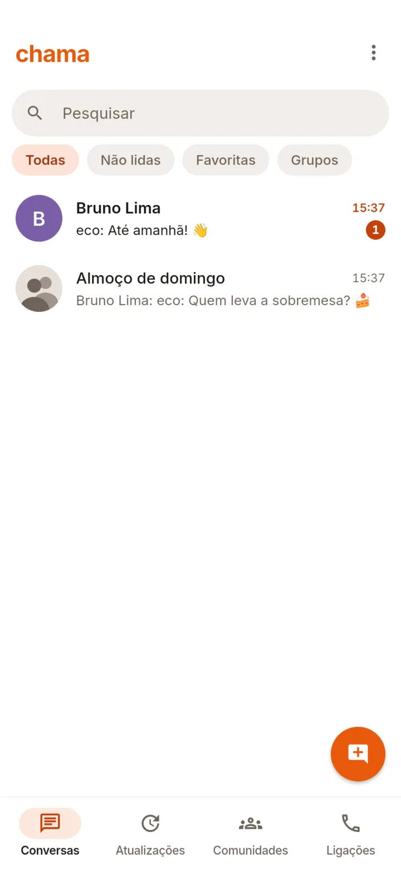
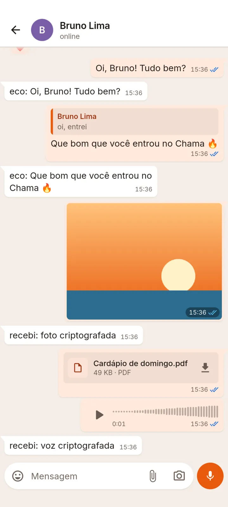
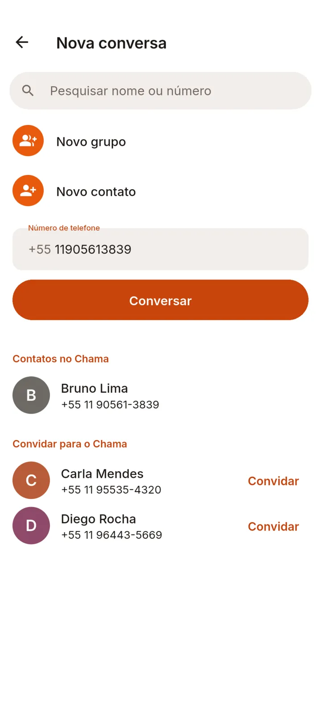
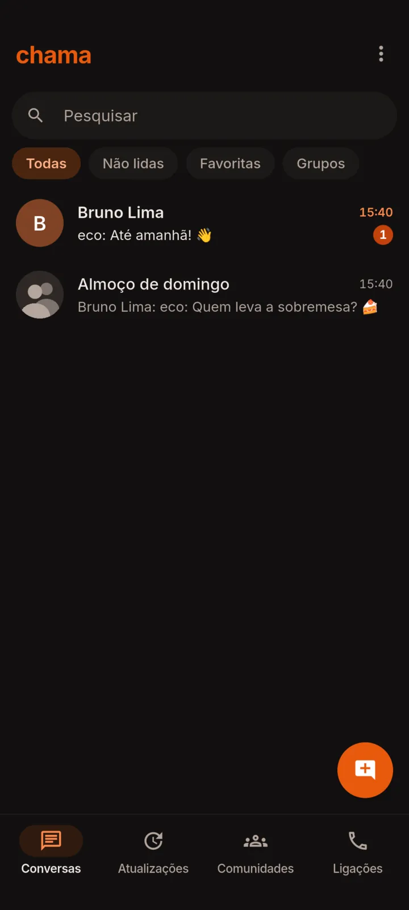
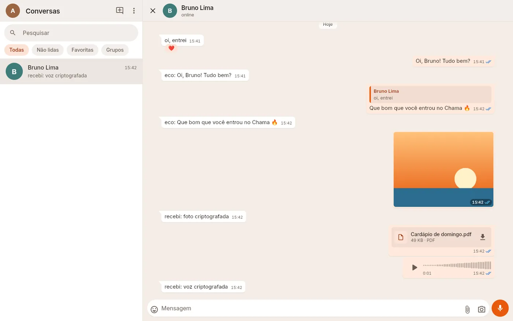
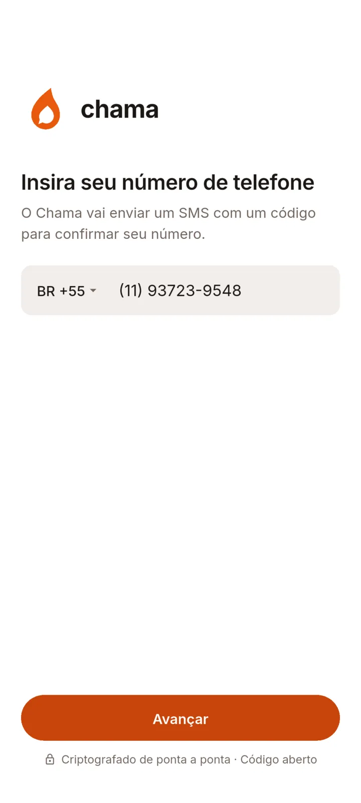
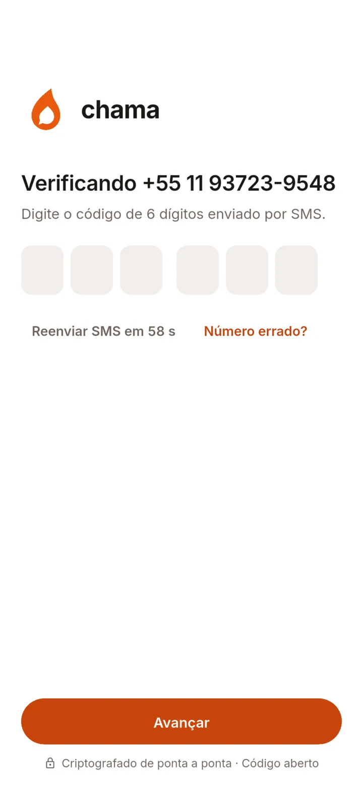
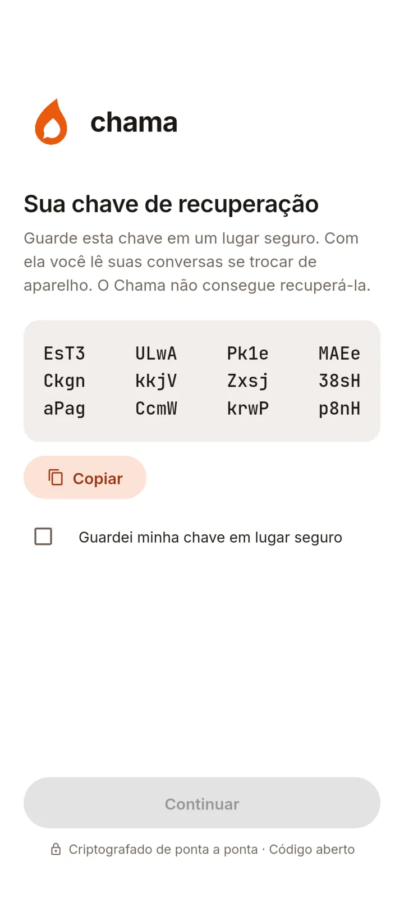
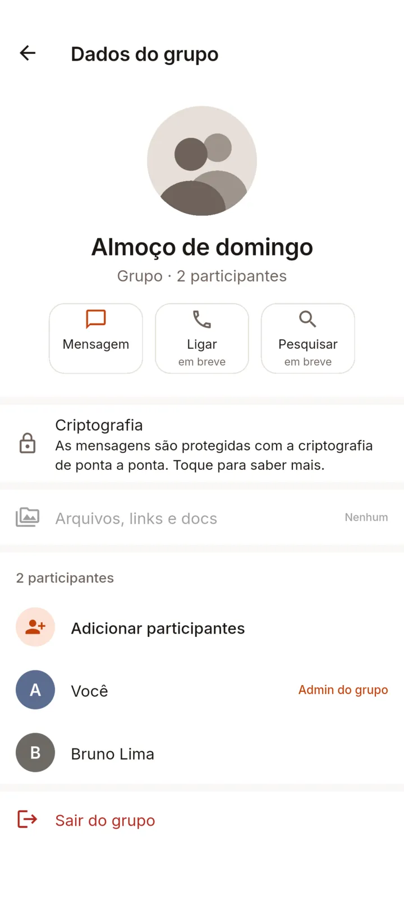
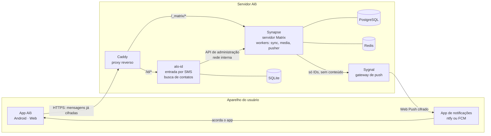

<p align="center">
  
</p>

<h1 align="center">Alô</h1>

<p align="center">
  Mensageiro livre, aberto e com criptografia de ponta a ponta, feito para o Brasil.<br>
  <em>Criptografado de ponta a ponta · Código aberto</em>
</p>

---

## O que é o Alô

O Alô é um aplicativo de mensagens com a cara e o jeito do WhatsApp: você entra com o seu
número de celular, encontra quem já está na sua agenda e conversa, sozinho ou em grupo, com
texto, fotos, documentos e mensagens de voz.

A diferença está em quem manda nele:

- **Gratuito e sem anúncios.** Não há publicidade nem venda de dados.
- **Código aberto** (licença AGPL-3.0). Qualquer pessoa pode ler, auditar e melhorar o código,
  e quem modificar o servidor ou o app precisa manter as mudanças abertas.
- **Ninguém lê suas mensagens.** Toda conversa é cifrada no seu aparelho antes de sair dele
  (criptografia de ponta a ponta). O servidor só guarda e repassa um conteúdo embaralhado que
  ele não consegue abrir. Isso vale também para quem opera o servidor.
- **Sem algoritmo.** A lista de conversas segue apenas a ordem da última mensagem. Não existe
  feed, ranking nem recomendação de conteúdo.
- **Feito para ser operado por uma instituição pública ou sem fins lucrativos**, sem que ela
  consiga ler mensagens, escolher o que as pessoas veem ou censurar em silêncio.
- **Protocolo aberto.** O Alô usa o [Matrix](https://matrix.org), o mesmo padrão dos
  mensageiros oficiais do governo da França (Tchap) e das Forças Armadas da Alemanha
  (BwMessenger). No futuro, universidades, estados e ONGs poderão rodar servidores compatíveis
  entre si (federação).

> **Situação atual:** o Alô está em desenvolvimento e ainda não foi lançado ao público.
> O servidor, o app Android e a versão web já funcionam no ambiente local de desenvolvimento.
> Veja o [status por etapa](#status) e o [roadmap](docs/roadmap.md).

## Como ele é

<table>
  <tr>
    <td align="center" width="25%">
      <br>
      <sub>Lista de conversas com filtros e contador de não lidas</sub>
    </td>
    <td align="center" width="25%">
      <br>
      <sub>Resposta citada, foto, PDF e voz, tudo criptografado, com tiques azuis de leitura</sub>
    </td>
    <td align="center" width="25%">
      <br>
      <sub>Contatos da agenda que já usam o Alô, e convite para quem ainda não usa</sub>
    </td>
    <td align="center" width="25%">
      <br>
      <sub>Tema escuro</sub>
    </td>
  </tr>
</table>

<p align="center">
  <br>
  <sub>Versão web: lista e conversa lado a lado, como no WhatsApp Web</sub>
</p>

Mais telas, como a entrada por SMS, a chave de recuperação, os dados do grupo e as
configurações, estão em [Recursos](#recursos) e no [índice da documentação](docs/README.md).

## Recursos

O que já funciona hoje (etapas M1 a M3):

| Área | O que o app faz |
|---|---|
| **Entrada** | Cadastro com número de celular e código de 6 dígitos por SMS, como no WhatsApp. Não há senha. |
| **Criptografia** | Todas as conversas e grupos são criptografados de ponta a ponta, sem exceção. Uma **chave de recuperação** gerada no aparelho permite ler as conversas antigas num celular novo. |
| **Conversas** | Conversas individuais e em grupo; texto, emoji, respostas citadas, reações, edição e "apagar para todos" ou "apagar para mim". |
| **Mídia** | Fotos, documentos (PDF e outros) e mensagens de voz com forma de onda. Tudo é cifrado antes do envio. |
| **Status da mensagem** | Tiques: ✓ enviada, ✓✓ entregue, ✓✓ azul lida. As confirmações de leitura podem ser desligadas. |
| **Presença** | "digitando…", "online" e "visto por último". |
| **Organização** | Busca, filtros (Todas, Não lidas, Favoritas, Grupos), fixar, arquivar, silenciar e marcar como lida ou não lida. |
| **Grupos** | Criar grupo, adicionar e remover participantes, tornar administrador, sair do grupo. |
| **Contatos** | O app lê a agenda (com a sua permissão), mostra quem já usa o Alô com o nome que você salvou e permite convidar quem ainda não usa. Só resumos criptográficos (hashes) dos números saem do celular. |
| **Notificações** | Notificações com nome e texto da mensagem, abertura direta da conversa e resposta pela própria notificação. O servidor envia apenas identificadores, nunca o conteúdo. |
| **Bloqueio** | Bloquear e desbloquear um contato. |
| **Aparência** | Português do Brasil (e inglês), tema claro, escuro ou o padrão do sistema. |
| **Plataformas** | Android (versões para F-Droid e Google Play) e navegador (layout de tela larga). |

<table>
  <tr>
    <td align="center" width="25%">
      <br>
      <sub>Entrada pelo número de celular (+55)</sub>
    </td>
    <td align="center" width="25%">
      <br>
      <sub>Código de 6 dígitos por SMS</sub>
    </td>
    <td align="center" width="25%">
      <br>
      <sub>Chave de recuperação, criada no próprio aparelho</sub>
    </td>
    <td align="center" width="25%">
      <br>
      <sub>Dados do grupo: participantes e administrador</sub>
    </td>
  </tr>
</table>

O que vem depois: abrir o Alô no computador lendo um QR code, lista de aparelhos
conectados e PIN da conta (M4); status, canais, comunidades, enquetes e mensagens
temporárias (M5); ligações de voz e vídeo (M6); lançamento em produção (M7).

## Status

| Etapa | O que entrega | Situação |
|---|---|---|
| **M1** · Fundação | Servidor completo (Synapse com workers, PostgreSQL, Redis, Caddy, alo-id) que sobe com um comando; dois usuários de teste trocam uma mensagem criptografada. | ✅ Concluída |
| **M2** · Núcleo do app | App Flutter para Android e web: entrada por SMS, chave de recuperação, conversas, grupos, mídia, voz, tiques, busca, temas. ([#1](https://github.com/kaiomp/alo/issues/1)) | ✅ Concluída |
| **M3** · Lançamento Android | Sincronização de contatos, notificações push (Sygnal + UnifiedPush, FCM na versão Play), builds de release para F-Droid e Play. ([#2](https://github.com/kaiomp/alo/issues/2)) | ✅ Concluída |
| **M4** · Aparelhos e segurança da conta | Conectar a versão web por QR code, lista e remoção de aparelhos, PIN da conta, aviso de "novo aparelho" aos contatos. ([#3](https://github.com/kaiomp/alo/issues/3), [#11](https://github.com/kaiomp/alo/issues/11)) | 🔨 Próxima |
| **M5** · Extras | Status, canais, comunidades, enquetes, localização, mensagens temporárias, mensagens favoritas (com estrela), listas de transmissão, privacidade, recado do perfil, retenção mínima no servidor. ([#4](https://github.com/kaiomp/alo/issues/4), [#12](https://github.com/kaiomp/alo/issues/12)) | ⏳ Planejada |
| **M6** · Ligações | Ligações de voz e vídeo, individuais e em grupo (LiveKit + MatrixRTC). ([#5](https://github.com/kaiomp/alo/issues/5)) | ⏳ Planejada |
| **M7** · Produção | Provedor real de SMS, guia de implantação, monitoramento, teste de carga para milhões de usuários. ([#6](https://github.com/kaiomp/alo/issues/6), [#7](https://github.com/kaiomp/alo/issues/7)) | ⏳ Planejada |

Detalhes de cada etapa, pendências e ideias para depois (federação por DDD, modo sem
internet) estão no [roadmap](docs/roadmap.md).

## Como funciona

O app cifra cada mensagem no aparelho e a envia por HTTPS ao servidor. Na frente do servidor
fica o **Caddy** (proxy reverso, o "porteiro" que encaminha cada pedido ao serviço certo). O
**Synapse** é o servidor Matrix: guarda e entrega as mensagens cifradas. O **alo-id** é um
serviço pequeno, escrito para o Alô, que cuida da entrada por número de celular e da busca
de contatos. As notificações saem pelo **Sygnal**, que só repassa identificadores; o próprio
celular busca e decifra a mensagem.



A explicação completa, com as decisões de projeto, está na
[arquitetura](docs/design/2026-10-24-architecture.md). As garantias e os limites de
privacidade estão em [segurança e privacidade](docs/seguranca-e-privacidade.md).

## Começo rápido

Para quem quer rodar o Alô no próprio computador. Detalhes, solução de problemas e o
caminho completo do app estão no [guia de desenvolvimento](docs/desenvolvimento.md).

**Pré-requisitos do servidor:** Docker, Node 26, pnpm, openssl e curl.

```sh
pnpm install && make up && make smoke
```

- `make up` sobe o servidor local em `http://localhost:8080` (na primeira vez cria
  `server/data/.env` com segredos aleatórios).
- `make smoke` faz dois usuários de teste entrarem pelo número de celular, um encontrar o
  outro pelo número (busca de contatos por hash) e trocarem uma mensagem criptografada. Também confere que o banco de
  dados do servidor guarda só texto cifrado.
- `make down` para o servidor. `make reset` para e **apaga todos os dados** locais.

**O app** (pré-requisitos: Flutter 3.47.8, Android SDK com NDK e um emulador, Chrome e rustup):

```sh
make app-android   # com o emulador Android já aberto
make app-web       # no Chrome; a primeira vez compila a criptografia para a web (cerca de 10 minutos)
```

Entre com qualquer celular brasileiro, por exemplo `11 91234-5678`, e o código `000000`.

> O código `000000` só funciona no servidor de desenvolvimento (`ALO_DEV=1`), que por isso
> só aceita conexões do próprio computador. O alo-id se recusa a ligar esse modo fora de
> domínios `.test` ou `.localhost`.

**Testes:**

| Comando | O que testa |
|---|---|
| `make test` | Testes unitários do servidor e do app (não precisa do servidor rodando; precisa do Flutter) |
| `server/scripts/check.sh` | Verificações de aceitação contra o servidor rodando, incluindo push |
| `make app-e2e-web` | O app no Chrome conversa com um usuário de teste automatizado |
| `make app-e2e-android` | O mesmo no emulador Android, mais contatos e notificações push |

Notificações push no emulador precisam do app ntfy: rode `cd app && ./scripts/ntfy-setup.sh`
uma vez por emulador.

## Documentação

| Documento | Para quem | Conteúdo |
|---|---|---|
| [Índice da documentação](docs/README.md) | Todos | Mapa de todos os documentos e glossário |
| [Perguntas frequentes](docs/perguntas-frequentes.md) | Todos, inclusive quem não é da área técnica | Privacidade, governo, celular perdido, custos, iPhone |
| [Roadmap](docs/roadmap.md) | Parceiros, financiadores, colaboradores | Etapas M1 a M7, o que está pronto e o que vem |
| [Segurança e privacidade](docs/seguranca-e-privacidade.md) | Parceiros, auditores, desenvolvedores | O que o servidor vê e o que não vê, ameaças e defesas |
| [Arquitetura](docs/design/2026-10-24-architecture.md) | Desenvolvedores, avaliadores técnicos | Decisões de projeto, componentes, escala, federação |
| [Desenvolvimento](docs/desenvolvimento.md) | Desenvolvedores | Preparar o ambiente, rodar, testar, contribuir |
| [App Alô](app/README.md) | Desenvolvedores do app | App Flutter: rodar, testar, mapa do código, builds de release |
| [API do alo-id](docs/alo-id-api.md) | Desenvolvedores | Rotas de entrada por SMS, busca de contatos e redefinição de identidade |
| [Operação](docs/operacao.md) | Quem vai operar um servidor | Configuração, segredos, push, manutenção |

## Como apoiar

O Alô procura instituições que queiram operar um servidor (universidades, órgãos públicos,
organizações sem fins lucrativos), financiadores e pessoas que queiram contribuir.

- **Instituições e financiadores:** abram uma
  [issue no GitHub](https://github.com/kaiomp/alo/issues/new) contando quem são e como
  querem ajudar. A conversa continua por lá ou por um contato combinado na própria issue.
- **Desenvolvedores:** vejam as [issues abertas](https://github.com/kaiomp/alo/issues) e o
  [guia de desenvolvimento](docs/desenvolvimento.md).
- **Todo mundo:** reportar erros e sugerir melhorias também pelas
  [issues](https://github.com/kaiomp/alo/issues).

## Licença

GNU Affero General Public License v3.0 (AGPL-3.0-only). Veja [LICENSE](LICENSE).

O Alô copia padrões de interação conhecidos pelos brasileiros, mas não usa código, marca,
ícones, textos nem cores do WhatsApp. Não é afiliado ao WhatsApp nem à Meta.

---

## In English

Alô is a free, open-source (AGPL-3.0) messenger for Brazil with the look and feel of
WhatsApp: sign in with a phone number and an SMS code, find your contacts, and chat one to one
or in groups with text, photos, files and voice notes. Every chat is end-to-end encrypted by
default, so not even the server operator can read messages, and there is no feed, ranking or
ads. It is built on the open [Matrix](https://matrix.org) protocol (Synapse server, Flutter app
on the famedly Matrix SDK with vodozemac) so that public or non-profit institutions can run it,
and later federate regional servers. The server, the Android app and the web app work today in
the local development stack (milestones M1 to M3); device linking, extras, calls and the
production launch follow (see [docs/roadmap.md](docs/roadmap.md)). Quick start:
`pnpm install && make up && make smoke`.
