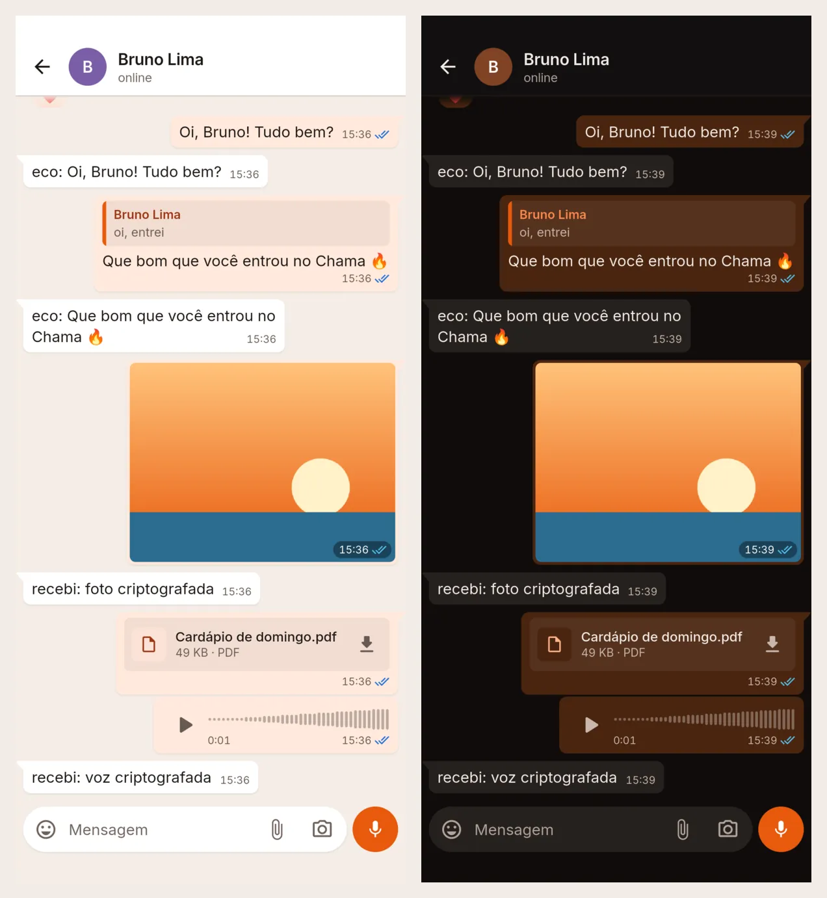
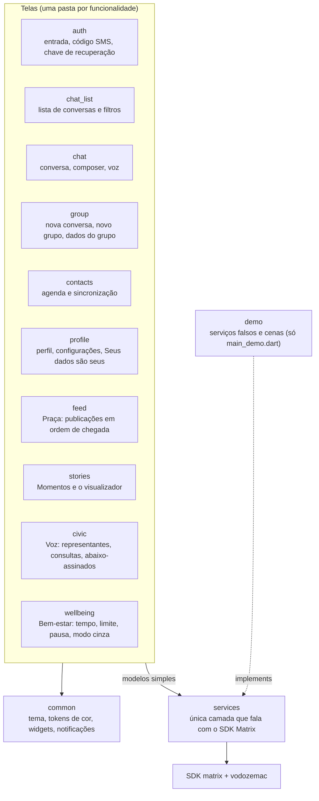
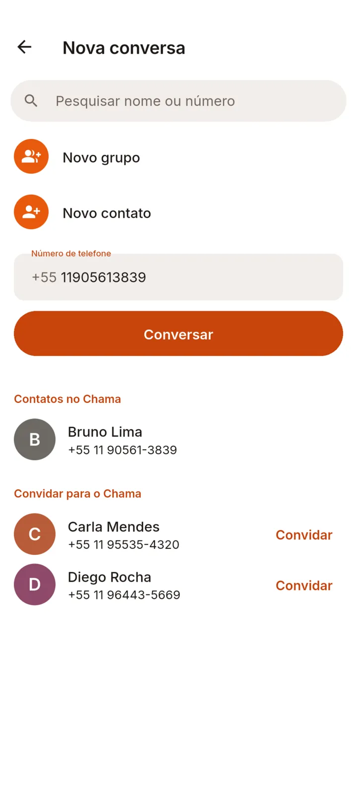

# App Chama

Um único app Flutter para Android e para a web (iOS e desktop depois), construído sobre o SDK
Dart [matrix](https://pub.dev/packages/matrix), com o vodozemac para a criptografia de ponta a
ponta.

  

O passo a passo completo do ambiente (versões, emulador, solução de problemas) está no
[guia de desenvolvimento](../docs/desenvolvimento.md).

## Rodar

Pré-requisitos: Flutter 3.47.8, rustup (o vodozemac é compilado de Rust para Android e para a
web), o Android SDK com o NDK e um emulador (AVD), e o Chrome.

Suba a pilha do servidor antes (`make up` na raiz do repositório). Depois:

- Emulador Android: ligue o AVD e rode `make app-android`.
- Chrome: `make app-web` (a primeira execução compila o vodozemac para a web, cerca de 10 minutos).

Entre com qualquer celular brasileiro (por exemplo `11 91234-5678`) e o código `000000`
(só na pilha de desenvolvimento).

O endereço do servidor vem de `lib/config.dart`: em debug, `http://localhost:8080` na web e
`http://10.0.2.2:8080` no emulador Android (é assim que o emulador enxerga a sua máquina). Para
outro endereço, use `--dart-define=CHAMA_BASE_URL=…`.

## Testar

- `make app-test`: testes de unidade e de widget.
- `make app-e2e-web`, `make app-e2e-android`: o app conversa com uma pessoa de teste
  roteirizada (`tools/peer`) contra a pilha local. `scripts/e2e.sh <chrome|android> <arquivo>`
  roda um teste de integração só. No Android, o primeiro AVD é ligado, a menos que
  `CHAMA_AVD=<nome>` diga outro. O Chrome é procurado no caminho do macOS; em outros sistemas,
  defina `CHROME=<caminho do executável do chrome>`.
- `scripts/screenshots.sh`: gera as capturas de tela da documentação (web e Android, temas claro
  e escuro) em `build/screenshots`.

## Mapa do código

- `lib/services/`: o único código que fala com o SDK Matrix. Os widgets recebem modelos simples.
- `lib/auth`, `lib/chat_list`, `lib/chat`, `lib/group`, `lib/contacts`, `lib/profile`,
  `lib/feed`, `lib/stories`, `lib/civic`, `lib/wellbeing`, `lib/common`: uma pasta por
  funcionalidade. As abas Momentos, Praça, Voz e Perfil e a tela Bem-estar só aparecem
  quando há os serviços delas em `Deps` (hoje, só no modo demonstração).
- `lib/demo/` e `lib/main_demo.dart`: o modo demonstração, sem servidor (veja
  [Modo demonstração](../docs/desenvolvimento.md#modo-demonstração-sem-servidor)).
- Textos: `lib/l10n/app_pt.arb` (português, o modelo) e `app_en.arb`.
- Cores: só em `lib/common/theme.dart`.

## Contatos

Depois da entrada, o app lê a agenda (permissão READ_CONTACTS; a tela Nova conversa explica o
motivo antes de o Android perguntar) e pergunta ao chama-id quais números têm conta. Só os
hashes SHA-256 dos números saem do celular, cada número no máximo uma vez por dia, no máximo
1000 por requisição (veja [API do chama-id, "Privacidade da busca de contatos"](../docs/chama-id-api.md#privacidade-da-busca-de-contatos-issue-7)).
Os nomes salvos na agenda substituem os nomes de exibição em todo o app. Sem a permissão, as
conversas começam digitando um número.

  

## Notificações push

Os pushes chegam pelo UnifiedPush: pelo app distribuidor da pessoa (por exemplo o ntfy) ou, no
build da Play Store, pelo FCM através do distribuidor embutido do UnifiedPush. O servidor
(pusher do Synapse → Sygnal) manda só os IDs da sala e do evento, criptografados com Web Push; o
app busca a mensagem, decifra e mostra. Sem um distribuidor, Configurações → Notificações avisa.

No emulador: suba a pilha (`make up`) e o emulador, e rode `./scripts/ntfy-setup.sh` uma vez. O
script instala o ntfy e o aponta para o ntfy da pilha (`http://10.0.2.2:8081`).

## Builds de release

Dois flavors: `fdroid` (o padrão, sem código do Google; o push precisa de um app UnifiedPush, como
o ntfy) e `play` (adiciona o distribuidor FCM embutido do UnifiedPush, então o push funciona sem
app extra).

- `make app-apk CHAMA_BASE_URL=https://chama.example`: um APK fdroid por ABI (arm64-v8a,
  armeabi-v7a, x86_64) em `build/app/outputs/flutter-apk/`.
- `make app-aab CHAMA_BASE_URL=https://chama.example`: o pacote da Play Store,
  `build/app/outputs/bundle/playRelease/app-play-release.aab`.

`CHAMA_BASE_URL` é obrigatório e precisa ser `https://`: builds release e profile se recusam a
abrir sem ele. O `network_security_config.xml` do Android (só HTTPS) não vale para o cliente HTTP
do próprio Dart, então é essa checagem que impede códigos e tokens de saírem por HTTP sem
criptografia.

A assinatura lê a chave do ambiente, nunca do repositório: `CHAMA_KEYSTORE` (caminho de um
arquivo .jks ou .p12 fora do repositório), `CHAMA_KEYSTORE_PASSWORD`, `CHAMA_KEY_ALIAS` e
`CHAMA_KEY_PASSWORD`. Sem elas, um build release para com erro. Só para teste local,
`CHAMA_ALLOW_DEBUG_KEY=1` assina com a chave de debug e o nome da versão termina em `-debugkey`;
as lojas recusam esses builds, e um build assinado pela loja não consegue atualizá-los (quem
testou teria de desinstalar e perder chaves e conversas).

Para uma loja que assina o APK sozinha (o servidor de build do F-Droid), `CHAMA_UNSIGNED=1` gera o
release sem assinatura e ignora as variáveis acima, por exemplo
`CHAMA_UNSIGNED=1 flutter build apk --release --flavor fdroid --dart-define=CHAMA_BASE_URL=https://chama.example`.
O APK é `build/app/outputs/flutter-apk/app-fdroid-release.apk` (sem assinatura, ele não instala
até ser assinado).

Versão: `version: <nome>+<código>` no pubspec.yaml. Aumente o código a cada release; os APKs
divididos por ABI somam 1000 × número da ABI (armeabi-v7a 1, arm64-v8a 2, x86_64 4).
