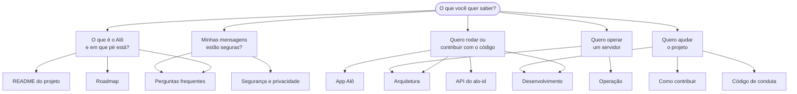
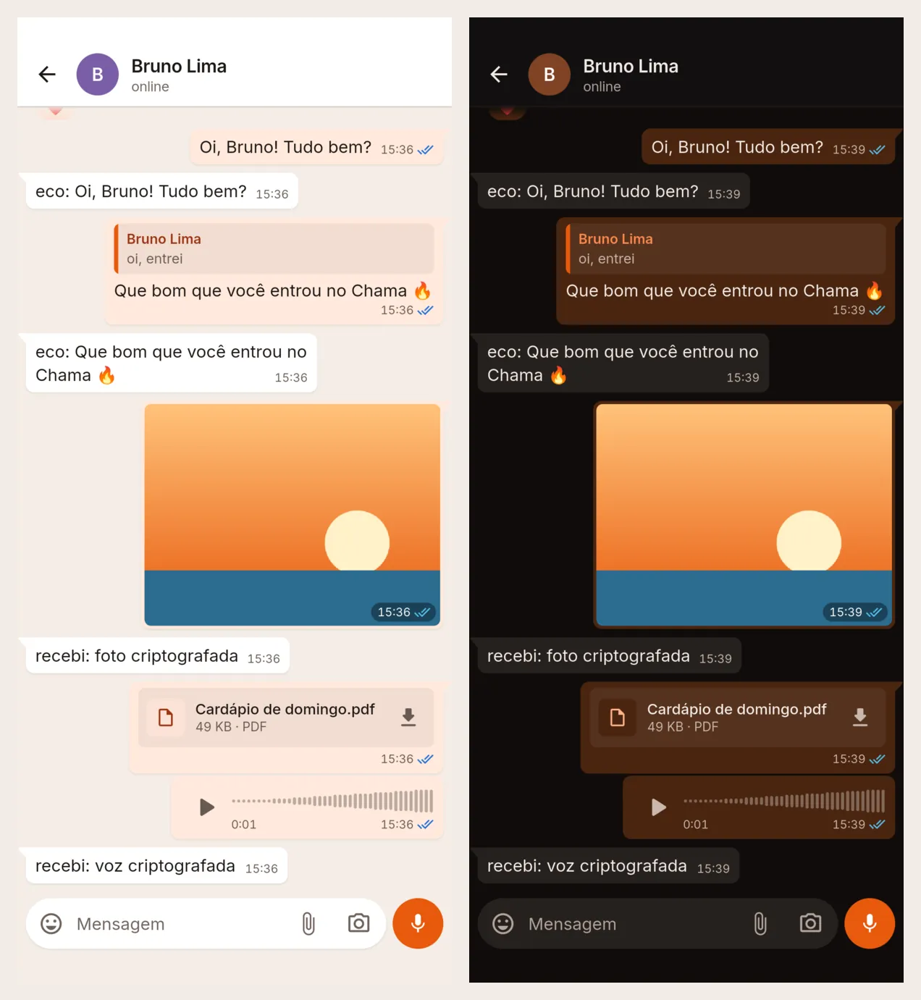

# Documentação do Alô

Este é o mapa de toda a documentação do Alô, o mensageiro livre, aberto e com criptografia de
ponta a ponta feito para o Brasil. Comece pelo documento que combina com o que você procura.
Quem chegou para ajudar começa pelo [guia de contribuição](../CONTRIBUTING.md).

## Por onde começar

## Todos os documentos

### Para todos

| Documento | O que tem nele |
|---|---|
| [README do projeto](../README.md) | O que é o Alô, por que existe, telas, status e começo rápido. |
| [Perguntas frequentes](perguntas-frequentes.md) | Respostas diretas, sem jargão: o governo pode ler minhas mensagens? E se eu perder o celular? Por que número de telefone? Quem paga os servidores? |
| [Roadmap](roadmap.md) | As etapas M1 a M7: o que está pronto, o que vem a seguir, as abas novas (hoje protótipo) e as ideias para depois do lançamento. |

### Para quem quer ajudar

| Documento | O que tem nele |
|---|---|
| [Como contribuir](../CONTRIBUTING.md) | Quem pode ajudar (dev, QA, design, comunicação, jurídico, Voz), primeiros passos, como pegar uma tarefa, branch e pull request, onde conversar. |
| [Código de conduta](../CODE_OF_CONDUCT.md) | Como nos tratamos e como relatar um problema. |

### Para parceiros, financiadores e auditores

| Documento | O que tem nele |
|---|---|
| [Segurança e privacidade](seguranca-e-privacidade.md) | O que o servidor vê e o que não vê, como o Alô se defende de clonagem de chip e de abuso do operador, e os limites honestos do modelo. |
| [Arquitetura](design/2026-10-24-architecture.md) | As decisões de projeto: por que Matrix, como funcionam a entrada por telefone, a criptografia, os aparelhos, as notificações, a escala para milhões de usuários e a federação por regiões. |

### Para desenvolvedores

| Documento | O que tem nele |
|---|---|
| [Desenvolvimento](desenvolvimento.md) | Preparar o ambiente, subir o servidor local, rodar o app, testes e como contribuir. |
| [App Alô](../app/README.md) | O app Flutter: rodar no Android e no Chrome, testes, mapa do código, contatos, notificações e builds de release (F-Droid e Play). |
| [API do alo-id](alo-id-api.md) | As rotas do serviço de entrada: código por SMS, busca de contatos, redefinição de identidade, PIN da conta, remoção de aparelhos e vinculação por QR, com erros e limites. |
| [Site usealo.app](../site/LEIAME.md) | O site público e o formulário de inscrição: estrutura, rodar no computador, publicar no Worker da Cloudflare. |

### Para quem vai operar um servidor

| Documento | O que tem nele |
|---|---|
| [Operação](operacao.md) | Configuração do servidor, segredos, notificações push e manutenção. |

## Telas do app

As capturas de tela usadas na documentação ficam em [`imagens/`](imagens/). Todas mostram o
app rodando no ambiente de desenvolvimento, com contatos de teste.

| Tela | Claro | Escuro |
|---|---|---|
| Entrada pelo número de celular | [android-entrar-com-telefone-claro](imagens/android-entrar-com-telefone-claro.webp) | — |
| Código de 6 dígitos por SMS | [android-codigo-sms-claro](imagens/android-codigo-sms-claro.webp) | — |
| Chave de recuperação | [android-chave-de-recuperacao-claro](imagens/android-chave-de-recuperacao-claro.webp) | — |
| Lista de conversas | [android-lista-de-conversas-claro](imagens/android-lista-de-conversas-claro.webp) | [android-lista-de-conversas-escuro](imagens/android-lista-de-conversas-escuro.webp) |
| Conversa com foto, PDF e voz | [android-conversa-claro](imagens/android-conversa-claro.webp) | [android-conversa-escuro](imagens/android-conversa-escuro.webp) |
| Conversa nos dois temas, lado a lado | [android-conversa-claro-e-escuro](imagens/android-conversa-claro-e-escuro.webp) | |
| Dados do grupo | [android-dados-do-grupo-claro](imagens/android-dados-do-grupo-claro.webp) | — |
| Nova conversa e contatos | [android-nova-conversa-claro](imagens/android-nova-conversa-claro.webp) | — |
| Configurações | [android-configuracoes-claro](imagens/android-configuracoes-claro.webp) | — |
| Web em tela larga | [web-conversa-tela-larga-claro](imagens/web-conversa-tela-larga-claro.webp) | [web-conversa-tela-larga-escuro](imagens/web-conversa-tela-larga-escuro.webp) |
| Web em três painéis, com dados do grupo | [web-dados-do-grupo-tela-larga-claro](imagens/web-dados-do-grupo-tela-larga-claro.webp) | — |

  

## Glossário rápido

Termos que aparecem na documentação, explicados em poucas palavras.

| Termo | O que quer dizer |
|---|---|
| **Criptografia de ponta a ponta** (E2EE) | A mensagem é embaralhada no aparelho de quem envia e só o aparelho de quem recebe consegue desembaralhar. O servidor no meio do caminho não consegue ler. |
| **Matrix** | Um padrão aberto de troca de mensagens, como o e-mail é um padrão aberto. O Alô usa esse padrão em vez de inventar um próprio. |
| **Servidor** (homeserver) | O computador que guarda e entrega as mensagens cifradas. No Alô é o **Synapse**. |
| **Operador** | A instituição que mantém um servidor Alô funcionando. |
| **Federação** | Servidores de operadores diferentes conversando entre si, como e-mails entre Gmail e Outlook. |
| **alo-id** | O serviço do Alô que confere o código do SMS e liga cada número de celular a uma conta. |
| **Chave de recuperação** | Um código gerado no seu aparelho que permite ler as conversas antigas num aparelho novo. Só você tem. |
| **Verificação de aparelho** | A confirmação de que um aparelho novo é mesmo seu. Sem ela, o aparelho não recebe as chaves das mensagens. |
| **Cifrar / decifrar** | O mesmo que criptografar / descriptografar. |
| **Metadados** | Dados sobre a conversa (quem, quando, com quem), não o conteúdo. |
| **SIM swap** | Golpe em que alguém consegue um chip com o seu número. |
| **Hash** | Um resumo matemático de um dado (por exemplo, um número de telefone) que serve para comparar sem mandar o dado original. |
| **Push** | A notificação que acorda o app quando chega mensagem. No Alô, o push leva só um identificador, nunca o texto. |
| **UnifiedPush / ntfy** | Uma forma aberta de entregar notificações no Android sem depender do Google. O ntfy é um dos apps que fazem isso. |
| **FCM** | O serviço de notificações do Google, usado só na versão do Alô para a Google Play. |
| **F-Droid** | Uma loja de aplicativos Android só com software livre. |
| **AGPL-3.0** | A licença do Alô: o código é aberto, e quem modificar e oferecer o serviço precisa publicar as mudanças. |
