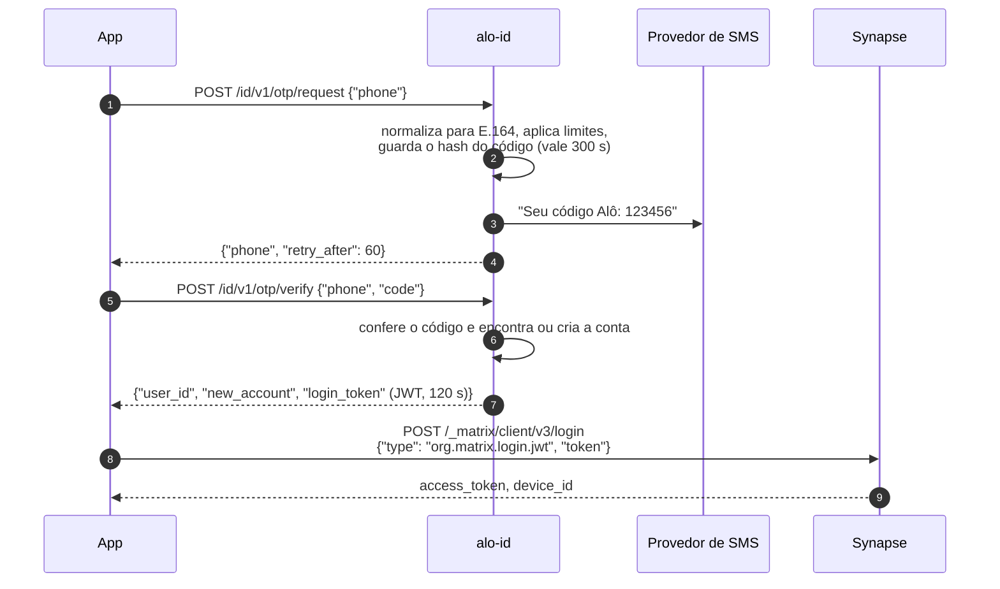
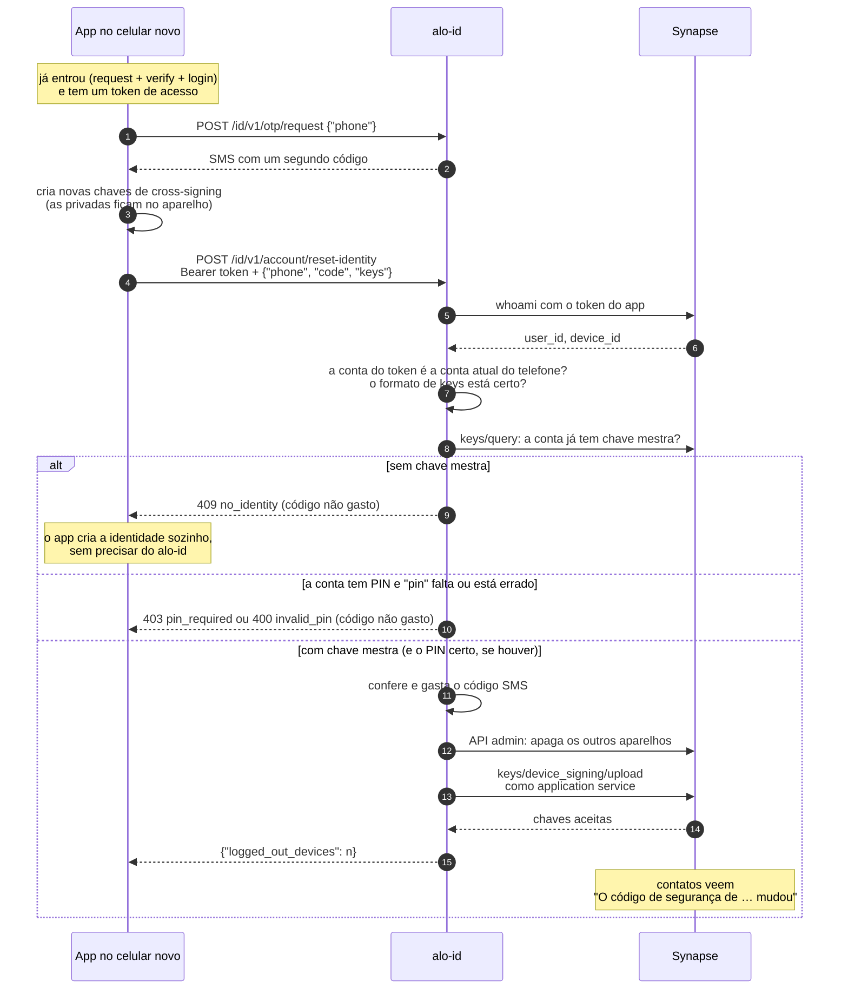
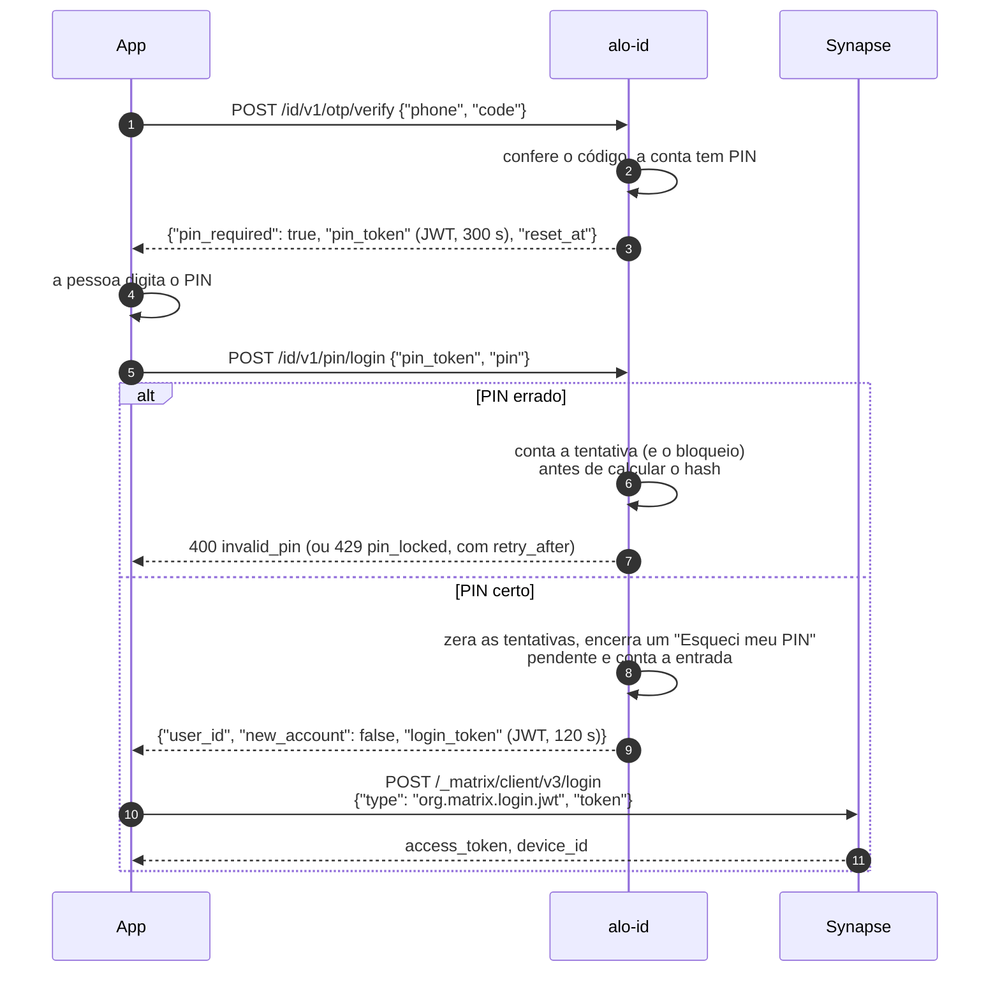
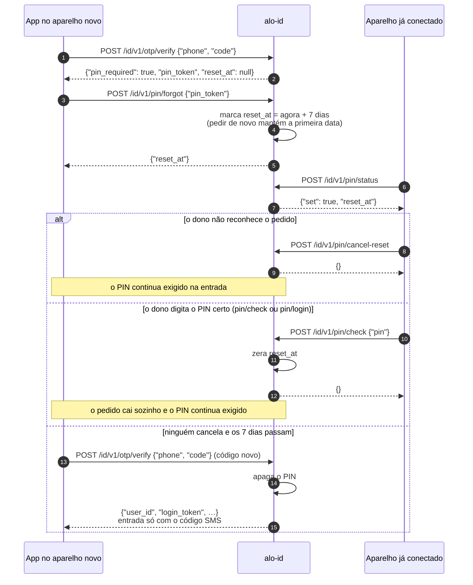
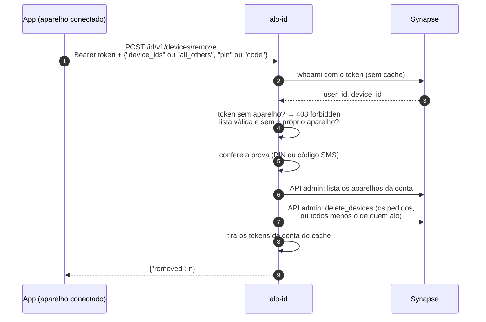
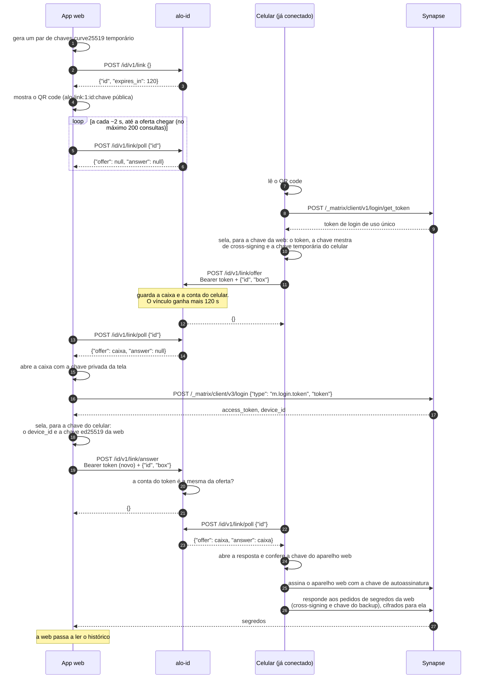

# API do alo-id

O alo-id é o serviço de entrada do Alô ([arquitetura, seção 4](design/2026-10-24-architecture.md#4-identidade-e-entrada)): ele confirma o número de
telefone por código SMS e libera o login no servidor Matrix. Também responde quais contatos da
agenda têm conta, guarda o PIN da conta (confirmação em duas etapas) e cuida da redefinição de
identidade de criptografia. E é o ponto de encontro da vinculação do app web por QR code.

Os clientes chegam ao alo-id pelo proxy, no caminho `/id/v1`. Todos os corpos são JSON. Todo
erro tem o formato `{"error": "<código>"}`, às vezes com campos extras.

> **Termos usados aqui**
>
> - **E.164**: o formato internacional de número de telefone. Nesta API, sempre só os dígitos,
>   sem `+`: `5511987654321`.
> - **JWT**: um token assinado e de vida curta. O alo-id o entrega e o Synapse o aceita como
>   prova de login.
> - **Token de acesso Matrix**: o token que o Synapse devolve no login. Ele identifica o aparelho
>   nas chamadas seguintes.
> - **Chaves de cross-signing**: o trio de chaves públicas (mestra, de autoassinatura e de
>   assinatura de usuários) que prova quais aparelhos pertencem à pessoa.
> - **Caixa selada**: um dado cifrado para a chave pública de quem vai abri-lo. Só o dono da
>   chave privada correspondente consegue abrir; quem só repassa a caixa (aqui, o alo-id) não
>   consegue lê-la nem forjá-la.
> - **PIN da conta**: 6 dígitos que a pessoa escolhe no app. Quando existe, o código SMS sozinho
>   não basta para entrar num aparelho novo (veja [PIN da conta](#pin-da-conta-confirmação-em-duas-etapas)).

## Rotas

| Método | Caminho | Autenticação |
|---|---|---|
| GET | `/id/v1/health` | nenhuma |
| POST | `/id/v1/otp/request` | nenhuma |
| POST | `/id/v1/otp/verify` | nenhuma |
| POST | `/id/v1/directory/lookup` | `Authorization: Bearer <Matrix access token>` |
| POST | `/id/v1/account/reset-identity` | `Authorization: Bearer <Matrix access token>` |
| POST | `/id/v1/pin/login` | `pin_token` no corpo |
| POST | `/id/v1/pin/forgot` | `pin_token` no corpo |
| POST | `/id/v1/pin/status` | `Authorization: Bearer <Matrix access token>` |
| POST | `/id/v1/pin/set` | `Authorization: Bearer <Matrix access token>` |
| POST | `/id/v1/pin/remove` | `Authorization: Bearer <Matrix access token>` |
| POST | `/id/v1/pin/check` | `Authorization: Bearer <Matrix access token>` |
| POST | `/id/v1/pin/cancel-reset` | `Authorization: Bearer <Matrix access token>` |
| POST | `/id/v1/devices/remove` | `Authorization: Bearer <Matrix access token>` |
| POST | `/id/v1/link` | nenhuma |
| POST | `/id/v1/link/offer` | `Authorization: Bearer <Matrix access token>` (o celular) |
| POST | `/id/v1/link/answer` | `Authorization: Bearer <Matrix access token>` (o novo aparelho web) |
| POST | `/id/v1/link/poll` | nenhuma (o ID do vínculo) |

### Entrada no app, do começo ao fim



Em desenvolvimento o "provedor de SMS" só imprime o código no log do alo-id (veja
[Limites](#limites)).

### `GET /id/v1/health`

Resposta: `{"ok": true}`

### `POST /id/v1/otp/request`

Envia um código de 6 dígitos por SMS.

- Requisição: `{"phone": "<number>"}`. Aceita o formato nacional brasileiro (`11987654321`,
  `(11) 98765-4321`) ou o internacional (`+55 11 98765-4321`).
- Resposta: `{"phone": "5511987654321", "retry_after": 60}`. `phone` é o número em E.164 sem
  `+`. `retry_after` é quantos segundos faltam para poder pedir outro código.
- Erros: `invalid_phone` 400, `rate_limited` 429 (com `retry_after` em segundos).

### `POST /id/v1/otp/verify`

Confere o código e depois encontra ou cria a conta do telefone.

- Requisição: `{"phone": "<number>", "code": "123456"}`
- Resposta:

  ```json
  {
    "phone": "5511987654321",
    "user_id": "@u7k3m5q2x4w6a2b5c:alo.test",
    "homeserver": "http://localhost:8080",
    "new_account": true,
    "login_token": "<JWT>"
  }
  ```

  - `user_id` é opaco (`@u` + 16 caracteres base32 minúsculos). Ele nunca contém o telefone.
  - `new_account` é `true` para um telefone novo, para um número reciclado cuja conta antiga foi
    aposentada (sem atividade por 45 dias) e quando a conta antiga foi desativada de outro jeito
    (por exemplo pelo operador). Uma conta desativada nunca volta: o número ganha uma conta nova
    mesmo que a antiga tivesse PIN.
  - `login_token` é um JWT para o `POST /_matrix/client/v3/login` do Matrix, com
    `{"type": "org.matrix.login.jwt", "token": "<JWT>"}`. Ele expira em 120 s.
  - `homeserver` é o endereço base público, para clientes de produção. Os clientes devem usar o
    próprio endereço base configurado para chegar ao servidor: em desenvolvimento, o emulador
    Android chega à máquina em `http://10.0.2.2:8080`, e não no endereço `localhost` deste campo.
- Erros: `invalid_phone` 400, `invalid_code` 400 (código errado, ou nenhum código pedido),
  `expired` 400, `too_many_attempts` 429 (5 tentativas erradas neste código),
  `rate_limited` 429 (10 tentativas erradas em 24 h, com `retry_after`).
- Quando a conta tem PIN, a resposta não traz `login_token`:

  ```json
  { "phone": "5511987654321", "pin_required": true, "pin_token": "<JWT>", "reset_at": null }
  ```

  `pin_token` vale 300 s e vai, junto com o PIN, para `POST /id/v1/pin/login`. A audiência dele é
  `alo-pin`, então o Synapse o recusa como login Matrix. `reset_at` é o horário Unix em que
  termina uma espera de "Esqueci meu PIN" em andamento, ou `null`. Uma conta com PIN nunca é
  aposentada por inatividade. Veja [PIN da conta](#pin-da-conta-confirmação-em-duas-etapas).

### `POST /id/v1/directory/lookup`

Descobre quais contatos têm conta.

- Requisição: `{"hashes": ["<hash>", ...]}`, no máximo 1000 hashes.
- Como calcular cada hash: o SHA-256 em hexadecimal minúsculo dos dígitos E.164, sem `+`.
  Exemplo: para `+55 11 98765-4321`, calcule o hash do texto `5511987654321`.
- Resposta: `{"registered": [{"hash": "<hash>", "user_id": "@u...:alo.test"}]}`. Só aparecem
  os hashes que têm conta. Um hash repetido aparece uma vez.
- Erros: `invalid_token` 401, `bad_request` 400 (não é uma lista, tem mais de 1000 itens, ou um
  item não tem exatamente 64 caracteres hexadecimais minúsculos), `rate_limited` 429 (com
  `retry_after`).

Exemplo com `curl` contra a pilha local (troque `<token>` por um token de acesso Matrix):

```sh
curl -s -XPOST http://localhost:8080/id/v1/directory/lookup \
  -H 'Authorization: Bearer <token>' -H 'content-type: application/json' \
  -d "{\"hashes\":[\"$(printf %s 5511987654321 | openssl sha256 | awk '{print $NF}')\"]}"
```

### `POST /id/v1/account/reset-identity`

Para um telefone novo sem a chave de recuperação (arquitetura, [seção 4](design/2026-10-24-architecture.md#4-identidade-e-entrada) e [seção 5](design/2026-10-24-architecture.md#5-criptografia-aparelhos-e-vinculação)). Exige um token
de acesso válido da conta, um segundo código SMS, novo, para o mesmo telefone, e as novas chaves
de cross-signing **públicas**. Quem cria as chaves é o celular; as chaves privadas nunca saem
dele.

- Requisição:

  ```json
  {
    "phone": "<number>",
    "code": "123456",
    "pin": "123456",
    "keys": {
      "master_key": { "user_id": "@u...", "usage": ["master"], "keys": { "ed25519:<pub>": "<pub>" } },
      "self_signing_key": { "user_id": "@u...", "usage": ["self_signing"], "keys": { "...": "..." }, "signatures": { "...": "..." } },
      "user_signing_key": { "user_id": "@u...", "usage": ["user_signing"], "keys": { "...": "..." }, "signatures": { "...": "..." } }
    }
  }
  ```

  `keys` é o corpo do `POST /_matrix/client/v3/keys/device_signing/upload` do Matrix: as chaves
  de autoassinatura (`self_signing_key`) e de assinatura de usuários (`user_signing_key`) vêm
  assinadas pela nova chave mestra. O objeto precisa ter exatamente essas três chaves. Cada
  chave tem `user_id` igual ao de quem alo, um `usage` com exatamente o próprio tipo, e só os
  campos `user_id`, `usage`, `keys` e `signatures`. Assim nenhuma chave privada pode ser
  enviada. O corpo da requisição tem limite de 8 KiB.
  `pin` só é exigido quando a conta tem PIN.
- Resposta: `{"logged_out_devices": 1}` (quantos outros aparelhos foram desconectados).
- Erros: `invalid_token` 401, `invalid_phone` 400, `forbidden` 403 (a conta do token não é a
  conta atual do telefone), `bad_request` 400 (`keys` ausente ou malformado),
  `no_identity` 409, `pin_required` 403, `invalid_pin` 400, `pin_locked` 429,
  `invalid_code` 400, `expired` 400, `too_many_attempts` 429,
  `rate_limited` 429, `invalid_keys` 400 (o Synapse recusou as chaves, por exemplo por uma
  assinatura errada; o código já foi gasto e os outros aparelhos já foram desconectados, então
  tente de novo com um código novo).

Fluxo:

1. O cliente entra (request + verify + login Matrix) e recebe um token de acesso.
2. O cliente pede um segundo código (`otp/request`) e a pessoa o digita.
3. O cliente cria novas chaves de cross-signing e alo `reset-identity` com o token de acesso,
   o código e as chaves públicas. O alo-id confere, nesta ordem: o token, se a conta do token
   é a conta atual do telefone, o formato de `keys`, se a conta tem uma chave mestra de
   cross-signing e, quando a conta tem PIN, o PIN. Só depois disso o código é conferido e gasto.
4. O alo-id desconecta todos os outros aparelhos da conta (os tokens de acesso deles param de
   funcionar).
5. O alo-id envia as chaves em nome da pessoa pelo seu application service Matrix (um
   application service é uma integração registrada no Synapse; o Synapse não pede
   autenticação interativa a ele). Os contatos então veem o aviso "O código de segurança de Ana mudou" (com o nome de quem redefiniu).



`no_identity` (409) quer dizer que a conta ainda não tem chave mestra de cross-signing, então
não há o que redefinir. O código não é gasto. O cliente simplesmente cria o cross-signing
sozinho: o primeiro envio de chaves de cross-signing não exige autenticação interativa.

## PIN da conta (confirmação em duas etapas)

Um PIN de 6 dígitos que a pessoa cria no app. O alo-id guarda só um hash argon2id do PIN (com
um sal aleatório por conta e o *pepper* do servidor, o segredo `OTP_PEPPER`); o PIN em si nunca
é guardado nem vai para o log. O PIN pertence à conta, não ao número: se um número reciclado
ganhar uma conta nova, ela começa sem o PIN do dono anterior.

Quando a conta tem PIN:

- entrar num aparelho novo exige o código SMS **e depois** o PIN (`otp/verify` → `pin/login`).
  Quem tem só o chip da vítima (SIM swap) para no passo do PIN;
- a redefinição de identidade exige o PIN (`reset-identity`, campo `pin`);
- a conta nunca é aposentada por inatividade: um número reciclado só passa para uma conta nova
  depois que o PIN for redefinido ("Esqueci meu PIN", 7 dias) ou removido. A exceção é uma conta
  já desativada de outro jeito (por exemplo pelo operador): o número ganha uma conta nova na
  próxima entrada.

### Entrada com PIN



A entrada só conta como atividade da conta quando o PIN está certo. Assim, alguém que só tem o
chip e erra o PIN não mantém viva uma conta que não é dele.

### Tentativas erradas

As 4 primeiras tentativas erradas seguidas são livres (para erros de digitação). A partir da
quinta, cada erro bloqueia novas tentativas por 1 min, 5 min, 1 h e depois 24 h (as seguintes
continuam em 24 h). Durante o bloqueio, até o PIN certo é recusado com `pin_locked`. Um PIN
certo zera a contagem.

- O bloqueio vale para a conta, não para o código SMS nem para o aparelho: pedir um código novo
  não libera novas tentativas.
- Cada tentativa é contada, e o próximo bloqueio é gravado, **antes** do cálculo do hash. Uma
  rajada de tentativas em paralelo não passa do bloqueio.
- `pin/login`, `pin/check`, `pin/set`, `pin/remove`, `devices/remove` e `reset-identity` somam
  na mesma contagem.

### "Esqueci meu PIN": espera de 7 dias

Quem esqueceu o PIN e não tem mais nenhum aparelho conectado pede a redefinição no passo do PIN.
O alo-id não libera a entrada na hora: ele marca uma data 7 dias à frente. Durante a espera,
os aparelhos já conectados da conta veem o pedido (`pin/status`) e podem cancelá-lo
(`pin/cancel-reset`). Se o pedido foi de um golpista, o dono cancela e o PIN continua valendo.



Depois que a espera termina, a próxima entrada com o código SMS apaga o PIN e segue sem ele. A
partir daí a regra de 45 dias de inatividade volta a valer para a conta. Criar um PIN novo
também encerra uma espera em andamento.

Digitar o PIN certo em qualquer rota (`pin/login`, `pin/check`, `pin/set`, `pin/remove`,
`devices/remove`, `reset-identity`) também encerra a espera: quem sabe o PIN não precisa
redefini-lo. Assim, se um golpista com o chip pedir "Esqueci meu PIN" e o dono entrar ou
responder ao lembrete do PIN durante os 7 dias, o pedido cai sozinho, mesmo que o dono não o
tenha visto.

### Provas nos aparelhos conectados

As rotas que mudam a conta (`pin/set`, `pin/remove`, `pin/check`, `pin/cancel-reset`,
`devices/remove`) exigem:

- um token de acesso de um **aparelho real**: um token sem aparelho recebe `forbidden` 403. O
  "entrar como usuário" da API admin do Synapse cria tokens assim, e apagar aparelhos não os
  encerra. O alo-id nunca cria um. `reset-identity` também recusa esses tokens;
- um token **conferido na hora** com o Synapse, sem o cache de 60 s da busca de contatos, para
  que um token desconectado agora há pouco falhe na mesma hora;
- no máximo 20 mudanças por conta por hora (contadas por conta, não por IP, por causa do CGNAT).

Algumas também pedem uma **prova**: o PIN atual (quando a conta tem PIN) ou um código SMS novo
para o telefone da conta, pedido com `otp/request`. O código SMS serve para quem esqueceu o PIN
mas ainda tem um aparelho conectado.

### `POST /id/v1/pin/login`

- Requisição: `{"pin_token": "<JWT do otp/verify>", "pin": "123456"}`
- Resposta: o mesmo corpo do `otp/verify` sem PIN (`login_token`, `user_id`, `new_account`, …).
  O PIN certo também encerra um "Esqueci meu PIN" pendente.
- Erros: `invalid_token` 401 (`pin_token` inválido ou expirado; um `login_token` também é
  recusado), `pin_required` 403 (`pin` ausente), `invalid_pin` 400 (com `retry_after` quando esta
  tentativa iniciou um bloqueio), `pin_locked` 429 (com `retry_after`), `forbidden` 403 (o número
  passou para outra conta nesse meio-tempo).

### `POST /id/v1/pin/forgot`

"Esqueci meu PIN". Inicia a espera de 7 dias; pedir de novo mantém a primeira data.

- Requisição: `{"pin_token": "<JWT>"}`
- Resposta: `{"reset_at": 1767225600}` (horário Unix em que a espera termina). Depois dele, o
  `otp/verify` apaga o PIN e entra só com o código SMS.
- Erros: `invalid_token` 401, `bad_request` 400 (a conta não tem PIN).

### `POST /id/v1/pin/status`

- Requisição: `{}`. Resposta: `{"set": true, "reset_at": null}`. `reset_at` é a data do fim de
  uma espera de "Esqueci meu PIN", ou `null`.
- Erros: `invalid_token` 401.

### `POST /id/v1/pin/set`

Cria ou troca o PIN.

- Requisição: `{"pin": "123456"}` para o primeiro PIN. Para trocar, mande também uma prova:
  `"current_pin"` (o PIN atual) ou `"code"` (um código SMS novo).
- Resposta: `{}`. Um PIN novo também encerra uma espera de "Esqueci meu PIN".
- Erros: `bad_request` 400 (o PIN não tem exatamente 6 dígitos, ou falta a prova),
  `invalid_pin` 400, `pin_locked` 429, `invalid_code` 400, `expired` 400, `forbidden` 403 (token
  sem aparelho), `rate_limited` 429.

### `POST /id/v1/pin/remove`

Desliga a confirmação em duas etapas.

- Requisição: uma prova, `{"pin": "123456"}` ou `{"code": "123456"}`. Resposta: `{}`.
- Erros: `bad_request` 400 (falta a prova), `invalid_pin` 400, `pin_locked` 429,
  `invalid_code` 400, `expired` 400, `forbidden` 403, `rate_limited` 429.

### `POST /id/v1/pin/check`

O lembrete periódico do app ("Digite seu PIN"), para a pessoa não esquecer. Tentativas erradas
somam na contagem de bloqueio.

- Requisição: `{"pin": "123456"}`. Resposta: `{}`. O PIN certo também encerra um "Esqueci meu
  PIN" pendente.
- Erros: `bad_request` 400 (a conta não tem PIN), `pin_required` 403, `invalid_pin` 400,
  `pin_locked` 429, `forbidden` 403, `rate_limited` 429.

### `POST /id/v1/pin/cancel-reset`

Cancela uma espera de "Esqueci meu PIN" (não faz nada se não houver).

- Requisição: `{}`. Resposta: `{}`.
- Erros: `forbidden` 403, `rate_limited` 429.

## Aparelhos conectados

### `POST /id/v1/devices/remove`

A tela "Aparelhos conectados" do app. Para apagar um aparelho, o Matrix pede autenticação
interativa (senha), que uma conta do Alô não tem (arquitetura,
[seção 4](design/2026-10-24-architecture.md#4-identidade-e-entrada)). Por isso o alo-id
apaga os aparelhos pela API admin do Synapse, depois de uma prova. Os tokens de acesso dos
aparelhos apagados param de funcionar na hora.

- Requisição: a lista de aparelhos, `{"device_ids": ["ABCDEFGHIJ"], "pin": "123456"}`, ou, para
  "Sair de todos os outros aparelhos", `{"all_others": true, "code": "123456"}`. A prova é a de
  [Provas nos aparelhos conectados](#provas-nos-aparelhos-conectados): `pin` quando a conta tem
  PIN, ou `code` (um código SMS novo, pedido com `otp/request`). A lista tem de 1 a 100 IDs de
  texto, cada um com 1 a 255 caracteres, e o aparelho de quem alo não pode estar nela (para
  sair dele, o app faz o logout Matrix normal). Mande só uma das duas formas: com
  `all_others: true` e `device_ids` juntos, o alo-id não adivinha qual a pessoa quis e
  responde `bad_request` 400, sem gastar a prova.
- Resposta: `{"removed": 1}`: quantos aparelhos existiam na conta e foram apagados. Um ID que a
  conta não tem é ignorado.
- O formato da lista é conferido **antes** da prova, então uma lista errada não gasta o código
  SMS nem conta como tentativa de PIN.
- O alo-id também tira do cache de 60 s da busca de contatos todos os tokens da conta, para
  que um aparelho apagado não continue buscando contatos até o cache expirar. A
  redefinição de identidade, que também desconecta os outros aparelhos, faz o mesmo.



- Erros: `invalid_token` 401, `bad_request` 400 (nem `device_ids` nem `all_others: true`, ou os
  dois juntos, lista
  vazia, com mais de 100 itens, com um item que não é texto, vazio ou com mais de 255
  caracteres, ou com o próprio aparelho; ou falta
  a prova), `forbidden` 403 (token sem aparelho, ou o número passou para outra conta),
  `invalid_pin` 400, `pin_locked` 429, `invalid_code` 400, `expired` 400,
  `too_many_attempts` 429, `rate_limited` 429.

## Vinculação do app web por QR code

O "Aparelhos conectados" do WhatsApp, no Alô ([arquitetura, seção 5](design/2026-10-24-architecture.md#5-criptografia-aparelhos-e-vinculação)).
A web abre um ponto de encontro no alo-id e o celular, já conectado, entrega por ele um login
para a web. O alo-id só guarda e repassa duas **caixas seladas** por vínculo, cada uma postada
uma vez:

- a **oferta** do celular, cifrada para a chave da web: um token de login Matrix de uso único;
- a **resposta** da web, cifrada para a chave do celular: as chaves do novo aparelho.

A web gera um par de chaves curve25519 temporário e mostra um QR code com o ID do vínculo e a
chave pública: `alo-link:1:<id>:<chave pública, base64 sem "=">`. Essa chave só existe na tela
(nunca chega ao alo-id), então uma caixa que abre na web veio de alguém que viu a tela. Uma
caixa é a saída da cifra de chave pública do vodozemac (a mesma do backup de chaves do Matrix):
`{"ciphertext": "…", "mac": "…", "ephemeral": "…"}`, três textos base64, com no máximo 4096
caracteres somados.



O alo-id nunca vê o conteúdo de uma caixa: ele confere só o formato (três textos base64 e o
tamanho). A segurança do vínculo vem da chave que está só no QR code e da assinatura que o
celular dá ao aparelho web no fim. Um aparelho só recebe chaves de mensagens depois de assinado
pelo celular ([arquitetura, seção 5](design/2026-10-24-architecture.md#5-criptografia-aparelhos-e-vinculação)).

Regras do ponto de encontro:

- **Validade.** Um vínculo vale 120 s a partir da abertura. A oferta dá mais 120 s, contados a
  partir dela, para a resposta e as últimas consultas. Depois disso o ID não existe mais
  (`not_found` 404). Vínculos vencidos são apagados do banco quando outro vínculo é aberto.
- **Cada passo uma vez.** A primeira oferta vale; uma segunda é `conflict` 409. A resposta
  também só vale uma vez, e uma resposta antes da oferta é `conflict` 409.
- **Mesma conta.** Só a conta que fez a oferta pode responder (`forbidden` 403). Quando responde,
  a web já entrou na conta com o token da oferta.
- **Tokens.** `link/offer` e `link/answer` pedem um token de um aparelho real, conferido na hora
  com o Synapse, e somam nas 20 mudanças por conta por hora, como as rotas de
  [Provas nos aparelhos conectados](#provas-nos-aparelhos-conectados).
- **Limites.** Cada IP abre no máximo 60 vínculos por hora; cada vínculo aceita no máximo 200
  consultas (`rate_limited` 429).

### `POST /id/v1/link`

Abre um ponto de encontro. Quem alo é a página web que vai mostrar o QR code.

- Requisição: `{}`. Resposta: `{"id": "<22 caracteres base64url>", "expires_in": 120}`.
- Erros: `rate_limited` 429 (60 por IP por hora, com `retry_after`).

### `POST /id/v1/link/offer`

O celular entrega a oferta depois de ler o QR code.

- Requisição: `{"id": "<id>", "box": {"ciphertext", "mac", "ephemeral"}}`, com o token de acesso
  do celular. Resposta: `{}`.
- A caixa, cifrada para a chave pública do QR code, leva o token de login de uso único
  (`POST /_matrix/client/v1/login/get_token`), a chave mestra de cross-signing da conta e a
  chave pública temporária do celular.
- Erros: `invalid_token` 401, `forbidden` 403 (token sem aparelho), `bad_request` 400 (formato da
  caixa), `not_found` 404 (ID vencido ou desconhecido), `conflict` 409 (já existe uma oferta),
  `rate_limited` 429.

### `POST /id/v1/link/answer`

A web entrega a resposta depois de entrar com o token da oferta.

- Requisição: `{"id": "<id>", "box": {…}}`, com o token de acesso **novo** da web. Resposta: `{}`.
- A caixa, cifrada para a chave temporária do celular, leva o `device_id` e a chave ed25519 do
  aparelho web. O celular confere essa chave contra a que o Synapse publica antes de assinar o
  aparelho.
- Erros: `invalid_token` 401, `forbidden` 403 (token sem aparelho, ou a conta não é a da oferta),
  `bad_request` 400, `not_found` 404, `conflict` 409 (ainda sem oferta, ou já respondido),
  `rate_limited` 429.

### `POST /id/v1/link/poll`

A web consulta até a oferta chegar; o celular consulta até a resposta chegar. Não pede token: o
ID de 22 caracteres aleatórios é o segredo, e o que ele devolve são caixas que só a web ou o
celular conseguem abrir.

- Requisição: `{"id": "<id>"}`. Resposta: `{"offer": <caixa ou null>, "answer": <caixa ou null>}`.
- Erros: `not_found` 404 (ID vencido ou desconhecido), `rate_limited` 429 (passou de 200
  consultas, com `retry_after`).

## Limites

| Limite | Valor | Modo de desenvolvimento (`ALO_DEV=1`) |
|---|---|---|
| Validade do código | 300 s | igual |
| Tentativas erradas por código | 5 | igual |
| Códigos por telefone | 1 a cada 60 s (enquanto houver um código pendente), 5 em 24 h | igual |
| Tentativas erradas por telefone | 10 em 24 h | igual |
| Pedidos de código por IP | 10 por hora | ×100 |
| Buscas por conta | 30 por hora | ×100 |
| Hashes buscados por conta | 10.000 em 24 h (janela fixa a partir da primeira busca) | ×100 |
| Tokens de acesso inválidos na busca, por IP | 100 por hora (tokens válidos não contam) | ×100 |
| Alodas de reset-identity por IP | 10 por hora | ×100 |
| Mudanças na conta (`pin/set`, `remove`, `check`, `cancel-reset`, `devices/remove`, `link/offer`, `link/answer`) por conta | 20 por hora | ×100 |
| Vínculos abertos (`link`) por IP | 60 por hora | ×100 |
| Consultas por vínculo (`link/poll`) | 200 | igual |
| Validade de um vínculo | 120 s desde a abertura, mais 120 s depois da oferta | igual |
| Validade do `pin_token` | 300 s | igual |
| PINs errados por conta | 4 livres, depois bloqueios de 1 min, 5 min, 1 h, 24 h, 24 h, … | igual |
| Espera de "Esqueci meu PIN" | 7 dias | igual |
| Tamanho do corpo | 16 KiB (lookup: 96 KiB, reset-identity: 8 KiB) | igual |

- Os limites por IP contam um endereço IPv6 pelo seu /64. Um IPv6 mapeado de IPv4 conta como
  IPv4.
- As janelas deslizam: uma chamada sai da contagem quando fica mais velha que a janela.
- `rate_limited` sempre traz `retry_after` em segundos.
- No modo de desenvolvimento, o código `000000` é aceito para qualquer telefone que tenha pedido
  um código.

## Privacidade da busca de contatos ([issue #7](https://github.com/kaiomp/alo/issues/7))

Decisão para a etapa M3: manter hashes SHA-256 simples e limitar quantos números uma conta pode testar.

- Não há limite de busca por IP. As operadoras móveis brasileiras colocam muitos celulares atrás
  de um mesmo endereço IP (CGNAT, o compartilhamento de um IP público entre muitos clientes),
  então um limite por IP bloquearia usuários comuns. Toda busca exige um token de acesso, e
  toda conta exige um telefone confirmado por SMS. Só os tokens de acesso inválidos têm limite
  por IP (100 por hora), porque cada um custa ao alo-id uma chamada ao Synapse; passado esse
  limite, os tokens desse IP que o alo-id não viu nos últimos 60 s são recusados até a janela
  passar.
- Cada conta pode fazer 30 buscas por hora e enviar 10.000 hashes em 24 horas. A primeira
  sincronização de uma agenda grande cabe nisso; depois, o app confere cada número no máximo
  uma vez por dia.
- O alo-id não guarda nem registra em log os hashes que um cliente envia. Ele guarda só uma
  contagem por conta (`lookup_quota`).

Risco residual, aceito por enquanto:

- Um número de telefone tem poucos valores possíveis (alguns bilhões de celulares brasileiros),
  então um hash pode ser revertido testando todos os números. O operador, portanto, consegue
  ver quais números estão na agenda de alguém enquanto a busca é processada. "Não guardado" é
  uma promessa do operador, não uma propriedade do protocolo.
- Um atacante com muitas contas confirmadas por SMS pode testar 10.000 números por conta por
  dia para descobrir quem usa o Alô. Listar todos os celulares brasileiros levaria centenas de
  milhares de contas-dia (cada conta precisa do próprio chip).
- Um esquema de descoberta privada de contatos (por exemplo um enclave seguro ou interseção
  privada de conjuntos) elimina os dois riscos. É criptografia nova no servidor e continua em
  aberto na [issue #7](https://github.com/kaiomp/alo/issues/7) (M7).

## Outros erros

- `bad_request` 400: o corpo não é um objeto JSON, um campo tem o tipo errado, ou o corpo é
  grande demais.
- `not_found` 404: rota desconhecida.
- `internal` 500: qualquer outro problema (a causa fica no log do alo-id).

## Tabela de códigos de erro

| Código | HTTP | Rotas |
|---|---|---|
| `invalid_phone` | 400 | `otp/request`, `otp/verify`, `reset-identity` |
| `invalid_code` | 400 | `otp/verify`, `reset-identity`, `pin/set`, `pin/remove`, `devices/remove` |
| `expired` | 400 | `otp/verify`, `reset-identity`, `pin/set`, `pin/remove`, `devices/remove` |
| `invalid_keys` | 400 | `reset-identity` |
| `invalid_pin` | 400 | `pin/login`, `pin/set`, `pin/remove`, `pin/check`, `reset-identity`, `devices/remove` |
| `bad_request` | 400 | todas as rotas POST |
| `invalid_token` | 401 | `directory/lookup`, `reset-identity`, `devices/remove`, `link/offer`, `link/answer`, todas as rotas `pin/*` |
| `forbidden` | 403 | `reset-identity`, `pin/login`, `pin/set`, `pin/remove`, `pin/check`, `pin/cancel-reset`, `devices/remove`, `link/offer`, `link/answer` |
| `pin_required` | 403 | `pin/login`, `pin/check`, `reset-identity` |
| `not_found` | 404 | rota desconhecida; `link/offer`, `link/answer`, `link/poll` (vínculo vencido ou desconhecido) |
| `no_identity` | 409 | `reset-identity` |
| `conflict` | 409 | `link/offer`, `link/answer` (o passo já foi feito, ou a resposta veio antes da oferta) |
| `too_many_attempts` | 429 | `otp/verify`, `reset-identity`, `pin/set`, `pin/remove`, `devices/remove` |
| `rate_limited` | 429 | `otp/request`, `otp/verify`, `directory/lookup`, `reset-identity`, `pin/set`, `pin/remove`, `pin/check`, `pin/cancel-reset`, `devices/remove`, `link`, `link/offer`, `link/answer`, `link/poll` |
| `pin_locked` | 429 | `pin/login`, `pin/set`, `pin/remove`, `pin/check`, `reset-identity`, `devices/remove` |
| `internal` | 500 | qualquer rota |

O app traduz cada código para uma mensagem em português (por exemplo `errInvalidCode`:
"Código incorreto. Confira e tente de novo." em `app/lib/l10n/app_pt.arb`).
