# Guia de desenvolvimento

Este guia mostra como preparar a sua máquina, subir o servidor local, rodar o app no Chrome e no
emulador Android, executar os testes e gerar builds de release. No fim há as regras do projeto
para quem contribui e uma seção de problemas comuns.

<p align="center">
  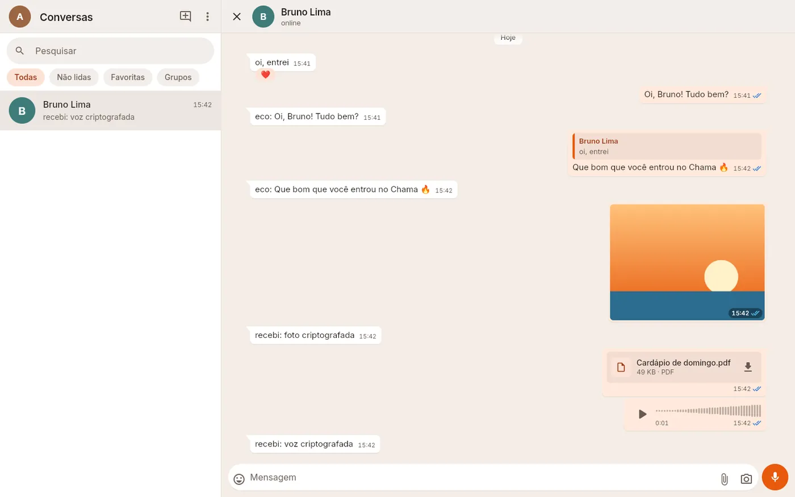
</p>

> **Resumo em quatro comandos** (depois de instalar os pré-requisitos):
>
> ```sh
> pnpm install     # dependências Node (chama-id, ferramentas de teste)
> make up          # sobe o servidor local em http://localhost:8080
> make smoke       # dois usuários entram e trocam uma mensagem criptografada
> make app-web     # abre o app no Chrome
> ```
>
> Entre com qualquer celular brasileiro (por exemplo `11 91234-5678`) e o código `000000`.

## Sumário

1. [Pré-requisitos](#1-pré-requisitos)
2. [Mapa do repositório](#2-mapa-do-repositório)
3. [Servidor local](#3-servidor-local)
4. [Rodando o app](#4-rodando-o-app)
5. [Testes](#5-testes)
6. [Capturas de tela](#6-capturas-de-tela)
7. [Builds de release](#7-builds-de-release)
8. [Regras do projeto para contribuidores](#8-regras-do-projeto-para-contribuidores)
9. [Problemas comuns](#9-problemas-comuns)

---

## 1. Pré-requisitos

O projeto tem duas partes com ferramentas diferentes:

- **Servidor** (pasta `server/`, `services/` e `tools/`): só precisa de Docker, Node e pnpm.
- **App** (pasta `app/`): precisa de Flutter, Rust, Android SDK, JDK e Chrome.

Quem só mexe no servidor pode parar na primeira tabela.

### Servidor

| Ferramenta | Versão | Para quê | Como conferir |
|---|---|---|---|
| Docker com o plugin Compose (`docker compose`) | testado com Docker 29.6.2 e Compose 5.3.1 | roda a pilha do servidor | `docker compose version` |
| Node.js | 26 (arquivo `.nvmrc`) | chama-id, `tools/smoke`, `tools/peer` e os scripts | `node --version` |
| pnpm | 10.32.1 (campo `packageManager` do `package.json`) | instala as dependências do workspace | `pnpm --version` |
| openssl, curl, git | qualquer versão recente | `server/scripts/init.sh` gera segredos com openssl; `check.sh` usa curl | `openssl version` |

Instalação sugerida:

```sh
nvm install                  # lê o .nvmrc e instala o Node 26
npm install -g pnpm@10.32.1  # o Node 26 não traz mais o corepack
pnpm install                 # na raiz do repositório
```

### App

| Ferramenta | Versão | Para quê |
|---|---|---|
| Flutter | **3.47.8** exatamente (o `pubspec.yaml` aceita `>=3.47.8 <3.48.0`), com Dart 3.13.7 | o app inteiro |
| rustup | qualquer versão recente | o vodozemac (biblioteca de criptografia do Matrix) é compilado de Rust em todo build Android e no build web |
| Rust nightly | instalado automaticamente pelo script da web | só para o build web (WebAssembly) |
| JDK | 21 (testado com OpenJDK 21.0.12.1) | Gradle, o sistema de build do Android |
| Android SDK | plataforma 36, build-tools 36, platform-tools, emulator | compilar e rodar no Android (`compileSdk` e `targetSdk` 36, `minSdk` 24) |
| Android NDK | 28.2.13676358 (a versão que o Flutter 3.47.8 pede) | compilar o código nativo (Rust) |
| Um emulador (AVD) | testado com `Medium_Phone_API_36.1` (imagem `android-36.1`, Google Play, arm64-v8a) | testes no Android |
| Google Chrome | qualquer versão estável | rodar o app web e os testes web |

Passo a passo:

```sh
# Flutter 3.47.8 (o canal stable pode já estar em outra versão)
git clone -b 3.47.8 https://github.com/flutter/flutter.git ~/flutter
export PATH="$HOME/flutter/bin:$PATH"
flutter --version            # deve mostrar Flutter 3.47.8

# Rust
curl --proto '=https' --tlsv1.2 -sSf https://sh.rustup.rs | sh

# Android SDK (os scripts procuram em $ANDROID_HOME; no macOS o padrão é este)
export ANDROID_HOME="$HOME/Library/Android/sdk"
"$ANDROID_HOME/cmdline-tools/latest/bin/sdkmanager" "platform-tools" "emulator" \
  "platforms;android-36" "build-tools;36.0.0" "ndk;28.2.13676358" \
  "system-images;android-36.1;google_apis_playstore;arm64-v8a"

# Um emulador (ou pelo Android Studio: Device Manager → Medium Phone, API 36.1)
echo no | "$ANDROID_HOME/cmdline-tools/latest/bin/avdmanager" create avd \
  -n Medium_Phone_API_36.1 -d medium_phone \
  -k "system-images;android-36.1;google_apis_playstore;arm64-v8a"

flutter doctor               # confere tudo de uma vez
```

> Em Mac Intel ou Linux x86, troque `arm64-v8a` por `x86_64` na imagem do emulador.
> No Linux, `ANDROID_HOME` costuma ser `$HOME/Android/Sdk`, e os scripts de teste web pedem
> `CHROME=<caminho do executável do chrome>` (eles procuram o Chrome no caminho do macOS).

---

## 2. Mapa do repositório

```
chama/
├── Makefile                    atalhos: make up, make test, make app-web, make app-apk…
├── package.json                workspace pnpm (Node 26, pnpm 10.32.1)
├── pnpm-workspace.yaml         pacotes do workspace: services/* e tools/*
├── server/                     a pilha do servidor em Docker Compose
│   ├── compose.yaml            todos os serviços, redes e portas
│   ├── caddy/Caddyfile         proxy reverso: decide qual serviço atende cada caminho
│   ├── synapse/                modelos de configuração do Synapse, dos workers e do app service do chama-id
│   ├── sygnal/sygnal.yaml      configuração do gateway de push (Web Push)
│   ├── scripts/init.sh         gera segredos e configuração em server/data (roda a cada make up)
│   ├── scripts/check.sh        testes de aceitação contra a pilha rodando
│   └── data/                   gerado: segredos (.env), banco do chama-id, mídia, chaves. Fora do git
├── services/
│   └── chama-id/               serviço de entrada por telefone (código SMS → login Matrix), em TypeScript
│       ├── src/                código: rotas, OTP, contas, diretório de contatos, cliente admin do Synapse
│       └── test/               testes com node:test
├── tools/
│   ├── smoke/                  teste de fumaça: dois usuários trocam uma mensagem criptografada
│   └── peer/                   "pessoa de teste" roteirizada que conversa com o app nos testes de ponta a ponta
├── app/                        o app Chama em Flutter (Android e web)
│   ├── lib/                    código do app (mapa detalhado em app/README.md)
│   ├── test/                   testes de unidade e de widget
│   ├── integration_test/       testes de ponta a ponta contra a pilha local
│   ├── test_driver/            drivers do flutter drive (normal e de capturas de tela)
│   ├── scripts/                scripts de teste, push, contatos, capturas e build web
│   ├── android/                projeto Android: flavors fdroid e play, assinatura
│   ├── web/                    página e ícones da versão web (web/pkg é gerado)
│   └── assets/                 fontes e marca
└── docs/
    ├── design/                 documento de arquitetura
    ├── imagens/                capturas de tela e logo usados na documentação
    ├── chama-id-api.md         API do chama-id
    ├── desenvolvimento.md      este guia
    └── operacao.md             como operar um servidor em produção
```

Outros documentos: [README do app](../app/README.md),
[API do chama-id](chama-id-api.md), [operação em produção](operacao.md) e a
[arquitetura](design/2026-10-24-architecture.md).

---

## 3. Servidor local

### O que sobe

`make up` sobe dez contêineres. Só o Caddy publica portas, e só em `127.0.0.1`: em modo de
desenvolvimento o código `000000` entra em qualquer número, então a pilha nunca pode ficar
exposta na rede.

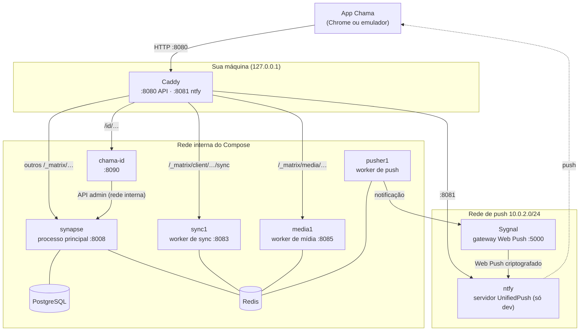

| Serviço | Imagem | O que faz |
|---|---|---|
| `postgres` | `postgres:17.11-alpine` | banco de dados do Synapse |
| `redis` | `redis:7.4.11-alpine` | replicação entre o Synapse principal e os workers |
| `synapse` | `ghcr.io/element-hq/synapse:v1.163.2` | servidor Matrix (homeserver), processo principal |
| `sync1` | mesma do Synapse | worker que atende o `/sync`, a rota mais pesada |
| `media1` | mesma do Synapse | worker de upload e download de mídia (arquivos já chegam criptografados) |
| `pusher1` | mesma do Synapse | worker que envia notificações ao Sygnal |
| `sygnal` | `matrixdotorg/sygnal:v0.17.0` | gateway de push: manda Web Push criptografado ao celular |
| `ntfy` | `binwiederhier/ntfy:v2.28.0` | servidor UnifiedPush para o emulador (só em desenvolvimento) |
| `chama-id` | construída de `services/chama-id/Dockerfile` (Node 26.12.1) | entrada por telefone e código SMS, busca de contatos, redefinição de identidade |
| `caddy` | `caddy:2.11.7-alpine` | proxy reverso, a única porta de entrada |

Como o Caddy distribui as requisições (`server/caddy/Caddyfile`):

| Caminho | Vai para |
|---|---|
| `OPTIONS` em qualquer caminho | resposta `204` (preflight CORS do navegador) |
| `/_synapse/admin/*` | bloqueado com `403`: a API de administração só existe na rede interna |
| rotas de sync (`/_matrix/client/v3/sync` e afins) | `sync1:8083` |
| `/_matrix/media/*` e `/_matrix/client/v1/media/*` | `media1:8085` |
| `/push/v1/config` | JSON fixo com o endereço do gateway e a chave pública VAPID do Sygnal |
| `/id/*` | `chama-id:8090` |
| outros `/_matrix/*` | `synapse:8008` |
| qualquer outro | `404` |

### Comandos

| Comando | O que faz |
|---|---|
| `make up` | roda `server/scripts/init.sh` e sobe a pilha, esperando todos os serviços ficarem saudáveis |
| `make down` | para a pilha (os dados ficam) |
| `make logs` | segue os logs de todos os serviços (últimas 100 linhas de cada) |
| `make reset` | para a pilha **e apaga todos os dados**: contas, conversas, segredos. Use só quando quiser começar do zero |
| `./server/scripts/check.sh` | testes de aceitação contra a pilha rodando |
| `make smoke` | sobe a pilha (se preciso) e roda o teste de fumaça |

O que o `init.sh` faz a cada `make up`:

1. Cria `server/data/.env` na primeira vez, com `SERVER_NAME=chama.test`,
   `PUBLIC_BASEURL=http://localhost:8080` e segredos aleatórios (`openssl rand -hex 32`). Um segredo
   que já existe nunca é trocado.
2. Gera uma vez o par de chaves VAPID do Sygnal (`server/data/push/vapid.pem`) e a chave de
   assinatura do Synapse (`server/data/synapse/signing.key`).
3. Renderiza de novo os modelos `server/synapse/*.tmpl` com os valores do `.env`. Uma variável
   desconhecida ou vazia faz o script falhar.
4. Calcula `CONFIG_REV`, um hash da configuração. Se você editou um modelo, o próximo `make up`
   recria os contêineres afetados sozinho.

### Fatos do ambiente local

- Endereço base: `http://localhost:8080` (no emulador Android: `http://10.0.2.2:8080`).
- `server_name` é `chama.test`. As contas têm ID opaco, por exemplo `@u7k3m5q2x4w6a2b5c:chama.test`
  (`u` + 16 caracteres aleatórios). O número de telefone nunca aparece no ID.
- O SMS é simulado: o código de verdade aparece no log do chama-id, e o código fixo `000000` é
  aceito para qualquer número que tenha pedido um código (`CHAMA_DEV=1`). Para ver o código
  sorteado:

  ```sh
  docker compose -f server/compose.yaml --env-file server/data/.env logs chama-id | grep '\[sms\]'
  ```

- O modo de desenvolvimento só liga quando o `SERVER_NAME` termina em `.test` ou `.localhost`.
  Assim ele não pode ser ativado por engano num domínio de verdade.

### Testes de aceitação: `check.sh`

```sh
./server/scripts/check.sh
```

Ele para na primeira falha e termina com `all checks passed`. Cada execução usa números novos e
aleatórios. O que é conferido:

| Área | Verificação |
|---|---|
| Rede | só o Caddy publica portas, e só `127.0.0.1:8080` e `127.0.0.1:8081` |
| Entrada | pedir e confirmar código, ID opaco sem dígitos do telefone, login JWT no Synapse |
| Contatos | busca por hash sem token dá `401`; com token encontra a conta |
| Workers | o sync é atendido pelo `sync1` e a mídia pelo `media1`, nunca pelo processo principal |
| Admin | o cliente admin do chama-id lê a última atividade e desativa uma conta (o token dela para de funcionar) |
| Identidade | redefinição de identidade completa (`tools/smoke/identity.ts`) |
| Conta (M4) | token de login de uso único sem pedir senha (1 por minuto, vale uma vez), ponto de encontro da vinculação, desconectar aparelhos, PIN da conta (`tools/smoke/safety.ts`) |
| Números reciclados | conta parada é aposentada, conta com PIN nunca é, conta desativada pelo operador dá conta nova (`tools/smoke/recycled.ts`, roda dentro do contêiner do chama-id com um segundo chama-id em `127.0.0.1:8099` que trata toda conta como parada); nenhuma conta tem token de acesso sem aparelho |
| Segurança | token do app service recusado vindo de IP público; login por senha e cadastro aberto recusados; `/_synapse/admin` bloqueado |
| Push | a mensagem chega ao tópico ntfy como Web Push criptografado; decifrado, só tem IDs (sem texto, sem remetente); conversa silenciada não gera push |
| Isolamento | o Sygnal não alcança Synapse, chama-id, PostgreSQL nem Redis |

### Teste de fumaça: `make smoke`

```sh
make smoke
```

Dois usuários entram por telefone, A encontra B pelo hash do número, A manda uma mensagem
criptografada, B decifra, e o script confere no banco do servidor que só existe texto cifrado.
Termina com `smoke: OK (encrypted message delivered and decrypted)`.

---

## 4. Rodando o app

Suba a pilha antes (`make up`). O app escolhe o servidor assim (`app/lib/config.dart`):

| Build | Endereço usado |
|---|---|
| debug na web | `http://localhost:8080` |
| debug no Android | `http://10.0.2.2:8080` (é assim que o emulador enxerga a sua máquina) |
| qualquer build com `--dart-define=CHAMA_BASE_URL=…` | o endereço informado |
| release e profile | **só** `https://…` informado em `CHAMA_BASE_URL`; sem isso o app não abre |

### No Chrome

```sh
make app-web
```

Na primeira vez o script `app/scripts/build-vodozemac-web.sh` compila o vodozemac para
WebAssembly (cerca de 10 minutos: instala o Rust nightly, `wasm-pack` 0.15.0,
`wasm-bindgen-cli` 0.2.100 e `flutter_rust_bridge_codegen` 2.13.0). O resultado fica em
`app/web/pkg/` (fora do git). Nas próximas vezes ele só imprime
`vodozemac 0.9.0 for web is already built`.

Em telas com 900 px ou mais de largura o app usa o layout de dois painéis, no estilo do
WhatsApp Web:

<p align="center">
  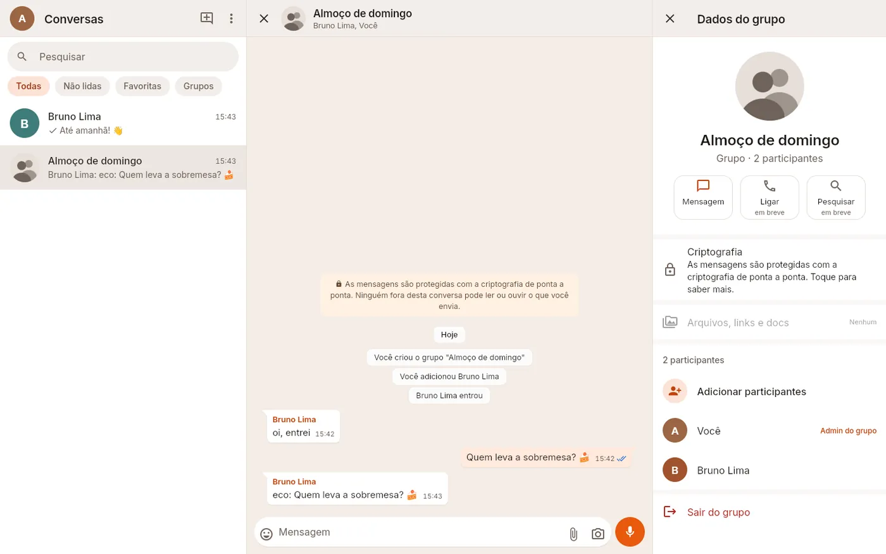
</p>

### Modo demonstração (sem servidor)

Uma versão do app com dados fictícios, para apresentações e para gravar os vídeos do
projeto. Não precisa de servidor, já abre conectada como "Bia Santana" e mostra as cinco
abas que o app terá (com o nome Alô): **Conversas**, **Momentos**, **Rede**, **Voz** e **Perfil**, além
da tela **Bem-estar**. Roda só na web (as fotos ficam em `app/web/demo/`, com os créditos
em `app/web/demo/CREDITS.md`).

<p align="center">
  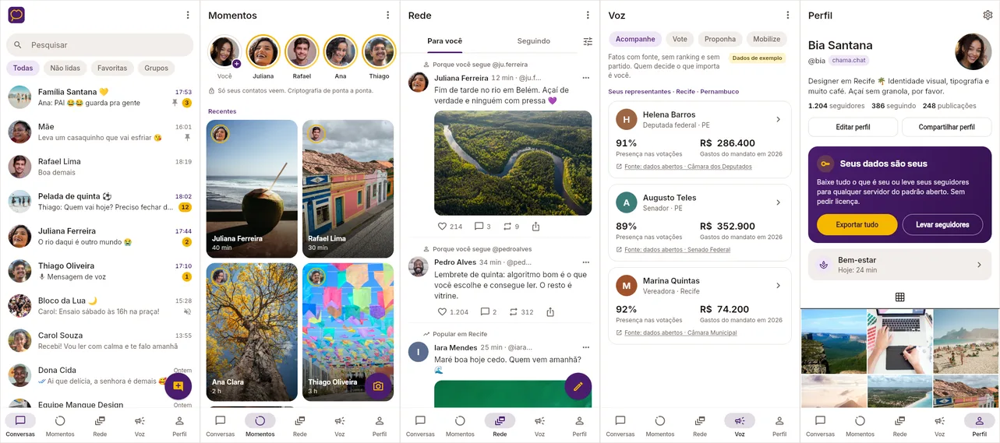
</p>

```sh
app/scripts/build-demo-web.sh          # flutter build web -t lib/main_demo.dart --no-web-resources-cdn
python3 app/scripts/serve-demo-web.py  # serve app/build/web em http://127.0.0.1:8765
# abra http://127.0.0.1:8765 (de preferência numa janela de 412x915)
```

O build funciona sem internet: o CanvasKit vem do próprio build (`--no-web-resources-cdn`)
e a fonte de emoji (Noto Color Emoji, licença OFL, em `app/web/demo/fonts/`) também; o
script só aponta o carregador do Flutter para essa pasta. O `serve-demo-web.py` existe
porque o `python3 -m http.server` aceita só 5 conexões na fila e derruba as outras quando
a demonstração carrega dezenas de fotos de uma vez.

Como funciona:

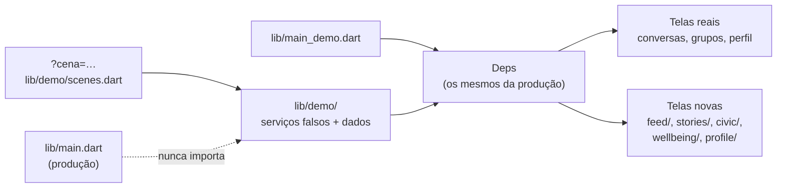

- As telas são as mesmas do app de verdade. Só os serviços mudam: `lib/demo/` tem versões
  falsas de `ChatService`, `ChatSession` e companhia (`implements`), com pessoas, conversas,
  posts e momentos inventados.
- As telas novas falam com três interfaces em `lib/services/`: `SocialService` (Momentos,
  Rede, Perfil), `CivicService` (Voz) e `WellbeingService` (Bem-estar). Hoje só a
  demonstração implementa essas interfaces. No app de produção, `Deps.social`,
  `Deps.civic` e `Deps.wellbeing` ficam vazios e a tela inicial continua com as abas atuais.
- **Voz** vai do país ao bairro: a barra de lugares mostra **Brasil · Pernambuco · Recife ·
  Casa Amarela**, e cada nível tem os seus representantes, consultas, abaixo-assinados e
  canais. A cidade tem orçamento participativo e a pauta da Câmara Municipal; o bairro tem
  problemas relatados com foto e apoio dos vizinhos, audiência pública e a sua própria
  consulta. Abaixo do nível nacional, só vota quem é "morador verificado".
- **Voz** é apartidária: fatos com fonte ("Fonte: dados abertos"), nada ordenado por
  relevância, nenhuma cor de partido. Na demonstração, todos os políticos, projetos e
  números são inventados e as telas mostram "Dados de exemplo".
- **Rede** tem duas abas. **Para você** recomenda, mas nunca em segredo: cada item diz por
  que está ali ("Porque você segue @ju.ferreira", "Perto de você · Boa Vista", "Tema:
  comida"), e "Por que estou vendo isto?" tem "Mostrar mais/menos disso" e liga ou desliga o
  tema. Em **Escolha seu algoritmo** a pessoa troca o algoritmo (Padrão Alô, Perto de você,
  Só quem eu sigo ou feeds feitos pela comunidade) e os temas. **Seguindo** mostra só quem
  você segue, do mais novo ao mais antigo, e termina em "Você está em dia".
- A Rede mistura posts de texto, de foto e **vídeos curtos verticais (reels)**, que tocam
  sem som enquanto estão na tela (pacote `video_player`) e abrem em tela cheia. Negócios
  locais têm perfil comercial; há post em parceria (dois autores), selo "Parceria paga com
  @marca" e anúncio marcado "Patrocinado", no máximo 1 a cada 10 itens
  (`app/lib/feed/ads.dart`, com teste), escolhido só pelo tema, nunca pelas conversas.
  Nunca há anúncio nas conversas nem nos Momentos. Marcas e criadores da demonstração são
  inventados. Os vídeos vêm do Pixabay e do Pexels (créditos em `app/web/demo/CREDITS.md`).
- O nome do app que aparece na tela (hoje **Alô**) vem de uma chave só, `appName`, em
  `app/lib/l10n/app_pt.arb` (e `app_en.arb`): os textos usam `{app}` no lugar do nome. O
  nome da aba Rede vem da chave `tabFeed`. Os perfis da demonstração usam um servidor
  inventado (`exemplo.social`) que a tela não mostra.
- **Modo simples** (em Configurações, e oferecido na primeira vez: "Prefere letras maiores
  e menos botões?"): letras 25% maiores, só três abas (Conversas, Rede, Voz), fotos maiores
  na lista, botão de áudio maior, fundo de conversa liso e sem animações decorativas.
- **Feito para todas as idades**: alvos de toque de pelo menos 48 px, texto principal de 16
  px ou mais, telas testadas com fonte em 200%, legenda nos ícones de ação no Modo simples,
  botões visíveis para o que antes era só gesto (Momentos: anterior/próximo; vídeos:
  setas; áudio: um toque grava, com Enviar e Cancelar na tela), "Desfazer" em vez de
  perguntas, textos curtos com "Saiba mais" para o resto, descrição das fotos e dos vídeos
  para leitores de tela, e "reduzir movimento" do sistema respeitado.
- **Bem-estar**: a Rede tem fim ("Você está em dia", em Seguindo), há limite diário com um cartão de
  pausa, Modo descanso, Resumo de notificações, esconder curtidas e modo cinza. Sem
  sequências, medalhas ou culpa.
- `lib/main.dart` nunca importa `lib/demo/`.

**Cenas que se apresentam sozinhas.** Com `?cena=<nome>` na URL a demonstração faz tudo
sozinha: toca, digita, rola e mostra um círculo onde "toca". O título da página muda para
`Alô · cena <nome> · inicio` no instante zero e para `… · fim` no final. O console mostra
cada passo com o tempo (`CENA conversa 7.00 s: chega mensagem`) e a linha `cena:fim` no
começo da pausa final de 2 s.

| Cena | URL | Duração | O que mostra |
|---|---|---|---|
| `conversa` | `/?cena=conversa` | ~29 s | conversa privada, aviso de criptografia, foto, áudio, tiques azuis, reação |
| `momentos` | `/?cena=momentos` | ~24 s | anéis, momento aberto, troca de pessoa, resposta |
| `rede` (antes `praca`, que ainda funciona) | `/?cena=rede` | ~29 s | Rede · Para você: reel tocando, "Parceria paga", "Patrocinado" e "Por que este anúncio?", "Por que estou vendo isto?", reel em tela cheia, Seguindo até "Você está em dia" |
| `algoritmo` | `/?cena=algoritmo` | ~19 s | "Escolha seu algoritmo": troca para um feed da comunidade, desliga um tema, o feed muda |
| `voz` | `/?cena=voz` | ~27 s | do Brasil ao bairro (Casa Amarela), apoio a um problema, consulta do bairro com morador verificado, o povo x a Câmara, abaixo-assinado chegando à meta |
| `dados` | `/?cena=dados` | ~24 s | exportar tudo e levar os seguidores para outro servidor |
| `calma` | `/?cena=calma` | ~22 s | fim da Rede (Seguindo), limite diário, vídeos sem reprodução automática, Modo descanso, curtidas escondidas, modo cinza, "Hora de uma pausa" |
| `simples` | `/?cena=simples` | ~14 s | a pergunta da primeira vez, "Sim, quero", o app fica maior e mais simples, um áudio para a Mãe |
| `tour` | `/?cena=tour` | ~88 s | as cinco abas, o Bem-estar e o Modo simples em sequência |

Os horários das mensagens seguem o relógio do computador. Para gravar sempre com horários
de fim de tarde, fixe o relógio do navegador (no Playwright:
`page.clock.setSystemTime(new Date('2026-10-27T18:40:00'))`) antes de abrir a página.

### No emulador Android

Ligue o emulador primeiro (pelo Android Studio ou pelo terminal) e depois rode o app:

```sh
"$ANDROID_HOME/emulator/emulator" -avd Medium_Phone_API_36.1 &
make app-android
```

`make app-android` usa o primeiro emulador da lista do `adb devices`. Com mais de um aparelho,
escolha com `ANDROID_SERIAL`:

```sh
ANDROID_SERIAL=emulator-5556 make app-android
```

Com o app rodando, `r` no terminal faz hot reload e `R` reinicia o app.

### Entrando no app

Digite qualquer celular brasileiro, por exemplo `11 91234-5678`, e o código `000000`.

| Número | Código SMS | Chave de recuperação |
|---|---|---|
|  | 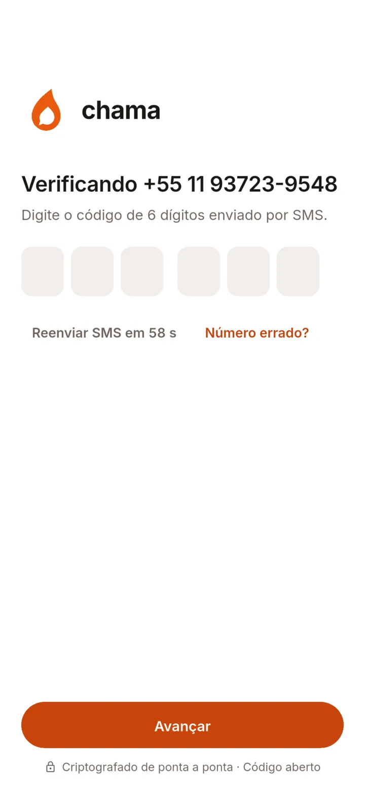 | 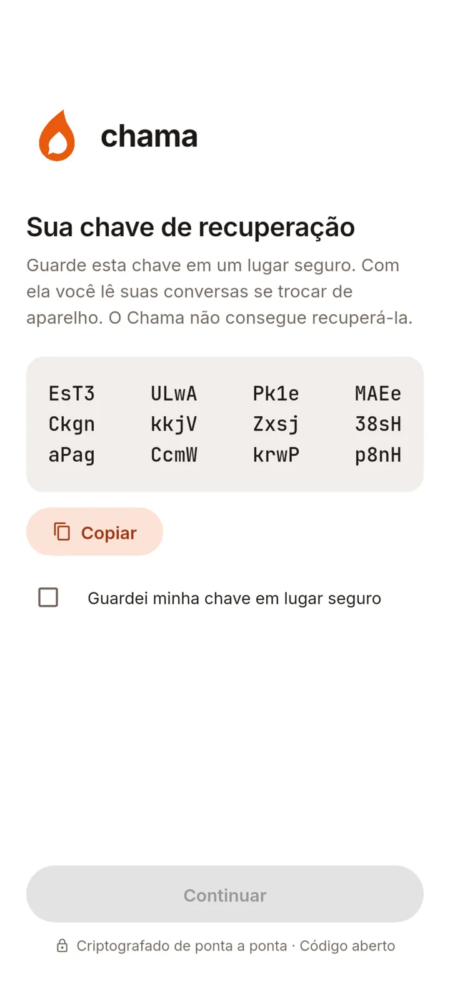 |

Para conversar com alguém, abra outra sessão (outra aba do Chrome, o emulador, ou a pessoa de
teste abaixo) com outro número.

### Uma pessoa de teste para conversar

O `tools/peer` é um usuário roteirizado: entra com um número, entra em toda conversa para a qual
for convidado e responde.

```sh
cd tools/peer && PEER_PHONE=5511900001234 node peer.ts
```

Quando aparece `peer ready @u…:chama.test`, procure `11 90000-1234` em **Nova conversa** no app.
A pessoa de teste:

- diz `oi, entrei` ao entrar na conversa;
- confirma a entrega de cada mensagem (✓✓ cinza) e marca como lida 3 s depois (✓✓ azul);
- responde `eco: <texto>` a textos, `recebi: foto criptografada` a fotos e
  `recebi: voz criptografada` a mensagens de voz;
- responde 30 s depois (em vez de 3 s) a um texto que começa com `demora`, para dar tempo de
  fechar o app e receber a resposta como notificação.

Variáveis opcionais: `PEER_NAME` (nome exibido, padrão `Peer`) e `CHAMA_BASE_URL` (padrão
`http://localhost:8080`).

### Num celular de verdade

O celular não enxerga `10.0.2.2`. Pelo cabo USB, redirecione a porta e informe o endereço:

```sh
adb reverse tcp:8080 tcp:8080
cd app && flutter run -d <serial do celular> --dart-define=CHAMA_BASE_URL=http://localhost:8080
```

O build debug só permite HTTP sem criptografia para `localhost` e `10.0.2.2`. Push não funciona
assim: o ntfy de desenvolvimento só é configurado para o emulador.

### Push no emulador

As notificações chegam pelo UnifiedPush. No emulador, o app distribuidor é o ntfy, que precisa
ser instalado e apontado para o ntfy da pilha. Faça isso uma vez por emulador, com a pilha e o
emulador ligados:

```sh
cd app && ./scripts/ntfy-setup.sh
```

O script baixa o ntfy 1.25.2 do F-Droid (conferido por SHA-256, guardado em
`~/.cache/chama-ntfy/`), instala, dá a permissão de notificação, tira o ntfy da otimização de
bateria e configura o servidor padrão `http://10.0.2.2:8081`. Rodar de novo não muda nada.

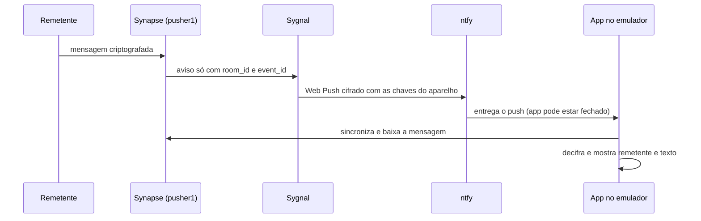

O servidor nunca manda o conteúdo da mensagem no push. Sem um distribuidor instalado, a tela
**Configurações → Notificações** avisa.

---

## 5. Testes

### Visão geral

| Comando | O que roda | Precisa da pilha? |
|---|---|---|
| `make test` | todos os testes de unidade: `pnpm -r test` (chama-id) e `flutter test` (app) | não |
| `pnpm --filter chama-id test` | só os testes do chama-id (81 hoje) | não |
| `make app-test` | testes de unidade e de widget do app (185 hoje) | não |
| `cd app && flutter analyze` | análise estática do Dart (lints do `analysis_options.yaml`) | não |
| `./server/scripts/check.sh` | aceitação do servidor | sim |
| `make smoke` | fumaça do servidor | sim (sobe sozinho) |
| `make app-e2e-web` | ponta a ponta no Chrome | sim |
| `make app-e2e-android` | ponta a ponta no Android: conversa, contatos e push | sim |

### Testes de unidade e de widget

```sh
make app-test          # ou: cd app && flutter test
cd app && flutter test test/phone_test.dart   # um arquivo só
```

Todo teste roda com um cofre de chaves em memória (`app/test/flutter_test_config.dart`), então
nenhum teste toca o armazenamento seguro de verdade. Alguns testes vigiam regras do projeto,
por exemplo:

- `test/l10n_test.dart`: o inglês tem exatamente as mesmas chaves que o português;
- `test/theme_test.dart`: o texto dos botões tem contraste WCAG AA nos temas claro e escuro.

### Ponta a ponta (integration tests)

Os testes em `app/integration_test/` rodam o app de verdade contra a pilha local. O script
`app/scripts/e2e.sh` prepara tudo:

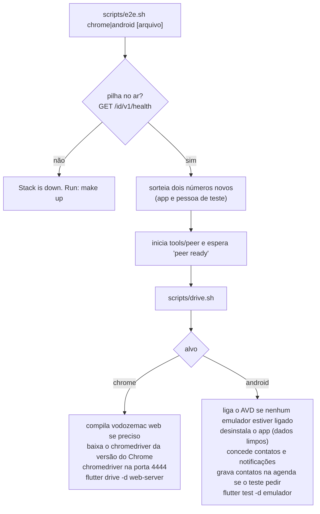

Rodar a suíte padrão (`integration_test/app_test.dart`):

```sh
make app-e2e-web        # Chrome sem janela, layout de dois painéis (1280×900)
make app-e2e-android    # emulador, layout de celular, mais contatos e push
```

Rodar um teste só:

```sh
cd app && ./scripts/e2e.sh chrome integration_test/session_test.dart
cd app && ./scripts/e2e.sh android integration_test/contacts_test.dart
```

| Arquivo | O que verifica | Onde roda |
|---|---|---|
| `boot_test.dart` | a biblioteca de criptografia e o banco local carregam nesta plataforma | Chrome e Android |
| `service_test.dart` | camada de serviço: entrada, chaves, conversa 1:1 criptografada, confirmações de entrega | Chrome e Android |
| `session_test.dart` | tiques até o azul, resposta, reação, edição e exclusão | Chrome e Android |
| `identity_test.dart` | aparelho novo: redefinir a identidade e destravar com a chave de recuperação; reparo de uma configuração interrompida | Chrome e Android |
| `app_test.dart` | pela interface: conversa com a pessoa de teste, tiques azuis, foto, arquivo e mensagem de voz | Chrome e Android |
| `contacts_test.dart` | a pessoa de teste aparece em "Contatos no Chama" com o nome da agenda e abre uma conversa | só Android |
| `push_test.dart` | uma mensagem chega como notificação com o app em segundo plano | só Android, com ntfy configurado |
| `screenshots_test.dart` | gera as capturas de tela (seção 6) | Chrome e Android |

`make app-e2e-android` roda, em sequência: `app_test.dart`, `contacts_test.dart`,
`./scripts/ntfy-setup.sh` e `push_test.dart`.

Como o teste de push funciona: em certo ponto o teste imprime `E2E_BACKGROUND`. O `drive.sh`
então aperta Home no emulador, espera uma notificação nova do Chama (até 90 s) e abre o app de
novo para o teste conferir o resultado.

Nos testes de contatos e de push, o `e2e.sh` grava na agenda do emulador a pessoa de teste com
o nome `Peer Agenda` e um número sem conta, `Sem Chama`. Os contatos são removidos no fim.

Variáveis de ambiente dos scripts de teste:

| Variável | Efeito |
|---|---|
| `CHAMA_AVD=<nome>` | qual AVD ligar quando nenhum emulador está ligado (padrão: o primeiro de `emulator -list-avds`) |
| `ANDROID_SERIAL=<serial>` | qual emulador usar quando há mais de um |
| `CHROME=<caminho>` | onde está o executável do Chrome (padrão: o caminho do macOS) |
| `WEB_SIZE=<l>x<a>[@<densidade>]` | tamanho da janela do Chrome (padrão `1280x900`) |
| `TEST_DRIVER=<arquivo>` | roda pelo `flutter drive` com esse driver (usado pelas capturas) |

---

## 6. Capturas de tela

As imagens da documentação saem de um teste de ponta a ponta,
`integration_test/screenshots_test.dart`: o app entra com um número novo, conversa com a pessoa
de teste (com o nome `Bruno Lima`), cria um grupo e fotografa cada tela, nos temas claro e escuro.

```sh
cd app && ./scripts/screenshots.sh                         # tudo em app/build/screenshots
cd app && ./scripts/screenshots.sh build/telas web-wide    # só a web em tela larga
```

| Alvo | Tamanho |
|---|---|
| `web-phone` | Chrome em 412×915 com densidade 2 (um celular) |
| `web-wide` | Chrome com área útil de 1440×900 |
| `android` | o emulador |

Os arquivos saem como `<plataforma>-<tamanho>-<tema>-<tela>.png`. Se o script ligou o emulador,
ele o desliga no fim. No Android, Bruno Lima, Carla Mendes e Diego Rocha são gravados na agenda
para a tela de nova conversa.

As imagens em `docs/imagens/` são cópias dessas capturas em WebP, com nomes em português, por
exemplo `android-conversa-escuro.webp`. Mantenha cada uma pequena (as atuais têm até cerca de
60 KB).

| Claro | Escuro |
|---|---|
| 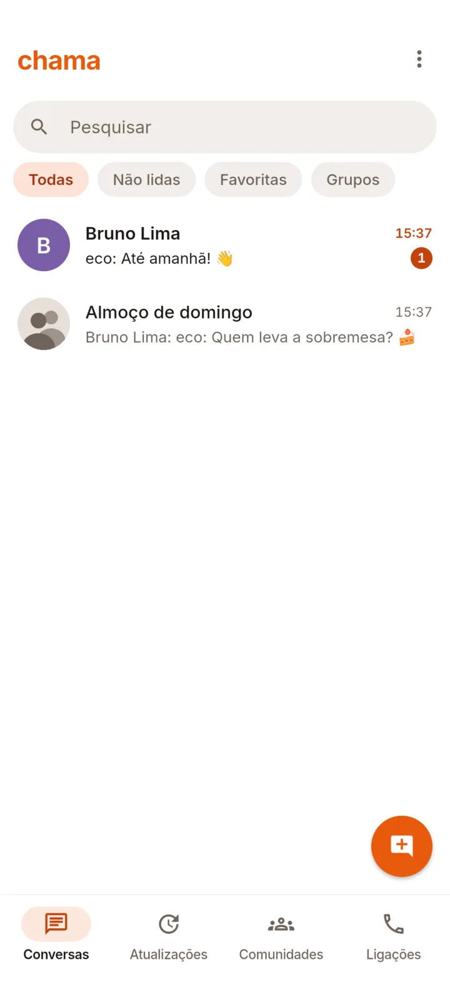 | 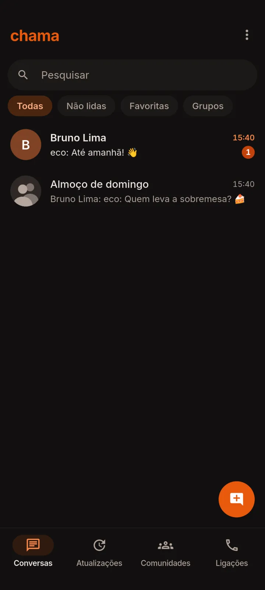 |

---

## 7. Builds de release

### Os dois flavors

| Flavor | Para onde vai | Push |
|---|---|---|
| `fdroid` (padrão) | F-Droid e download direto | sem nenhum código do Google; o usuário precisa de um app UnifiedPush, como o ntfy |
| `play` | Google Play | adiciona o distribuidor FCM embutido do UnifiedPush (`embedded-fcm-distributor` 3.1.0), então o push funciona sem app extra. Não usa o SDK do Firebase nem `google-services.json` |

`flutter run`, `flutter test`, `flutter drive` e `flutter build` usam `fdroid` quando não se
passa `--flavor` (campo `default-flavor` do `pubspec.yaml`).

### Comandos

```sh
make app-apk CHAMA_BASE_URL=https://chama.example   # APKs fdroid, um por ABI
make app-aab CHAMA_BASE_URL=https://chama.example   # pacote para a Play Store (flavor play)
```

| Comando | Saída |
|---|---|
| `make app-apk` | `app/build/app/outputs/flutter-apk/app-arm64-v8a-fdroid-release.apk` (cerca de 32 MB), `app-armeabi-v7a-fdroid-release.apk` (28 MB) e `app-x86_64-fdroid-release.apk` (35 MB) |
| `make app-aab` | `app/build/app/outputs/bundle/playRelease/app-play-release.aab` |

Os dois alvos rodam `flutter pub get` antes. Isso apaga um `GeneratedPluginRegistrant` velho
deixado por um teste de integração, que quebraria o `javac`.

### `CHAMA_BASE_URL` é obrigatório e precisa ser HTTPS

Builds release e profile se recusam a abrir sem um `CHAMA_BASE_URL` `https://`. O Makefile já
para antes de compilar:

```text
Set CHAMA_BASE_URL=https://… (make app-apk CHAMA_BASE_URL=https://chama.example)
```

Por quê: a configuração de segurança de rede do Android (`network_security_config.xml`, só HTTPS)
não vale para o cliente HTTP do próprio Dart. Essa checagem é o que impede que códigos SMS e
tokens saiam sem criptografia.

### Assinatura

A chave de assinatura vem do ambiente, nunca do repositório.

| Variável | Conteúdo |
|---|---|
| `CHAMA_KEYSTORE` | caminho de um arquivo `.jks` ou `.p12` **fora** do repositório |
| `CHAMA_KEYSTORE_PASSWORD` | senha do keystore |
| `CHAMA_KEY_ALIAS` | alias da chave |
| `CHAMA_KEY_PASSWORD` | senha da chave |
| `CHAMA_UNSIGNED=1` | gera o release sem assinatura e ignora as variáveis acima (para uma loja que assina sozinha, como o servidor de build do F-Droid) |
| `CHAMA_ALLOW_DEBUG_KEY=1` | só para teste local: assina com a chave de debug e o nome da versão ganha o sufixo `-debugkey` |

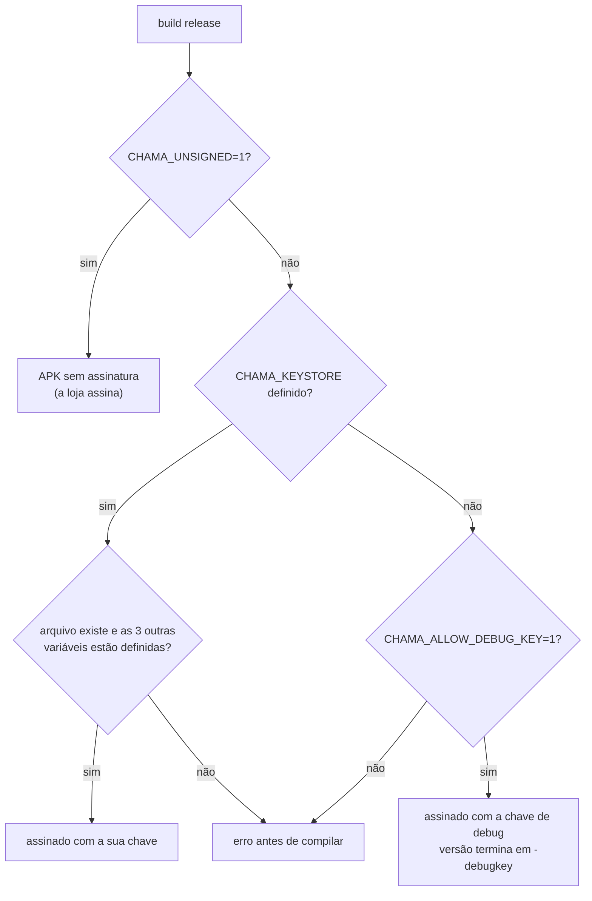

Criar uma chave nova (o `keytool` vem com o JDK) e gerar os APKs:

```sh
keytool -genkeypair -v -keystore ~/chama-release.jks -keyalg RSA -keysize 4096 -validity 10000 -alias chama
export CHAMA_KEYSTORE=~/chama-release.jks CHAMA_KEY_ALIAS=chama
export CHAMA_KEYSTORE_PASSWORD='…' CHAMA_KEY_PASSWORD='…'
make app-apk CHAMA_BASE_URL=https://chama.example
```

> **Cuidado com a chave de debug.** As lojas recusam builds assinados com ela, e um build
> assinado pela loja não consegue atualizar um build `-debugkey`. Quem testou um build desses
> precisaria desinstalar o app, perdendo chaves e conversas.

Build sem assinatura para o F-Droid:

```sh
cd app && CHAMA_UNSIGNED=1 flutter build apk --release --flavor fdroid --dart-define=CHAMA_BASE_URL=https://chama.example
```

A saída é `app/build/app/outputs/flutter-apk/app-fdroid-release.apk`. Sem assinatura, ela não
instala até ser assinada.

### Versão

A versão fica no `pubspec.yaml`, no formato `version: <nome>+<código>` (hoje `0.3.0+2`). Aumente
o código a cada release. Os APKs divididos por ABI somam 1000 × número da ABI ao código:
armeabi-v7a 1, arm64-v8a 2, x86_64 4. Exemplo: o código 2 vira 2002 no APK arm64-v8a.

---

## 8. Regras do projeto para contribuidores

| Regra | Na prática |
|---|---|
| **Criptografia de ponta a ponta sempre** | toda conversa é criptografada; o operador não pode ler conversas. Uma mudança que enfraqueça isso é bloqueada |
| **Textos da interface em pt-BR, no ARB** | nenhum texto fixo em widget. Adicione a chave em `app/lib/l10n/app_pt.arb` (o modelo) e a tradução em `app_en.arb`. O `test/l10n_test.dart` falha se as chaves não baterem. As classes geradas (`app_localizations*.dart`) ficam fora do git |
| **Cores só como tokens** | cores ficam em `app/lib/common/theme.dart` (classe `Tokens` e a extensão `ChatColors`). Widgets leem as cores do tema em vez de escrever cores com `Color(0x…)`. Açaí `#4A1D6E` (principal) e ipê `#F5B700` (destaque), neutros quentes, sem cores da bandeira ou de partidos |
| **Só `lib/services/` importa o SDK Matrix** | `package:matrix` aparece apenas em `app/lib/services/`. Widgets recebem modelos simples (`lib/services/models.dart`), o que deixa as telas fáceis de testar |
| **Uma pasta por funcionalidade** | `auth`, `chat_list`, `chat`, `group`, `contacts`, `profile`, `feed`, `stories`, `civic`, `wellbeing`, `common` (e `demo`, só para o modo demonstração) |
| **Comentários `// Limit:`** | um limite deliberado de escala ou simplicidade leva um comentário `// Limit:` dizendo o teto e o caminho para subir. Exemplo: `// Limit: SQLite + in-process rate limits, single replica only; move to PostgreSQL + Redis (spec §12) in M7.` |
| **Nenhum segredo no repositório** | segredos do servidor ficam em `server/data/.env` (gerado, fora do git); chaves de assinatura vêm de variáveis de ambiente; `.jks`, `.p12` e `.pem` estão no `app/android/.gitignore` |
| **Teste para toda mudança de lógica** | cada mudança de comportamento vem com teste. Código sensível (OTP, JWT, limites de tentativa, cotas diárias) precisa de um teste para cada limite |
| **TypeScript sem build** | o chama-id roda TypeScript direto no Node 26 (remoção de tipos). Use só sintaxe apagável: nada de `enum`, `namespace` ou propriedades de parâmetro, e importe com extensão `.ts` |
| **Erros do chama-id** | lance `AppError('<código>')` de `src/errors.ts`; o código define o status HTTP |
| **Inspiração no WhatsApp, sem cópia** | copiamos padrões de interação, nunca código, ícones, textos ou cores exatas |
| **Documentação em pt-BR** | README, `docs/` e `app/README.md` em português; comentários de código e mensagens de commit em inglês |

Antes de abrir um pull request:

```sh
make test
cd app && flutter analyze
make up && ./server/scripts/check.sh && make smoke     # se mexeu no servidor
make app-e2e-web                                       # se mexeu no app
```

As tarefas abertas estão nas issues do GitHub, por marco (M4 a M7).

---

## 9. Problemas comuns

### Build web: `linking with cc failed`

Aparece ao compilar o vodozemac para WebAssembly quando o `wasm-pack` instala o `wasm-bindgen`
por conta própria: as `RUSTFLAGS` do WebAssembly com threads vazam para a compilação nativa. O
`build-vodozemac-web.sh` instala o `wasm-bindgen-cli` 0.2.100 antes para evitar isso. Se
acontecer mesmo assim (por exemplo com outra versão já instalada), instale a versão certa e
rode de novo:

```sh
cargo install wasm-bindgen-cli --version 0.2.100 --locked
cd app && ./scripts/build-vodozemac-web.sh
```

Se o `web/pkg` ficou pela metade, apague e recompile: `rm -rf app/web/pkg && make app-web`.

### Chrome: o teste não conecta ao chromedriver

O `drive.sh` liga o chromedriver na porta 4444. Se um chromedriver de uma execução interrompida
ainda ocupa a porta, o novo não sobe. Veja quem está na porta e encerre:

```sh
lsof -nP -iTCP:4444 -sTCP:LISTEN
kill <PID>
```

O chromedriver é baixado na versão exata do seu Chrome para `~/.cache/chama-chromedriver/`.
Depois de atualizar o Chrome, o script baixa um novo sozinho.

### Emulador demora ou `Emulator did not boot in 5 minutes`

Quando nenhum emulador está ligado, o `drive.sh` liga o AVD com `-no-snapshot`, ou seja, uma
inicialização a frio, que pode levar minutos. O limite é 5 minutos. Para não esperar a cada
teste, ligue o emulador antes, uma vez, e deixe ligado: o script reaproveita o que já está
rodando.

```sh
"$ANDROID_HOME/emulator/emulator" -avd Medium_Phone_API_36.1 &
```

Se aparecer `No AVD '…'`, crie um AVD (seção 1) ou informe o nome com `CHAMA_AVD`.

### Aviso do Kotlin Gradle Plugin (KGP) no build Android

```text
WARNING: Your app uses the following plugins that apply Kotlin Gradle Plugin (KGP): webcrypto
```

O pacote `webcrypto`, trazido pelo `unifiedpush_linux`, aplica o Kotlin Gradle Plugin, e o
Flutter avisa que versões futuras vão recusar plugins assim. Hoje é só um aviso: o build
funciona. Fique de olho ao atualizar o Flutter; o `unifiedpush` pode precisar de uma versão nova.

### `package dev.flutter.plugins.integration_test does not exist`

Um teste de integração deixou um `GeneratedPluginRegistrant` velho. Rode `cd app && flutter pub get`
e tente de novo (os alvos `make app-apk` e `make app-aab` já fazem isso).

### `make up` falha ao criar a rede `push`

A rede de push usa `10.0.2.0/24` (o mesmo endereço que o emulador usa para chegar na sua
máquina). Se uma VPN ou a sua rede local já usa essa faixa, o Compose recusa criar a rede.
Desligue a VPN durante o desenvolvimento ou use outra faixa localmente.

### O app no emulador não chega ao servidor

Confira se a pilha está no ar (`curl http://localhost:8080/id/v1/health` deve responder
`{"ok":true}`) e se você não passou um `CHAMA_BASE_URL` com `localhost`: no emulador o endereço
certo é `10.0.2.2`.

### O push não chega no emulador

Rode `cd app && ./scripts/ntfy-setup.sh` com a pilha e o emulador ligados. Sem o ntfy configurado, o teste
de push falha esperando o registro, com a mensagem `push registration (is ntfy set up?)`.
