# Chama — Arquitetura

Situação: aceita · 2026-10-24 · revisada depois do M3 (contatos, push e builds Android)

O Chama é um mensageiro livre e de código aberto para o Brasil, com as funções e o jeito
do WhatsApp: um só app para Android, iOS, desktop e web (no estilo do WhatsApp Web), feito
a partir de um único código. O Android sai primeiro. O Chama foi pensado para ser operado
por uma organização pública e sem fins lucrativos (possivelmente um órgão público) sem que
esse operador consiga ler mensagens, ranquear conteúdo ou censurar usuários em silêncio.

Este documento descreve como o sistema é montado e por quê. A visão de segurança em
linguagem simples, para parceiros e instituições, está em
[Segurança e privacidade](../seguranca-e-privacidade.md). Os detalhes da API do serviço de
entrada estão em [chama-id API](../chama-id-api.md).

## Sumário

1. [Objetivos e não objetivos](#1-objetivos-e-não-objetivos)
2. [Decisão principal: construir sobre o Matrix](#2-decisão-principal-construir-sobre-o-matrix)
3. [Visão geral do sistema](#3-visão-geral-do-sistema)
4. [Identidade e entrada](#4-identidade-e-entrada)
5. [Criptografia, aparelhos e vinculação](#5-criptografia-aparelhos-e-vinculação)
6. [Funções do WhatsApp no Matrix](#6-funções-do-whatsapp-no-matrix)
7. [Marcos](#7-marcos)
8. [Clientes](#8-clientes)
9. [Tratamento de erros](#9-tratamento-de-erros)
10. [Testes](#10-testes)
11. [Operação e confiança](#11-operação-e-confiança)
12. [Escala (milhões de usuários desde o lançamento)](#12-escala-milhões-de-usuários-desde-o-lançamento)
13. [Modelo de federação (proposta)](#13-modelo-de-federação-proposta)

### Glossário rápido

| Termo | Em palavras simples |
|---|---|
| **E2EE** (criptografia de ponta a ponta) | Só os aparelhos de quem conversa têm as chaves. O servidor guarda e repassa apenas dados embaralhados. |
| **Matrix** | Protocolo aberto de mensagens, como o e-mail: vários servidores podem conversar entre si. |
| **Homeserver / Synapse** | O servidor Matrix onde ficam as contas. Synapse é a implementação usada. |
| **Worker** | Um processo extra do Synapse que cuida de uma parte do trabalho (sincronização, mídia, push), para dividir a carga. |
| **Megolm / Olm** | Os algoritmos de criptografia do Matrix: Megolm cifra as mensagens de uma conversa; Olm cifra mensagens diretas entre dois aparelhos (por exemplo, para entregar chaves). |
| **vodozemac** | A biblioteca auditada, escrita em Rust, que implementa Olm e Megolm. |
| **Cross-signing** | Cada conta tem uma chave mestra que "assina" os aparelhos do próprio dono. Um aparelho assinado é um aparelho verificado. |
| **Chave de recuperação** | Um código que só o usuário guarda. Com ele, um aparelho novo prova que é do dono e recupera o histórico. |
| **JWT** | Um "bilhete" assinado e de vida curta que o chama-id entrega ao app para entrar no Synapse. |
| **UnifiedPush / Web Push** | Padrões abertos para enviar notificações ao celular. Web Push cifra o conteúdo para o aparelho. |
| **DDD** | O código de área do telefone (11 para São Paulo, 81 para Pernambuco etc.). |

## 1. Objetivos e não objetivos

**Objetivos**

- Paridade de funções com o WhatsApp, entregue em marcos (seção 7).
- Criptografia de ponta a ponta ligada por padrão em toda conversa, grupo e status.
- Cadastro com número de celular e código por SMS, como no WhatsApp.
- Um único app multiplataforma (Android primeiro; web, iOS e desktop do mesmo código), para
  que quem contribui trabalhe em uma só base de código.
- Sem ranqueamento, sem algoritmo de feed, sem anúncios. As conversas aparecem só em ordem
  de tempo.
- Todo o ambiente de desenvolvimento sobe na máquina local com um comando.
- Protocolo aberto, para que outros operadores (universidades, estados, ONGs) possam rodar
  servidores compatíveis depois (federação, seção 13).

**Não objetivos (por enquanto)**

- Builds de iOS e desktop para as lojas no MVP. O código já funciona nessas plataformas; as
  publicações vêm depois do Android.
- Pagamentos.
- API para empresas.
- Interoperar com o próprio WhatsApp.

## 2. Decisão principal: construir sobre o Matrix

O Chama usa o protocolo aberto [Matrix](https://spec.matrix.org), com clientes próprios.

| Opção | Veredito |
|---|---|
| **Protocolo Matrix + clientes próprios no estilo WhatsApp** | **Escolhida.** E2EE auditada (vodozemac) em todas as plataformas, inclusive no navegador; servidor maduro; federação nativa. Já é a base de mensageiros de governo (França: Tchap; Alemanha: BwMessenger). |
| Fork do Signal (servidor + Android) | A melhor criptografia, mas o servidor é difícil de hospedar por conta própria, não existe cliente para navegador e forks são desencorajados. |
| Protocolo próprio + libsignal | Controle total, mas teríamos de refazer multiaparelho, grupos e sincronização, e a libsignal não tem build para navegador. O maior risco de segurança. |
| XMPP (ejabberd + Conversations) | Comprovado (o WhatsApp antigo rodava em ejabberd), mas a E2EE no navegador é fraca e as funções são fragmentadas. |
| Fork dos apps Element com outra cara | Paridade mais rápida, mas são bases de código enormes cuja experiência briga com o modelo do WhatsApp. |

Escrever clientes próprios sobre os SDKs oficiais do Matrix dá controle total da experiência,
enquanto as partes difíceis (criptografia, sincronização, multiaparelho) vêm de bibliotecas
auditadas.

## 3. Visão geral do sistema

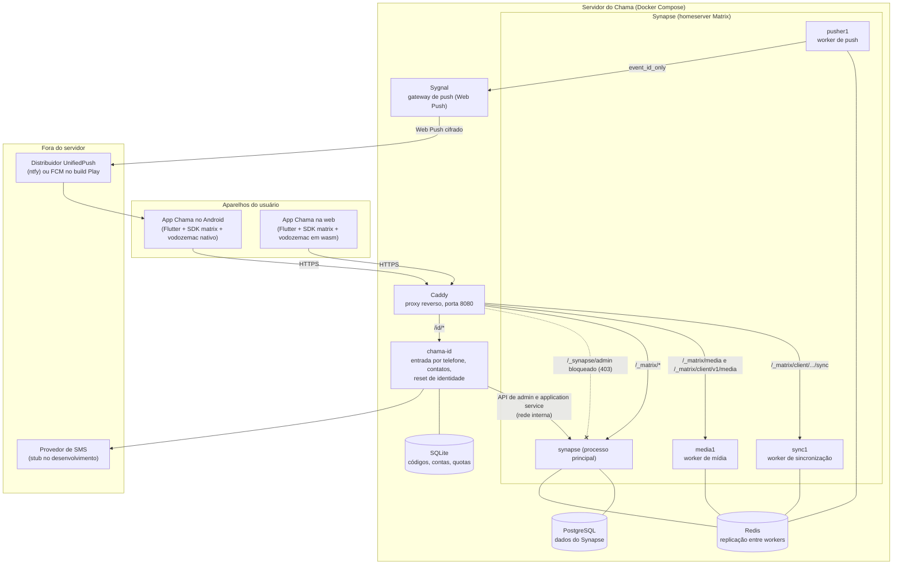

Em resumo: o app fala só com o **Caddy**. O Caddy manda as rotas Matrix para o **Synapse**
e seus workers e as rotas `/id/*` para o **chama-id**. O chama-id é o único que emite logins
(não há senha). As notificações saem pelo worker **pusher1**, passam pelo **Sygnal** e chegam
ao celular cifradas, sem o conteúdo da mensagem.

Ligações de voz e vídeo (LiveKit e Coturn) entram no M6.

### Componentes

| Unidade | O que faz | Depende de |
|---|---|---|
| `server/` | Stack Docker Compose: Synapse (processo principal + workers `sync1`, `media1`, `pusher1`), PostgreSQL, Redis, Caddy, chama-id, Sygnal (gateway de push) e ntfy para o emulador (só no desenvolvimento). Modelos de configuração e scripts (`server/scripts/init.sh`, `server/scripts/check.sh`). | Docker |
| `services/chama-id/` | Entrada por telefone (código SMS → JWT assinado), descoberta de contatos e reset de identidade de criptografia. Serviço pequeno em TypeScript, rodando em Node 26 com `node:sqlite`. | API de admin do Synapse, SQLite |
| `app/` | O app Chama (Flutter) para todas as plataformas. Layout de Android nos celulares; layout em dois painéis no estilo WhatsApp Web nas telas largas. | SDK Dart `matrix`, `flutter_vodozemac` |
| `tools/` | Ferramentas de teste em Node: `tools/smoke` (dois usuários trocam uma mensagem cifrada; também testa o reset de identidade) e `tools/peer` (o "contato de teste" que conversa com o app nos testes ponta a ponta). | `matrix-js-sdk` |
| `docs/` | Documentos de design e de operação, e as capturas de tela em `docs/imagens/`. | — |

### Rotas do proxy (`server/caddy/Caddyfile`)

| Caminho | Vai para | Observação |
|---|---|---|
| `/_matrix/client/(r0\|v3)/sync` e rotas de sync antigas | `sync1:8083` | A sincronização é a maior carga do servidor. |
| `/_matrix/media/*`, `/_matrix/client/v1/media/*` | `media1:8085` | Só o `media1` serve mídia (`enable_media_repo: false` no principal). |
| `/push/v1/config` | resposta fixa do Caddy | Endereço do gateway de push e a chave pública VAPID do Sygnal, que o app usa para se registrar. |
| `/id/*` | `chama-id:8090` | O chama-id não publica porta: só o Caddy chega nele. |
| `/_synapse/admin/*` | **403** | A API de admin só é usada pela rede interna. |
| `/_matrix/*` | `synapse:8008` | Todo o resto da API Matrix. |

No desenvolvimento, o Caddy escuta só em `127.0.0.1:8080` (e `127.0.0.1:8081` para o ntfy),
porque o modo de desenvolvimento aceita o código `000000` para qualquer número.
A federação está desligada no desenvolvimento (`federation_domain_whitelist: []`).

### Versões fixadas

Conferidas em 2026-10-24, nos arquivos `server/compose.yaml`, `app/pubspec.yaml` e
`services/chama-id/Dockerfile`:

| Peça | Versão |
|---|---|
| Synapse | v1.163.2 |
| PostgreSQL | 17.11 (alpine) |
| Redis | 7.4.11 (alpine) |
| Caddy | 2.11.7 (alpine) |
| Sygnal | v0.17.0 |
| ntfy (servidor de dev) | v2.28.0 |
| ntfy Android (emulador) | 1.25.2 |
| Node (chama-id) | 26.12.1 |
| Flutter | 3.47.8 |
| `matrix` (Dart) | 14.2.0 |
| `flutter_vodozemac` | 0.9.0 |
| `unifiedpush` | 6.2.0 |
| `flutter_local_notifications` | 22.3.2 |
| `flutter_contacts` | 2.6.0 |
| `share_plus` | 13.3.1 |
| `org.unifiedpush.android:embedded-fcm-distributor` | 3.1.0 (só no build Play) |
| `matrix-js-sdk` | 44.0.0 (só nas ferramentas de teste em Node) |

## 4. Identidade e entrada

### Conta com ID opaco

- Uma conta do Chama é um usuário Matrix com um ID **opaco e aleatório**, por exemplo
  `@u7k3m9q2x4w8a1b5:chama.chat` (`u` + 16 caracteres base32 minúsculos, 80 bits aleatórios).
  O número de telefone é a forma de entrar e a forma como os contatos encontram você, mas
  **não faz parte** do ID Matrix. O chama-id guarda o mapa `telefone → conta atual`
  (tabela `accounts`).
- **Por que IDs opacos:** as operadoras brasileiras repassam um número cancelado a um novo
  cliente depois de uns 180 dias. Se o número fosse o ID, o novo dono herdaria os grupos e as
  conversas do antigo e poderia falar em nome dele. IDs opacos também mantêm os números fora
  do estado das salas e fora da federação.
- **Números reciclados:** quando um telefone entra e a conta atual dele está sem atividade há
  45 dias, o chama-id desativa essa conta (os contatos veem que ela "saiu") e cria uma nova.
  Atividade é o mais recente entre: os aparelhos atuais, o último acesso registrado pelo
  Synapse (que guarda IPs por 7 dias) e a entrada anterior pelo chama-id. Dentro dos 45 dias,
  a mesma conta é usada, e o aparelho novo ainda precisa ser verificado (seção 5). No app, os
  contatos que tinham esse número salvo veem "O número de {nome} agora é de outra conta", e o
  nome salvo não passa para a conta nova.

### Fluxo de entrada

  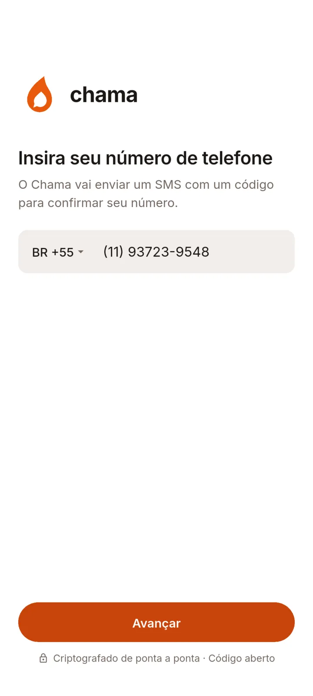
  &nbsp;
  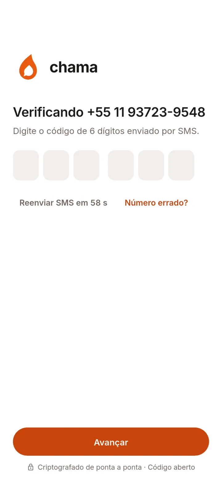

<em>Entrada com o número de celular e verificação pelo código de 6 dígitos.</em>

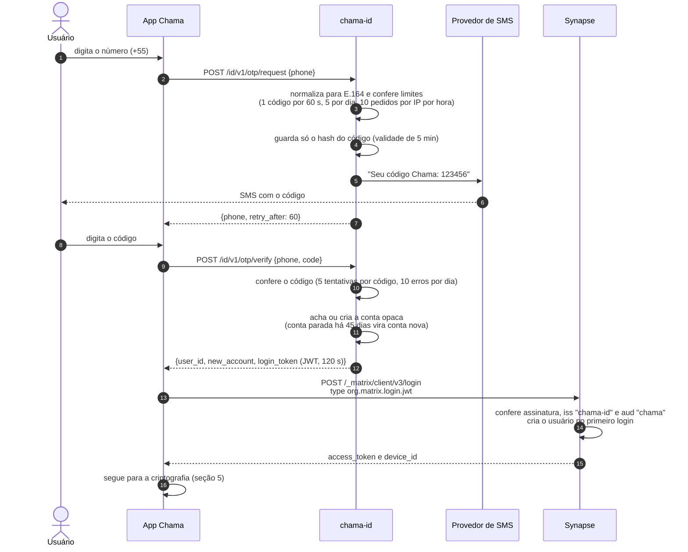

Detalhes:

1. `POST /id/v1/otp/request {phone}`: o chama-id guarda o hash do código de 6 dígitos (com um
   "pepper", um segredo do servidor), válido por 5 minutos, com no máximo 5 tentativas.
   Há limites por número e por IP e limites diários por número: 5 códigos e 10 tentativas
   erradas. Em desenvolvimento o provedor de SMS é um stub: o código aparece no log do
   chama-id, e o código fixo `000000` é aceito quando `CHAMA_DEV=1`.
2. `POST /id/v1/otp/verify {phone, code}`: o chama-id acha ou cria a conta e devolve um JWT
   (HS256, validade de 120 s, `sub` = a parte local opaca, `iss`/`aud` conferidos) e o
   `user_id`.
3. O app chama o Matrix `POST /_matrix/client/v3/login` com o tipo `org.matrix.login.jwt`.
   O Synapse cria a conta no primeiro login.

A lista completa de rotas, erros e limites está em [chama-id API](../chama-id-api.md).

### Regras de segurança da entrada

- O cadastro com senha está desligado no Synapse (`enable_registration: false`,
  `password_config.enabled: false`). Só o chama-id consegue emitir logins.
- **Sem senha, não existe a "autenticação interativa" (UIA) do Matrix.** O Synapse só oferece
  UIA para senha e SSO. Por isso, as ações que precisam dela são feitas pelo chama-id, depois
  de um código SMS novo e de um token de acesso válido:
  - **reset da identidade de criptografia**, para um celular novo sem a chave de recuperação
    (pronto desde o M2). O celular cria as novas chaves de cross-signing e envia só o pacote
    **público** assinado. O chama-id confere o código SMS, desconecta os outros aparelhos e
    envia o pacote em nome do usuário por meio de um *application service* do Matrix
    (`server/synapse/appservice.yaml.tmpl`, com `url: null`, para que o Synapse não envie
    eventos ao chama-id). O Synapse não pede UIA a um application service. As chaves privadas
    nunca saem do celular. (O Synapse só aceita "substituir sem UIA" pela API de admin quando
    usa o MAS, o Matrix Authentication Service. O caminho pelo application service funciona sem
    ele. Migrar a entrada para o MAS é uma opção para o M4.)
  - remover um aparelho vinculado e desativar a conta (M4).
- O chama-id fala com a API de admin só pela rede interna. O token do application service só
  é aceito de endereços privados (`ip_range_whitelist`), e o proxy bloqueia `/_synapse/admin`
  vindo de fora.
- O modo de desenvolvimento (`CHAMA_DEV=1`, código `000000`) é recusado se o `SERVER_NAME`
  não terminar em `.test` ou `.localhost`, então nunca pode ser ligado em produção por engano.
  Sem `CHAMA_DEV=1`, o chama-id hoje se recusa a iniciar, porque ainda não existe um provedor
  de SMS real (M7).
- Os números são validados e normalizados para E.164 no servidor (`libphonenumber-js`).
- Perfil: nome e foto são campos do perfil Matrix. O "recado" (o "sobre" do WhatsApp) usará um
  campo estendido de perfil (MSC4133); se o servidor não tiver, fica como estado na sala de
  status do usuário (M5).

**Privacidade:** os números não aparecem nos IDs Matrix. O app mostra o nome salvo na agenda
do celular ou o nome de exibição do contato. Mostrar o número aos membros de um grupo é uma
escolha do app, como no WhatsApp.

## 5. Criptografia, aparelhos e vinculação

### Regras fixas

- Todas as salas são criadas com `m.room.encryption` (Megolm), e o servidor liga a
  criptografia por padrão em todo tipo de sala (`encryption_enabled_by_default_for_room_type:
  all`). **Não existe conversa sem criptografia:** se o app encontra uma sala sem criptografia,
  liga a criptografia quando pode; quando não pode, mostra "Esta conversa não é criptografada.
  O Chama não envia mensagens nela." e não envia nada.
- O cross-signing é criado na primeira entrada. Uma chave de recuperação (backup seguro,
  SSSS) é mostrada uma vez, como o "backup criptografado de ponta a ponta" do WhatsApp.
- **Invariante de segurança: as chaves das mensagens só vão para aparelhos verificados.** O app
  usa a configuração `ShareKeysWith.crossVerifiedIfEnabled` do SDK (nunca `all`). Um aparelho
  que entra só com o código SMS não recebe nenhuma chave de mensagem até ser verificado com a
  chave de recuperação (ou, a partir do M4, por outro aparelho do mesmo dono). É isso que
  impede um golpista com SIM swap e o próprio operador de lerem mensagens novas ao entrar
  como alguém.
- No Android, o banco local do app é cifrado com SQLCipher, com a chave guardada no
  armazenamento seguro do sistema (Android Keystore). Na web, o SDK guarda os dados no
  IndexedDB do navegador.

### O que acontece em cada aparelho depois da entrada

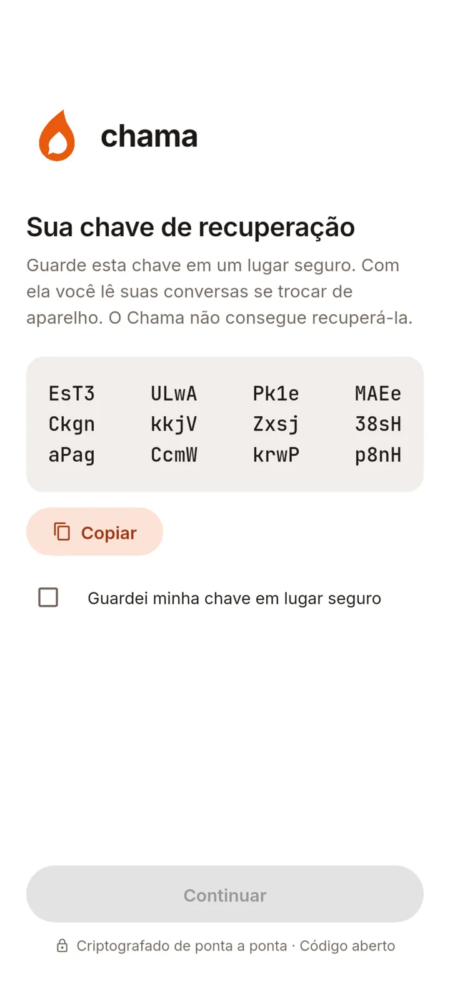

<em>Chave de recuperação gerada no próprio aparelho, para restaurar as conversas criptografadas.</em>

O app decide o próximo passo pelo estado das chaves (`CryptoStatus` em
`app/lib/services/chat_service.dart`):

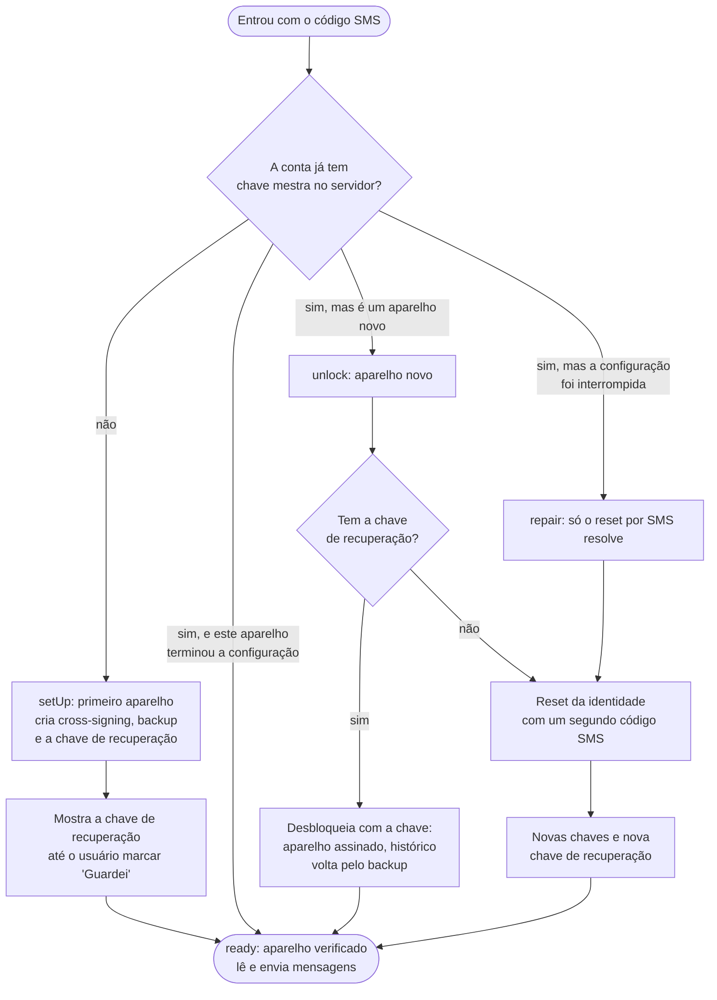

### Reset da identidade

Um usuário sem outro aparelho e sem a chave de recuperação pode **resetar a identidade**
(novas chaves de cross-signing, via chama-id, seção 4). O reset **desconecta todos os outros
aparelhos** da conta. Assim, quem fez SIM swap não consegue ficar escondido ao lado do dono
verdadeiro, que percebe na hora (como no novo registro do WhatsApp). Os contatos passam a ver
"O código de segurança de {nome} mudou". As mensagens antigas continuam ilegíveis no celular
novo. A partir do M4, o PIN da conta também protege o reset.

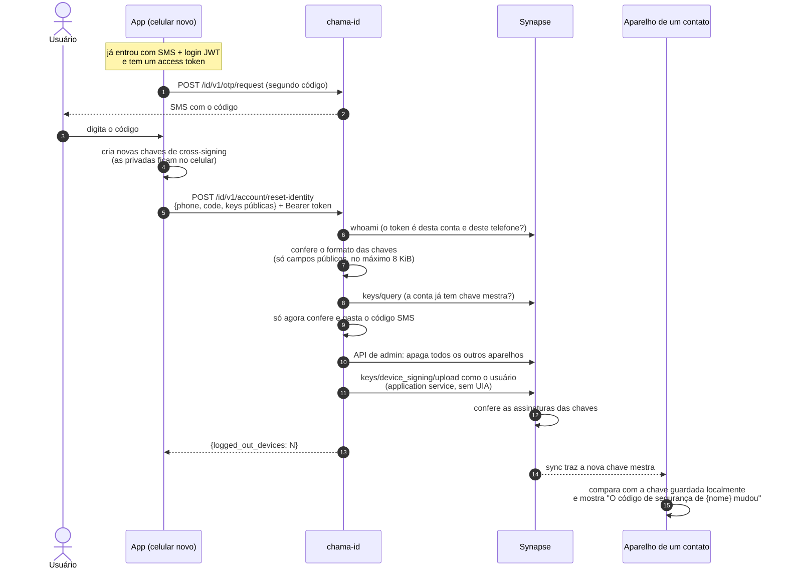

Por que a ordem importa: o token, o dono do telefone, o formato das chaves e a existência da
chave mestra são conferidos **antes** de gastar o código, para que esses erros não queimem o
código do usuário. E a desconexão dos outros aparelhos vem **antes** do envio das chaves, para
que um reset nunca deixe outro aparelho conectado.

O aviso de "código de segurança mudou" é feito no próprio aparelho do contato
(`app/lib/services/security_code.dart`): o app guarda a última chave mestra vista de cada
pessoa e, quando ela muda, grava um aviso em todas as conversas com essa pessoa. Como a
comparação é local, o operador não consegue esconder o aviso.

### Vinculação do app web (planejada para o M4)

Hoje o app web entra direto com telefone + código SMS e se desbloqueia com a chave de
recuperação, como um celular novo. O fluxo de "Aparelhos conectados" do WhatsApp, com QR code,
é o centro do M4 ([issue #3](https://github.com/kaiomp/chama/issues/3)). O desenho é este:

1. A web gera um par de chaves X25519 temporário e abre um ponto de encontro no chama-id
   (`POST /id/v1/link` → `{id}`). Mostra um QR code com `{id, pubkey, server}`.
2. O celular lê o QR, pede ao Synapse um token de login de uso único
   (`POST /_matrix/client/v1/login/get_token`), cifra esse token para a chave pública da web e
   o envia ao ponto de encontro.
3. A web consulta o ponto de encontro, decifra o token, entra com `m.login.token`, e o celular
   verifica o novo aparelho e compartilha os segredos de cross-signing e a chave do backup pelo
   compartilhamento de segredos do Matrix. O novo aparelho passa a ler o histórico.
4. O chama-id só vê dados cifrados. Os pontos de encontro expiram em 2 minutos.

A rota `/id/v1/link` ainda não existe no código.

## 6. Funções do WhatsApp no Matrix

Situação: **pronto** = no código hoje; **Mx** = marco planejado.

| WhatsApp | Chama no Matrix | Situação |
|---|---|---|
| Conversa 1:1 | Sala cifrada, `is_direct`, registrada em `m.direct` | pronto |
| Grupo | Sala cifrada; administradores = nível de poder 100 | pronto |
| Texto, emoji, links | `m.room.message` `m.text` (+ corpo formatado) | pronto |
| Responder / citar | `m.relates_to.m.in_reply_to` | pronto |
| Reação | `m.reaction` (`m.annotation`). Em sala cifrada, o emoji vai dentro da parte cifrada (`chat.chama.reaction`) e a chave visível ao servidor é um valor aleatório | pronto |
| Editar | Relação `m.replace` | pronto |
| Apagar para todos | Redação (*redaction*) | pronto |
| Apagar para mim | Escondida no app; lista guardada nos dados da conta da sala (`chat.chama.hidden`) | pronto |
| Encaminhar | Reenviar o conteúdo, marcado como encaminhado (`chat.chama.forwarded`) | M5 |
| Foto, vídeo, documento | Anexos cifrados (`m.image`, `m.video`, `m.file`) | pronto (foto e arquivo) |
| Mensagem de voz | `m.audio` + `org.matrix.msc3245.voice` + forma de onda | pronto |
| Figurinha | `m.sticker` | M5 |
| Localização | `m.location` (MSC3488) | M5 |
| Enquete | Enquetes (MSC3381) | M5 |
| Cartão de contato | `m.file` com vCard | M5 |
| Tique ✓ enviado | O servidor aceitou o evento (tem ID de evento) | pronto |
| Tiques ✓✓ entregue | Mensagem direta entre aparelhos `chat.chama.delivered`, cifrada com Olm, enviada pelos aparelhos de quem recebeu (em lote). Só em conversas 1:1 e grupos de até 32 membros; grupos maiores mostram só ✓ enviado e ✓✓ azul lido | pronto |
| Tiques ✓✓ azuis (lido) | Recibo `m.read`; `m.read.private` quando o usuário desliga as confirmações de leitura | pronto |
| Digitando… / gravando… | `m.typing`; gravação enviada como digitando + `chat.chama.activity` | pronto (digitando) |
| Online / visto por último | Presença do Matrix, com chave de privacidade | presença pronta; chave de privacidade M5 |
| Mensagens favoritas | Dados da conta `chat.chama.starred` | M5 |
| Fixar / arquivar / silenciar conversa | Etiquetas de sala (`chat.chama.pinned`, `chat.chama.archived`) e regras de push | pronto |
| Mensagens temporárias | `m.room.retention` (limpeza no Synapse) + o app esconde eventos vencidos | M5 |
| Armazenamento no servidor | Só até a entrega, no máximo 30 dias (política de retenção); o histórico fica nos celulares | decidido, M5 ([issue #12](https://github.com/kaiomp/chama/issues/12)) |
| Bloquear | `m.ignored_user_list` | M5 |
| Status (stories) | Uma sala por usuário, tipo próprio `chat.chama.status`, membros = contatos; os itens expiram em 24 h | M5 |
| Canais | Sala pública onde só administradores postam (níveis de poder); seguidores veem só os administradores | M5 |
| Comunidades | Spaces do Matrix com grupos e uma sala de avisos | M5 |
| Lista de transmissão | Lista no app; envia uma cópia para cada conversa 1:1 | M5 |
| Contatos | Ver "Contatos" abaixo | pronto (Android) |
| Ligações de voz / vídeo | MatrixRTC + SFU LiveKit | M6 |
| Notificações push | Ver "Notificações push" abaixo | pronto (Android) |
| Denunciar | `/report` do Matrix para a fila de moderação do operador | planejado (ainda sem marco) |

Regras de neutralidade embutidas no produto: a lista de conversas é ordenada só pela última
atividade (as fixadas ficam no topo); canais não têm ranqueamento de recomendação; o diretório
é só de busca (número exato ou nome do canal).

  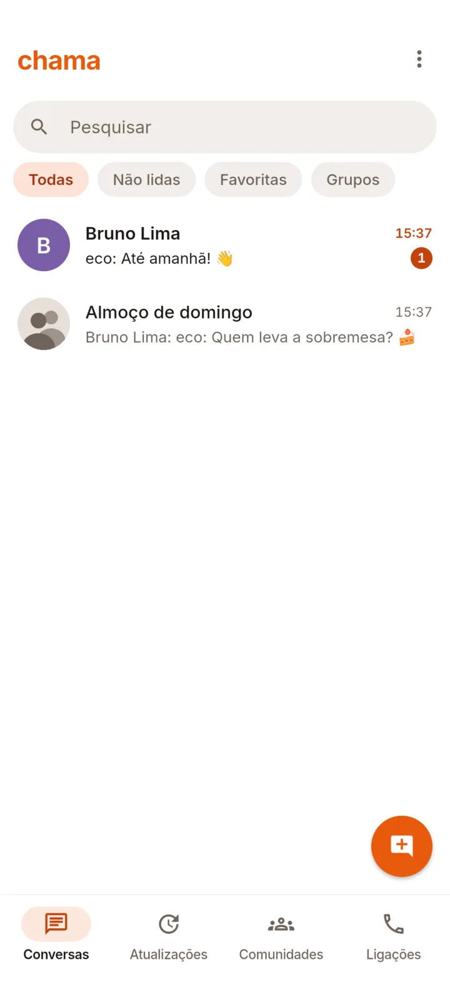
  &nbsp;
  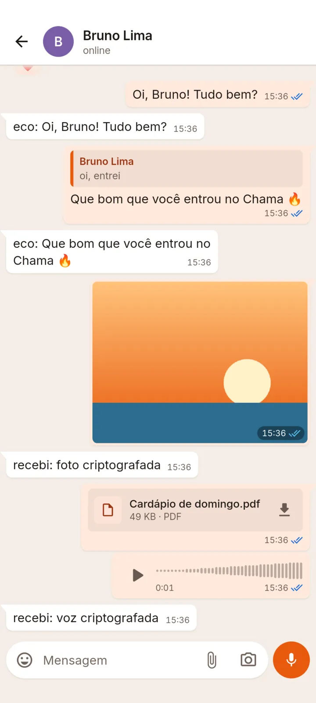

<em>Lista de conversas em ordem de tempo e uma conversa com resposta, foto, PDF e voz, tudo criptografado.</em>

### Retenção de mensagens no servidor

Decisão de 2026-10-24 ([issue #12](https://github.com/kaiomp/chama/issues/12), M5): como no
WhatsApp, o servidor guarda mensagens e mídia cifradas só até a entrega, no máximo uns 30 dias.
O histórico vive nos celulares.

- No Synapse: política padrão de retenção das salas (`max_lifetime` de 30 dias) com tarefas de
  limpeza, e retenção da mídia (`local_media_lifetime` de 30 dias).
- No app: manter o histórico local quando a cópia do servidor sumir, tratar lacunas e avisar
  que um aparelho novo só vê os últimos 30 dias.
- Um backup cifrado das conversas, controlado pelo usuário (chave só com ele, armazenamento à
  escolha dele), para recuperar o histórico se o celular for perdido. Tem desenho próprio.
- Vantagens: menos dados guardados para vazar, apreender ou tentar decifrar no futuro, e banco
  e mídia menores.

**Situação hoje:** a decisão está tomada, mas ainda não está configurada. O
`homeserver.yaml.tmpl` atual não tem política de retenção, então o servidor de
desenvolvimento guarda as mensagens cifradas sem prazo. O que já existe: o Synapse apaga os
registros de IP depois de 7 dias (`user_ips_max_age: 7d`), e o app apaga do cache local os
arquivos de mídia baixados depois de 30 dias.

### Contatos

O app lê a agenda do celular e pergunta ao chama-id quais números têm conta. Só hashes SHA-256
dos números saem do celular. Os nomes salvos nunca saem do aparelho.

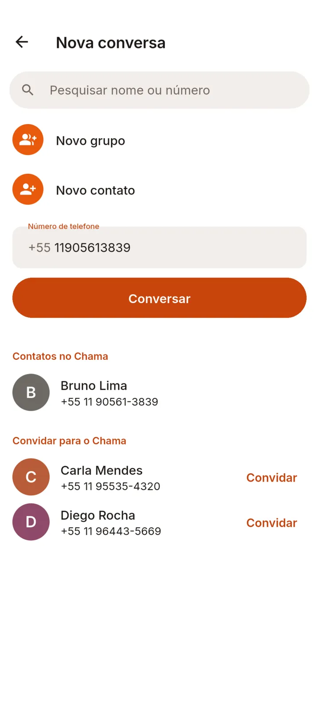

<em>Nova conversa: "Contatos no Chama" e "Convidar para o Chama" vêm da agenda do celular.</em>

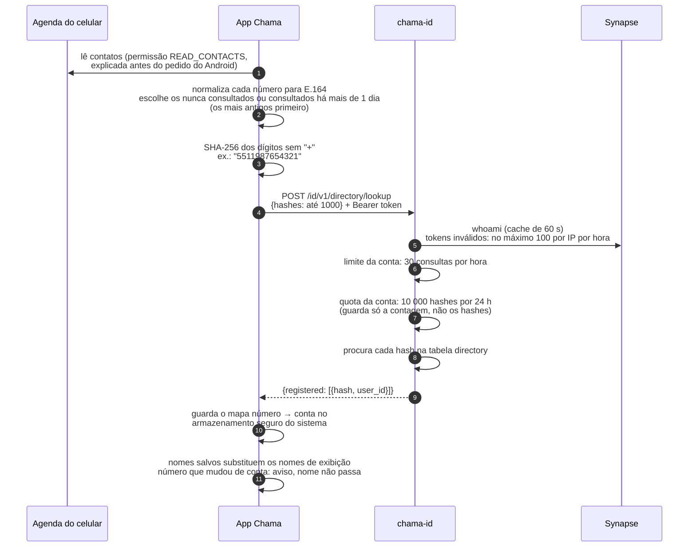

Pontos importantes:

- Cada número é consultado no máximo uma vez por dia, em lotes de no máximo 1000. Se o
  chama-id responde `rate_limited`, o app para e continua de onde parou depois do
  `retry_after`.
- Não existe limite por IP para consultas válidas: as operadoras móveis brasileiras colocam
  muitos celulares atrás de um mesmo IP (CGNAT), e um limite por IP bloquearia usuários
  comuns. Cada consulta já exige uma conta verificada por SMS.
- O mapa número → conta fica no armazenamento seguro do sistema, não nas preferências comuns
  do app.
- Sem a permissão, as conversas começam digitando o número. Na web não há leitura da agenda.
- **Risco residual:** um hash de número de telefone pode ser revertido testando todos os
  números possíveis. Detalhes e a decisão estão em
  [chama-id API](../chama-id-api.md) (seção sobre a privacidade da busca de contatos)
  e em [Segurança e privacidade](../seguranca-e-privacidade.md#limites-conhecidos).

### Notificações push

A notificação nunca carrega o conteúdo da mensagem. O servidor avisa só "chegou o evento X na
sala Y"; o celular acorda, busca a mensagem, decifra e monta a notificação sozinho.

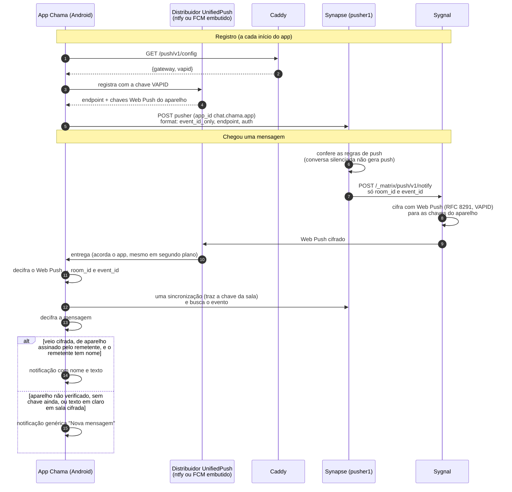

- Formato `event_id_only`, com `push.include_content: false` no Synapse: o Sygnal recebe só
  os IDs da sala e do evento, nunca o remetente, o nome da sala ou a mensagem.
- O Sygnal cifra o aviso com Web Push para as chaves do aparelho. O distribuidor (ntfy, ou o
  Google no build Play) só vê dados cifrados e o momento do envio.
- Build `fdroid` (padrão, sem código do Google): o usuário precisa de um app distribuidor
  UnifiedPush, como o ntfy. Build `play`: usa o distribuidor FCM embutido do UnifiedPush, sem o
  SDK do Firebase.
- Um único motor Flutter por processo Android: o push chega ao app que já está rodando ou o
  inicia sem tela, e nunca há um segundo cliente Matrix no mesmo banco local.
- Sem distribuidor instalado, Configurações → Notificações avisa o usuário. Se o Android
  bloqueia as notificações do Chama, a tela também avisa.

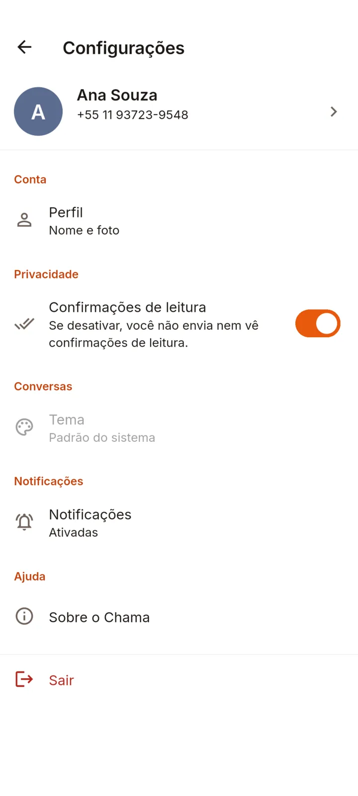

<em>Configurações: confirmações de leitura, tema e o estado das notificações ("Ativadas").</em>

## 7. Marcos

O MVP (M1 a M3, com push) foi a meta de uma semana. Ele precisa estar pronto para milhões de
cadastros (seção 12).

| # | Marco | Pronto quando | Situação |
|---|---|---|---|
| M1 | **Fundação.** Monorepo, stack Compose (Synapse com workers, Postgres, Redis, Caddy, chama-id), script de teste. | `make up` sobe a stack; um script faz dois usuários de teste entrarem com o código `000000` e trocarem uma mensagem cifrada. | concluído |
| M2 | **Núcleo do app (Android primeiro, também na web).** Entrada por telefone, chave de recuperação, reset de identidade, lista de conversas, 1:1 e grupos, texto, respostas, reações, edição, apagar, tiques, digitando, presença, fotos/arquivos, mensagens de voz, busca, fixar/arquivar/silenciar, contador de não lidas, interface em pt-BR, temas claro e escuro. | Teste de integração no Chrome e no emulador Android: o usuário do app conversa com um contato de teste, vê os tiques ficarem azuis, envia uma foto e uma mensagem de voz. | concluído ([issue #1](https://github.com/kaiomp/chama/issues/1)) |
| M3 | **Lançamento no Android.** Sincronização de contatos. Push: gateway Sygnal, FCM para o build da Play Store, UnifiedPush (ntfy) para o F-Droid e testes locais. Build de release, APKs por ABI. | Teste no emulador: o usuário Android conversa com um usuário web nos dois sentidos; uma mensagem chega como notificação com o app em segundo plano. | concluído ([issue #2](https://github.com/kaiomp/chama/issues/2)) |
| M4 | **Vincular aparelho e segurança da conta.** Vinculação por QR (seção 5), lista e remoção de aparelhos, verificação de aparelho por outro aparelho, PIN da conta (verificação em duas etapas, que também bloqueia o novo registro de um número por 7 dias), avisos de "aparelho novo" aos contatos, aviso na conversa para mensagens de aparelhos não verificados. | A web vinculada pelo QR no emulador lê o histórico anterior. | aberto ([issue #3](https://github.com/kaiomp/chama/issues/3), [issue #11](https://github.com/kaiomp/chama/issues/11)) |
| M5 | **Extras.** Status, canais, comunidades, enquetes, localização, mensagens temporárias, favoritas, listas de transmissão, bloqueio, ajustes de privacidade, "recado" no perfil, retenção de 30 dias. | Cada função tem um teste ponta a ponta. | aberto ([issue #4](https://github.com/kaiomp/chama/issues/4), [issue #12](https://github.com/kaiomp/chama/issues/12)) |
| M6 | **Ligações.** LiveKit + MatrixRTC, voz e vídeo 1:1 e em grupo. | Dois clientes fazem uma ligação localmente. | aberto ([issue #5](https://github.com/kaiomp/chama/issues/5)) |
| M7 | **Produção.** Adaptador de SMS real, chama-id em PostgreSQL + Redis, mídia em S3 + CDN, PgBouncer, monitoramento, guia de implantação, teste de carga, descoberta privada de contatos. | Um teste de carga atinge as metas da seção 12. | aberto ([issue #6](https://github.com/kaiomp/chama/issues/6), [issue #7](https://github.com/kaiomp/chama/issues/7)) |

## 8. Clientes

### O app Chama (`app/`)

- Flutter (Dart), uma base de código para Android, web, iOS e desktop. O Android sai primeiro.
- Camada Matrix: SDK Dart `matrix` da famedly com `flutter_vodozemac` para a criptografia. É
  a mesma base do FluffyChat, que já roda em todas essas plataformas.
- Organização do código: pastas por função (`auth`, `chat_list`, `chat`, `contacts`, `group`,
  `profile`, `common`) e uma camada fina de serviços sobre o SDK em `lib/services/`. Os widgets
  nunca chamam o SDK diretamente; recebem modelos simples. Isso deixa as funções fáceis de
  testar e de contribuir.
- Layout: nos celulares segue o WhatsApp Android (abas Conversas / Atualizações / Comunidades /
  Ligações, tela de conversa, seletor de contatos, configurações). Em telas largas (a partir de
  900 px) segue o WhatsApp Web: painel esquerdo (cabeçalho, busca, filtros
  Todas/Não lidas/Favoritas/Grupos, lista de conversas) e painel direito (cabeçalho da
  conversa, linha do tempo, campo de mensagem).
- A mídia é sempre baixada com autenticação e decifrada no app.
- Idiomas: pt-BR primeiro, inglês em segundo, com os arquivos ARB do Flutter
  (`lib/l10n/app_pt.arb` é o modelo).
- Sem dependência do Google Play Services no núcleo, para que o app também possa sair no
  F-Droid (FCM só no build da Play Store): sabores Android `fdroid` (padrão) e `play`.
- Push e agenda de contatos: só no Android por enquanto. A web não tem nenhum dos dois.
- Os builds de release falam com o servidor só por HTTPS (o endereço do servidor é definido no
  build com `CHAMA_BASE_URL`) e pegam a chave de assinatura do ambiente, nunca do repositório
  ([app/README.md](../../app/README.md)).

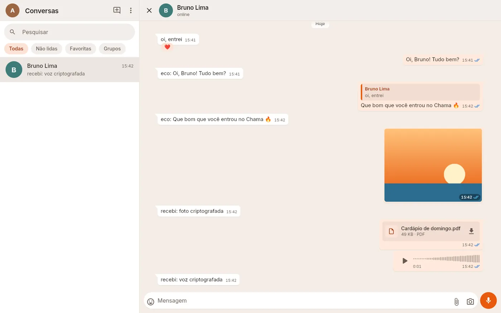

<em>Web em tela larga: lista e conversa lado a lado, com reação, resposta, foto, arquivo e voz.</em>

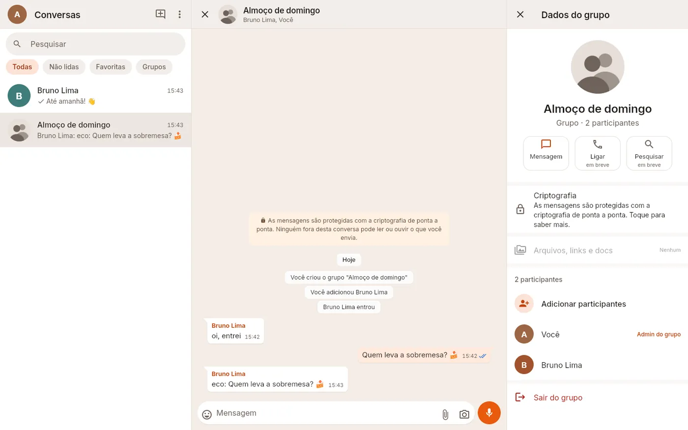

<em>Web em três painéis: lista, conversa em grupo e dados do grupo.</em>

### Marca

- Nome, ícone e paleta próprios. Copiamos padrões de interação, não os elementos visuais,
  o logo ou as cores exatas do WhatsApp.
- Cor principal: laranja-chama `#E8590C`, com neutros quentes. As cores são *design tokens*
  (definidas só em `app/lib/common/theme.dart`), então mudam em um lugar só. As cores da
  bandeira e de partidos são evitadas, para manter a neutralidade.

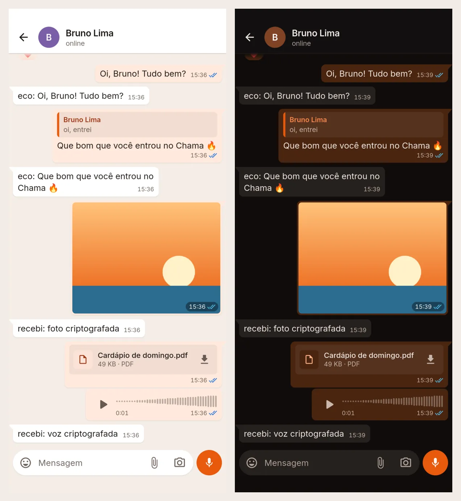

<em>A mesma conversa nos temas claro e escuro.</em>

## 9. Tratamento de erros

- O app tem uma caixa de saída: a mensagem mostra um relógio até o servidor aceitar e uma marca
  vermelha de "tentar de novo" se o envio falhar. O SDK tenta de novo por até 30 segundos;
  depois disso, o usuário tenta de novo com um toque.
- Falhas de decifração mostram "Aguardando esta mensagem. Isso pode levar alguns instantes." e
  são refeitas quando as chaves chegam, como no WhatsApp.
- O chama-id devolve erros JSON tipados (`{"error": "rate_limited", "retry_after": 60}`); o
  app traduz para texto em pt-BR.
- Quando a conexão cai, aparece uma faixa amarela "Conectando…"; o SDK reconecta com espera
  crescente.

## 10. Testes

| O quê | Comando | Precisa da stack? |
|---|---|---|
| Testes unitários do chama-id (`node --test`) e testes do app (`flutter test`) | `make test` | não |
| Dois usuários entram e trocam uma mensagem cifrada | `make smoke` | sobe sozinho (`make up`) |
| Verificações de aceitação da stack (portas, rotas, entrada, reset de identidade, push) | `server/scripts/check.sh` | sim |
| Testes unitários e de widgets do app | `make app-test` | não |
| App conversa com o contato de teste no Chrome | `make app-e2e-web` | sim |
| App no emulador Android: conversa, contatos e push | `make app-e2e-android` | sim, e um emulador |

- chama-id: testes `node --test` em `services/chama-id/test/` (normalização de telefone,
  validade e tentativas do código, claims do JWT, limites de uso, contas, diretório). Contra o
  Synapse real, quem testa é `server/scripts/check.sh`.
- Stack: `tools/smoke` faz dois usuários entrarem e trocarem uma mensagem cifrada;
  `tools/smoke/identity.ts` testa o reset de identidade.
- App: `flutter test` para lógica e widgets; `integration_test` ponta a ponta contra a stack
  local, no Chrome (rápido) e no emulador Android, com `tools/peer` fazendo o papel do contato.
  Para rodar um teste só: `cd app && ./scripts/e2e.sh <chrome|android> <arquivo>`.

## 11. Operação e confiança

- O operador pode moderar canais públicos e agir sobre denúncias, mas não pode ler conversas
  cifradas. Essa é a promessa central e precisa continuar verdadeira em todo marco.
- Proteções contra abuso do operador (seção 5 e M4): PIN da conta, avisos de "entrou" e de
  "aparelho novo" que o servidor não consegue esconder, verificação por cross-signing, avisos
  locais de "código de segurança mudou", pouca retenção de registros (nenhum registro de IP
  além de 7 dias), código aberto, auditorias independentes, builds Android reproduzíveis e
  relatórios de transparência.
- Limite honesto: o operador de um servidor Chama ainda controla a entrada nesse servidor,
  então pode bloquear usuários. A federação deixa outras organizações rodarem seus próprios
  servidores, mas não protege os usuários de um servidor contra o operador desse servidor. A
  portabilidade de contas entre servidores é um objetivo para depois.
- O que o operador vê e não vê, em linguagem simples: [Segurança e
  privacidade](../seguranca-e-privacidade.md).
- Licença: AGPL-3.0 para o código de servidor, igual ao Synapse; os clientes também são
  AGPL-3.0, para que os forks continuem abertos.

## 12. Escala (milhões de usuários desde o lançamento)

Meta para os primeiros meses: 5 milhões de contas, 1 milhão de usuários ativos por dia,
100 000 conexões simultâneas, pico de 2 000 mensagens por segundo.

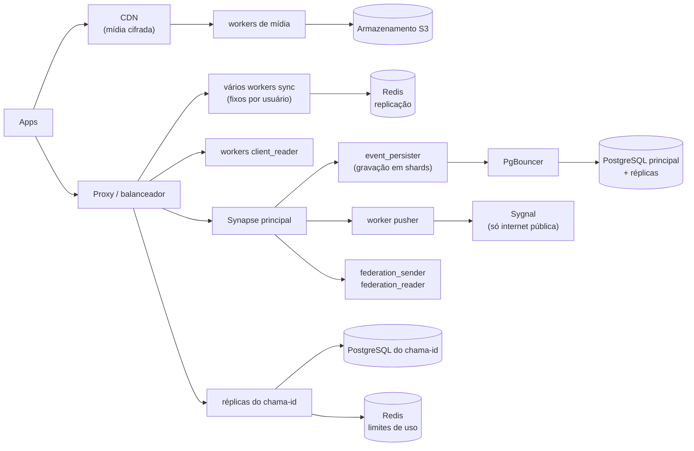

- **Synapse com workers desde o primeiro dia.** O Compose de desenvolvimento já roda o
  formato com workers (`sync1`, `media1`, `pusher1`), então a produção tem o mesmo desenho com
  mais réplicas:
  - workers `sync` (vários, atrás do proxy, fixos por usuário): a maior carga.
  - workers `client_reader` para as outras leituras dos clientes.
  - workers `event_persister` (gravadores de stream em shards) para as gravações.
  - worker `media_repository`; mídia guardada em armazenamento compatível com S3
    (`synapse-s3-storage-provider`), não em disco local.
  - worker `pusher` alimentando o Sygnal; workers `federation_sender` e `federation_reader`.
  - O Sygnal envia Web Push para qualquer endpoint que o usuário registre, então roda onde
    alcança a internet, mas nenhum serviço interno. Regra de saída em produção: só HTTPS (443)
    para endereços públicos; o firewall descarta o tráfego para loopback, redes privadas,
    link-local (inclusive metadados de nuvem) e CGNAT (`server/sygnal/sygnal.yaml`).
  - Redis para a replicação entre workers.
- **PostgreSQL** principal com réplicas por streaming e PgBouncer; `VACUUM` regular e
  compressão de estado (`synapse_auto_compressor`).
- **chama-id** não guarda estado além do SQLite no desenvolvimento. Hoje ele roda com SQLite e
  limites em memória, então só uma réplica (`services/chama-id/src/db.ts`). Em produção (M7)
  usa PostgreSQL (banco próprio) e várias réplicas atrás do proxy, com os limites de uso no
  Redis.
- **Mídia** servida por uma CDN na frente do worker de mídia (a mídia é cifrada, então a CDN
  só vê dados cifrados).
- **Limite conhecido:** uma instalação única do Synapse está comprovada com centenas de
  milhares de usuários ativos, não dezenas de milhões. Acima disso, os usuários são divididos
  entre vários homeservers Chama que federam (por exemplo, por região, seção 13). A federação
  torna isso possível sem mudar os apps.
- **Custo de SMS:** milhões de códigos de entrada custam dinheiro de verdade. O chama-id tem uma
  interface de provedor (`SmsProvider` em `services/chama-id/src/sms.ts`), para trocar pelo
  provedor mais barato (Zenvia, Infobip, Twilio, chamada rápida) sem mudar os apps.

## 13. Modelo de federação (proposta)

Objetivo: o Chama não ter um dono único, sem que os usuários precisem saber o que é um
servidor ([issue #13](https://github.com/kaiomp/chama/issues/13)).

- **Servidores regionais, operados por instituições brasileiras independentes** (universidades
  e institutos federais, governos estaduais, ONGs, cooperativas). O servidor de cada região é
  operado pela sua instituição, sob um único regulamento comum (retenção, moderação, relatórios
  de transparência, base mínima de segurança).
- **O DDD escolhe o servidor.** Na entrada, o app mapeia o código de área do número para um
  servidor regional, então o usuário só digita o número. A federação do Matrix liga os
  servidores; conversas entre regiões funcionam como qualquer outra.
- **Por quê:** um operador que se comporte mal, seja bloqueado ou saia do ar afeta só uma
  região; o custo de hospedagem fica dividido entre operadores (cerca de US$ 2–5 mil por mês por
  região em escala total, em vez de uma conta única e grande); órgãos públicos podem participar
  sem serem donos da rede inteira.
- **Já compatível:** os IDs das contas são opacos e o número de telefone não faz parte do ID
  (seção 4), então as contas podem morar em qualquer servidor.
- **Questões em aberto:** um diretório de telefones compartilhado entre servidores (quem roda e
  como continua privado), mudança de DDD, carga de federação para grupos grandes que cruzam
  regiões e a governança do regulamento comum.

O mapa abaixo é **ilustrativo**: a divisão por macrorregião e os tipos de instituição são
exemplos, não acordos.

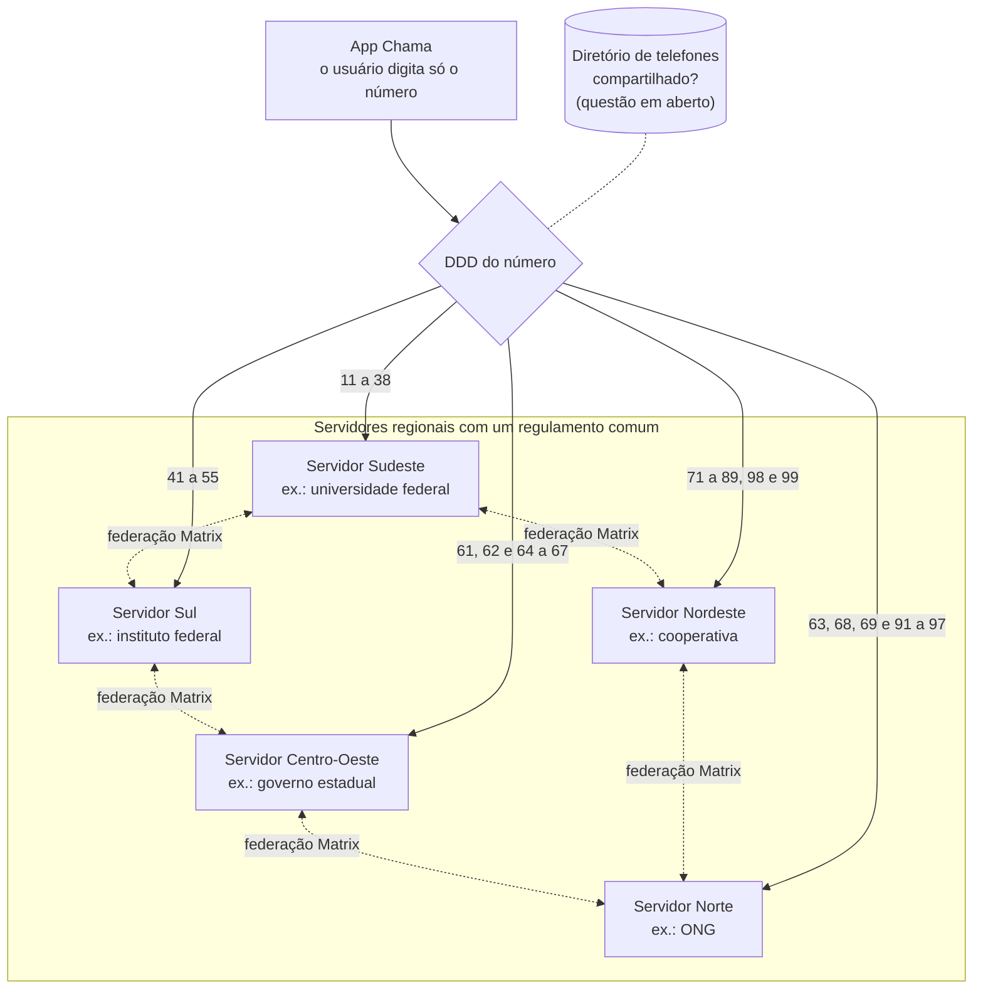

Na prática, todo servidor federa com todos (a figura mostra só algumas ligações). Uma conversa
entre uma pessoa de São Paulo e outra do Recife segue cifrada de ponta a ponta: cada servidor
guarda a cópia cifrada da sala para os seus usuários e repassa os eventos ao outro.

Também considerado para depois ([issue #14](https://github.com/kaiomp/chama/issues/14)): um
"modo sem internet" para quem está perto, por Bluetooth / Wi-Fi Direct, para bloqueios e
apagões (o Brasil já teve bloqueios nacionais de mensageiros). Um modelo puramente
ponto a ponto, sem servidores, não serve para milhões de usuários não técnicos (celulares
desligados, bateria, atrasos na entrega).
