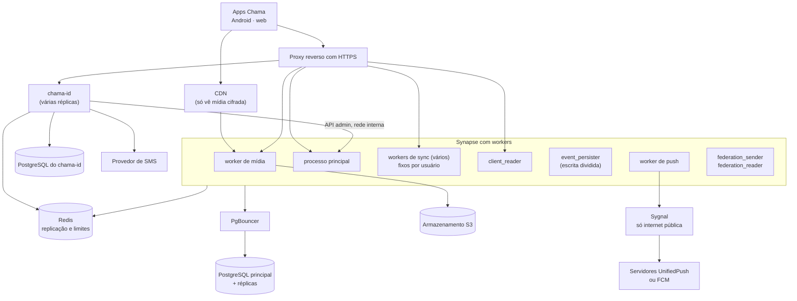
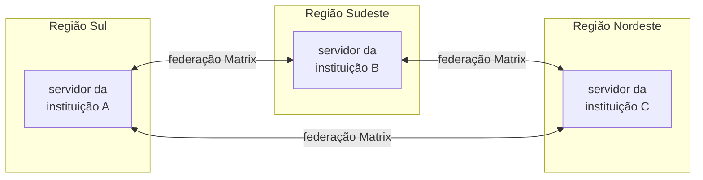
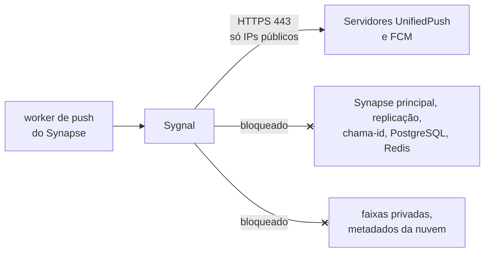

# Operação em produção

Este documento é para quem vai operar um servidor Chama: instituições, equipes de
infraestrutura e financiadores que querem entender o que custa e o que dá trabalho. Ele separa
com clareza o que **já existe** no repositório do que **ainda falta** (o marco M7, issue #6).

> **Situação hoje (outubro de 2026): o Chama ainda não roda em produção.** A pilha deste
> repositório é a de desenvolvimento. O ponto que bloqueia é o SMS: não há provedor de SMS real,
> e o chama-id se recusa a iniciar fora do modo de desenvolvimento
> (`no SMS provider configured (set CHAMA_DEV=1 for development)`). Todo o resto já funciona no
> mesmo formato que a produção vai usar, com workers, push e isolamento de rede, mas ainda
> precisa dos ajustes listados aqui.

Para rodar a pilha local, veja o [guia de desenvolvimento](desenvolvimento.md). Para a
arquitetura completa, veja a [especificação](design/2026-10-24-architecture.md), seções 11 a 13.

## Sumário

1. [O que existe e o que falta](#1-o-que-existe-e-o-que-falta)
2. [Arquitetura de produção](#2-arquitetura-de-produção)
3. [Do desenvolvimento para a produção](#3-do-desenvolvimento-para-a-produção)
4. [Provedor de SMS](#4-provedor-de-sms)
5. [HTTPS e domínio](#5-https-e-domínio)
6. [Hospedagem e custos](#6-hospedagem-e-custos)
7. [Backups](#7-backups)
8. [Monitoramento](#8-monitoramento)
9. [Retenção de dados](#9-retenção-de-dados)
10. [Regra de saída do Sygnal](#10-regra-de-saída-do-sygnal)
11. [Segredos](#11-segredos)
12. [Lista de tarefas até o lançamento](#12-lista-de-tarefas-até-o-lançamento)

---

## 1. O que existe e o que falta

| Área | Já existe | Falta (M7) |
|---|---|---|
| Servidor Matrix | Synapse v1.163.2 com workers separados para sync, mídia e push, PostgreSQL 17, Redis | mais réplicas de sync com roteamento fixo por usuário, workers `client_reader`, `event_persister` e de federação, PgBouncer e réplicas do PostgreSQL |
| Entrada por SMS | chama-id completo, com limites de tentativa e cotas testados; SMS simulado (código no log) | adaptador para um provedor real de SMS |
| Banco do chama-id | SQLite e limites em memória (uma réplica só) | PostgreSQL próprio e limites no Redis, para rodar várias réplicas |
| Proxy | Caddy com as rotas e o bloqueio da API admin | HTTPS com domínio real |
| Push | Synapse → Sygnal → UnifiedPush ou FCM, só com IDs; Sygnal numa rede isolada | firewall de saída do Sygnal na produção; tirar a liberação da rede de desenvolvimento |
| Mídia | worker de mídia em disco local | armazenamento compatível com S3 e uma CDN na frente |
| Retenção | logs de IP do Synapse por 7 dias | política de 30 dias para mensagens e mídia (issue #12); rotação dos logs do Docker |
| Monitoramento | verificações de saúde em cada serviço | métricas, alertas e um teste de carga |
| App | builds de release só com HTTPS, assinatura vinda do ambiente, flavors F-Droid e Play | publicação nas lojas |
| Documentação | este documento | guia de implantação passo a passo |

---

## 2. Arquitetura de produção

O ambiente local já usa o mesmo desenho da produção. Na produção cada peça ganha réplicas
(especificação, seção 12):



Metas para os primeiros meses (especificação, seção 12):

| Métrica | Meta |
|---|---|
| Contas | 5 milhões |
| Usuários ativos por dia | 1 milhão |
| Conexões simultâneas | 100 000 |
| Pico de mensagens | 2 000 por segundo |

> **Limite conhecido.** Uma única instalação do Synapse está comprovada com centenas de milhares
> de usuários ativos, não dezenas de milhões. Acima disso, a ideia é dividir os usuários entre
> vários servidores Chama federados, por exemplo por região (especificação, seção 13). A
> estimativa de custo da issue #6 calcula cerca de 20 servidores federados (entre 10 e 40) para
> 1 milhão de usuários por dia.

---

## 3. Do desenvolvimento para a produção

Estes itens da configuração atual só servem para desenvolvimento. Cada um precisa mudar antes de
um servidor público.

| Onde | Hoje (desenvolvimento) | Em produção |
|---|---|---|
| `server/compose.yaml`, serviço `chama-id` | `CHAMA_DEV: "1"`: aceita o código `000000` e imprime os códigos no log | sem `CHAMA_DEV`, com um provedor de SMS real |
| `server/data/.env` | `SERVER_NAME=chama.test`, `PUBLIC_BASEURL=http://localhost:8080` | o domínio definitivo e um endereço `https://` |
| `server/caddy/Caddyfile` | `auto_https off`, portas só em `127.0.0.1` | HTTPS ligado, porta 443 pública |
| `server/compose.yaml`, serviço `ntfy` e porta 8081 | servidor UnifiedPush para o emulador | remover (os usuários escolhem o próprio distribuidor) |
| `server/synapse/homeserver.yaml.tmpl` | `ip_range_whitelist: ['10.0.2.0/24']` para o Synapse alcançar o Sygnal | remover; o Sygnal fica num endereço próprio, fora das redes internas |
| `server/synapse/homeserver.yaml.tmpl` | `federation_domain_whitelist: []`: federação desligada | abrir quando a federação regional for adotada |
| `server/synapse/appservice.yaml.tmpl` | o token do application service só é aceito de faixas privadas; no ambiente local até os clientes em `localhost` chegam por um endereço privado do Docker (comentário `Limit:` no arquivo) | só protege de verdade com clientes vindo de IPs públicos; confirmar que o Synapse lê o IP real do cliente atrás do proxy |
| `server/sygnal/sygnal.yaml` | `vapid_contact_email: push@chama.test` | um e-mail de contato real do operador |
| `services/chama-id/src/db.ts` | SQLite e limites em memória, uma réplica só | PostgreSQL e Redis |
| `server/scripts/init.sh` | arquivos de configuração renderizados com permissão 0644 dentro de uma pasta 0700 | permissões mais fechadas e segredos num cofre |
| Mídia | disco local (`server/data/media`) | armazenamento S3 com CDN |

---

## 4. Provedor de SMS

O chama-id já tem a interface para isso em `services/chama-id/src/sms.ts`:

```ts
export interface SmsProvider { send(phoneDigits: string, text: string): Promise<void>; }
```

Hoje só existe a `ConsoleSms`, que escreve o código no log. Um provedor real é uma nova classe
com o mesmo método `send`, escolhida na inicialização em `src/server.ts`. O texto enviado é
`Seu código Chama: 123456. Não compartilhe com ninguém.`

Os limites que protegem o custo e as pessoas já estão prontos e testados: 1 código a cada 60 s
e 5 por dia por telefone, 10 pedidos por hora por IP, código válido por 5 minutos e no máximo 5
tentativas (tabela completa na [API do chama-id](chama-id-api.md#limites)).

Opções citadas na especificação: Zenvia, Infobip, Twilio ou verificação por chamada perdida
(flash call). O custo pesa:

| Provedor (checado em 24/10/2026) | Custo para 5 milhões de cadastros |
|---|---|
| Zenvia, R$ 0,07 por SMS (o mais barato checado) | cerca de US$ 76 mil |
| Provedor local (estimativa da AWS) | cerca de US$ 85 mil |
| Twilio | cerca de US$ 390 mil |

Esse é um custo único de cadastro; novos aparelhos e redefinições geram mais SMS depois.

Ponto em aberto (issue #6): tentativas erradas de código ainda não têm limite por IP. Um atacante
pode gastar as tentativas diárias de um número e bloquear a pessoa por 24 horas.

---

## 5. HTTPS e domínio

- **O `server_name` é definitivo.** Ele faz parte de todos os IDs de conta
  (`@u…:<server_name>`). Trocar depois de ter usuários quebra todas as contas. Escolha o
  domínio antes do primeiro cadastro.
- `PUBLIC_BASEURL` passa a ser `https://<domínio>`. O chama-id devolve esse valor no campo
  `homeserver`.
- O app de release é compilado com o mesmo endereço:
  `make app-apk CHAMA_BASE_URL=https://<domínio>`. Builds release recusam qualquer endereço
  sem `https://`.
- O Caddy obtém e renova certificados sozinho quando `auto_https` não está desligado e o domínio
  aponta para o servidor. A configuração de produção do Caddy ainda não está no repositório
  (faz parte do guia de implantação do M7).
- O chama-id confia no cabeçalho `X-Forwarded-For` para saber o IP do cliente. Por isso ele não
  pode ter porta pública: só o proxy pode alcançá-lo.

---

## 6. Hospedagem e custos

Duas estimativas foram checadas em 24/10/2026 (comentários da issue #6). Valores em dólar por
mês, sem SMS.

| Usuários ativos por dia | AWS São Paulo (serviços gerenciados) | Bare metal em São Paulo (Latitude.sh + Backblaze B2) |
|---|---|---|
| 10 mil | não estimado | cerca de US$ 1,0 mil (2 máquinas) |
| 100 mil | não estimado | US$ 4,6–5,8 mil (8 a 10 máquinas) |
| 1 milhão | US$ 104–134 mil, provável (faixa total US$ 58–259 mil) | US$ 41–52 mil (66 a 86 máquinas); com contrato de 1 ano, US$ 28–37 mil |

Como cada estimativa foi feita:

- **AWS São Paulo:** lista de preços da AWS (Price List API), dimensionamento a partir do texto
  da Element sobre escalar o Synapse para milhões de usuários.
- **Bare metal:** máquinas dedicadas da Latitude.sh em São Paulo, com 20 TB de tráfego incluídos
  por servidor, e mídia no Backblaze B2 com retenção de 30 dias.

Riscos do bare metal: estoque limitado de máquinas no Brasil, cerca de 20 PostgreSQL para operar
por conta própria, tudo numa única cidade, e o Synapse perto do próprio teto com 1 milhão de
usuários.

Formas de baixar o custo:

| Alavanca | Efeito |
|---|---|
| SMS local ou verificação por chamada perdida | corta o maior custo único |
| PostgreSQL operado pela própria equipe, ou máquinas mais baratas (Hetzner, OVH, Magalu) | corta o custo mensal de computação |
| Retenção de mídia de 30 dias | menos armazenamento (e menos dado guardado) |
| Element Synapse Pro (2 a 3 servidores; preço só sob consulta) ou um homeserver mais leve | a maior alavanca de todas, segundo a estimativa de bare metal |
| Federação regional (especificação, seção 13) | o custo se divide entre instituições: cerca de US$ 2–5 mil por mês por região em escala cheia |



Na proposta de federação, o DDD do número escolhe o servidor na entrada, então a pessoa só
digita o número. Um operador com problema afeta só a própria região. É uma proposta, ainda
com questões em aberto (issue #13).

---

## 7. Backups

O que guardar, do mais crítico para o menos:

| O quê | Onde fica hoje | Se for perdido |
|---|---|---|
| `server/data/.env` (todos os segredos) | arquivo, permissão 600 | o `init.sh` gera segredos novos que não batem com os dados existentes (a senha do PostgreSQL, por exemplo), e o servidor não sobe |
| Banco do chama-id: telefone → conta | `server/data/chama-id/chama-id.sqlite` | ninguém volta para a própria conta: cada número ganha uma conta nova e vazia |
| Banco do Synapse | volume Docker `pgdata` (PostgreSQL) | todas as contas, salas e mensagens cifradas pendentes |
| Chave de assinatura do Synapse | `server/data/synapse/signing.key` | o servidor perde a identidade dele na federação |
| Chave VAPID do Sygnal | `server/data/push/vapid.pem` | o push pelo FCM para até cada app registrar de novo |
| Mídia | `server/data/media` (S3 em produção) | anexos ainda não baixados |

Comandos que funcionam na pilha atual (rode da raiz do repositório):

```sh
# Banco do Synapse, em formato próprio do pg_dump
docker compose -f server/compose.yaml --env-file server/data/.env exec -T postgres \
  pg_dump -U synapse -Fc synapse > synapse.dump

# Banco do chama-id: cópia consistente com o serviço rodando
docker compose -f server/compose.yaml --env-file server/data/.env exec -T chama-id \
  node -e "new (require('node:sqlite').DatabaseSync)('/data/chama-id.sqlite').exec(\"VACUUM INTO '/data/backup.sqlite'\")"
# a cópia aparece em server/data/chama-id/backup.sqlite
```

Cuidados:

- **Criptografe os backups.** As mensagens já estão cifradas de ponta a ponta, e o servidor não
  tem as chaves. Mas o backup tem metadados sensíveis: quem fala com quem, a ligação entre
  telefone e conta, e os endereços IP dos últimos 7 dias.
- **Teste a restauração.** O roteiro de restauração ainda não foi escrito nem testado (faz parte
  do guia de implantação do M7).
- O histórico das conversas mora nos celulares. Com a retenção de 30 dias (seção 9), o servidor
  guarda cada vez menos, e o backup do servidor não substitui o backup das próprias pessoas.

---

## 8. Monitoramento

Já existe: cada serviço tem uma verificação de saúde, usada pelo Docker Compose.

| Serviço | Verificação |
|---|---|
| Synapse principal | `GET /health` na porta 8008 |
| `sync1`, `media1`, `pusher1` | `GET /health` nas portas 8083, 8085 e 8086 |
| chama-id | `GET /id/v1/health` (também acessível por fora: `curl https://<domínio>/id/v1/health`) |
| Sygnal | `GET /health` na porta 5000 |
| PostgreSQL, Redis | `pg_isready`, `redis-cli ping` |

Para ver o estado de tudo:

```sh
docker compose -f server/compose.yaml --env-file server/data/.env ps
```

E o `server/scripts/check.sh` serve como verificação completa de um ambiente novo (hoje ele
pressupõe o modo de desenvolvimento, porque entra com o código `000000`).

Falta (M7):

- métricas (o Synapse e o Sygnal expõem métricas no formato Prometheus, mas isso não está
  ligado na configuração);
- alertas (serviço fora do ar, fila de push crescendo, envio de SMS falhando, cota de SMS);
- coleta de logs com prazo de retenção (seção 9);
- um teste de carga que comprove as metas da seção 2.

O monitoramento não pode ler conversas, porque o servidor não tem as chaves. Mesmo assim, logs e
métricas devem evitar dados pessoais: o chama-id nunca registra tokens nem os hashes da busca de
contatos.

---

## 9. Retenção de dados

Guardar pouco protege as pessoas: o que não existe não vaza, não é apreendido e não é decifrado
no futuro.

| Dado | Regra | Situação |
|---|---|---|
| IPs dos usuários no Synapse | 7 dias (`user_ips_max_age: 7d`) | configurado |
| Logs dos contêineres | sem IPs além de 7 dias (especificação, seção 11) | **falta:** os logs do Synapse e do Docker ainda não têm rotação |
| Mensagens e mídia no servidor | só até a entrega, no máximo 30 dias, como no WhatsApp (issue #12) | **decidido, não configurado:** política de retenção do Synapse e limpeza de mídia |
| Códigos SMS no chama-id | só o hash; apagado ao ser usado; registros de tentativa somem depois de 24 h | configurado |
| Pedidos por IP no chama-id | apagados depois de 1 hora | configurado |
| Hashes da busca de contatos | nunca guardados; só uma contagem por conta | configurado |
| Números reciclados | registro da conta aposentada (`retired_accounts`) | guardado sem prazo hoje |

Com a retenção de 30 dias, um aparelho novo ou a versão web só verão os últimos 30 dias de
conversa no servidor. Um backup de conversas controlado pela própria pessoa ainda vai ser
desenhado (issue #12).

---

## 10. Regra de saída do Sygnal

O Sygnal é o gateway de push. Ele recebe do Synapse um aviso e entrega um Web Push no endereço
que o app do usuário registrou. Esse endereço pode ser qualquer servidor UnifiedPush, então
**quem decide para onde o Sygnal manda é o cliente**. Sem proteção, alguém poderia registrar um
endereço interno e fazer o Sygnal acessar serviços da própria rede do operador (o ataque se
chama SSRF, falsificação de requisição do lado do servidor).

Por isso o Sygnal fica isolado. No ambiente local isso já é verdade e é testado pelo `check.sh`:
o Sygnal não alcança Synapse, chama-id, PostgreSQL nem Redis.



A regra de firewall de produção (descrita em `server/sygnal/sygnal.yaml`):

| Destino | Regra |
|---|---|
| Endereços públicos, porta 443 (HTTPS) | permitido |
| Loopback (`127.0.0.0/8`) | bloqueado |
| Faixas privadas (`10.0.0.0/8`, `172.16.0.0/12`, `192.168.0.0/16`) | bloqueado |
| Link-local (`169.254.0.0/16`, inclui o serviço de metadados da nuvem) | bloqueado |
| CGNAT (`100.64.0.0/10`) | bloqueado |
| IPv6 local único (ULA) e link-local | bloqueado |
| Rede do Synapse principal, replicação dos workers, chama-id, PostgreSQL, Redis | o Sygnal não compartilha rede com nenhum deles |

Também falta (issue #6): tirar do Synapse de produção a liberação `ip_range_whitelist:
['10.0.2.0/24']`, que só existe para o ambiente local, e confirmar que o próprio Sygnal recusa
endereços privados ou de loopback.

---

## 11. Segredos

O `server/scripts/init.sh` gera os segredos uma vez, com `openssl rand -hex 32`, em
`server/data/.env` (permissão 600, pasta 700, fora do git). Em produção, guarde-os num cofre de
segredos e faça backup criptografado (seção 7).

| Segredo | Quem usa | Se vazar |
|---|---|---|
| `JWT_SECRET` | o chama-id assina o login e o Synapse confere | **crítico:** qualquer um entra em qualquer conta |
| `AS_TOKEN` | o chama-id age como usuário pelo application service (redefinição de identidade) | **crítico:** permite agir como qualquer conta `@u…`; o Synapse só o aceita de faixas privadas |
| `REGISTRATION_SHARED_SECRET` | o chama-id cria o próprio usuário administrador no Synapse | **crítico:** permite criar administradores |
| `POSTGRES_PASSWORD` | Synapse para acessar o PostgreSQL | acesso ao banco, se a rede permitir |
| `MACAROON_SECRET`, `FORM_SECRET` | Synapse (tokens internos e formulários) | falsificação de tokens internos do Synapse |
| `WORKER_REPLICATION_SECRET` | comunicação entre o Synapse principal e os workers | um intruso na rede interna se passa por worker |
| `OTP_PEPPER` | o chama-id guarda os códigos SMS só como hash com esse valor | facilita descobrir códigos pendentes a partir de uma cópia do banco |
| `HS_TOKEN` | Synapse → application service (sem uso real: `url: null`) | baixo |
| `server/data/push/vapid.pem` | Sygnal assina os Web Push | permite enviar pushes em nome do servidor |
| `server/data/synapse/signing.key` | Synapse assina eventos para a federação | outro servidor pode se passar por este na federação |
| Keystore de assinatura do app (`CHAMA_KEYSTORE` e senhas) | builds de release do Android | **crítico:** permite publicar uma atualização falsa do app. Perder o keystore impede atualizar o app nas lojas |

Regras:

- Nenhum segredo entra no repositório. Chaves `.jks`, `.p12` e `.pem` estão no
  `app/android/.gitignore`.
- O chama-id nunca escreve tokens no log.
- Os arquivos de configuração renderizados do Synapse carregam segredos; em produção eles não
  podem ficar legíveis por outros usuários (hoje ficam com permissão 0644 dentro de uma pasta
  0700).
- Trocar um segredo exige reiniciar os serviços que o usam. Uma troca do `JWT_SECRET` só afeta
  logins em andamento; já as chaves VAPID e de assinatura do Synapse devem ser preservadas.

---

## 12. Lista de tarefas até o lançamento

Tudo isso está na issue #6 (M7) e nos comentários dela.

**chama-id**

- [ ] Adaptador para um provedor real de SMS.
- [ ] PostgreSQL próprio e limites no Redis, para várias réplicas.
- [ ] Prazo máximo nas chamadas ao Synapse; pular as chamadas admin quando o último login tem
      menos de 45 dias; revogar tokens admin perdidos.
- [ ] Limite por IP para tentativas erradas de código.
- [ ] Descoberta privada de contatos (issue #7).

**Synapse e rede**

- [ ] Roteamento fixo por usuário para mais de um worker de sync.
- [ ] Rota de mídia da federação; limites de requisição e custo de presença ajustados para produção.
- [ ] Mídia em S3 com CDN; PgBouncer.
- [ ] Rotação dos logs (Synapse e Docker) para cumprir a promessa dos 7 dias.
- [ ] Retenção de 30 dias para mensagens e mídia (issue #12).
- [ ] Guardar e trocar o token do application service como segredo; confirmar o IP real do
      cliente atrás do proxy.
- [ ] Permissões fechadas nos arquivos de configuração; lista de chaves permitidas no `init.sh`.

**Push**

- [ ] Tirar `ip_range_whitelist: ['10.0.2.0/24']` da configuração de produção.
- [ ] Firewall de saída do Sygnal (seção 10) e conferir que ele recusa endereços privados.

**Operação**

- [ ] Guia de implantação passo a passo, com configuração de HTTPS e roteiro de restauração.
- [ ] Métricas, alertas e teste de carga contra as metas da seção 2.
