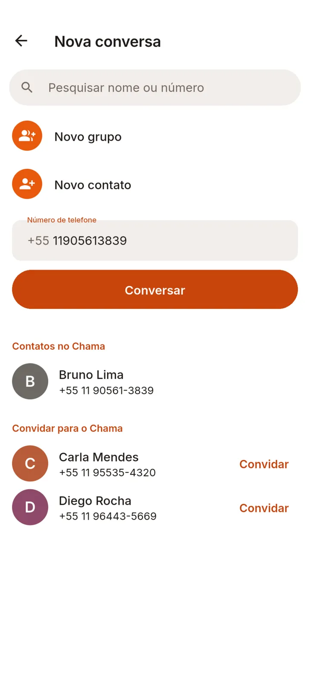
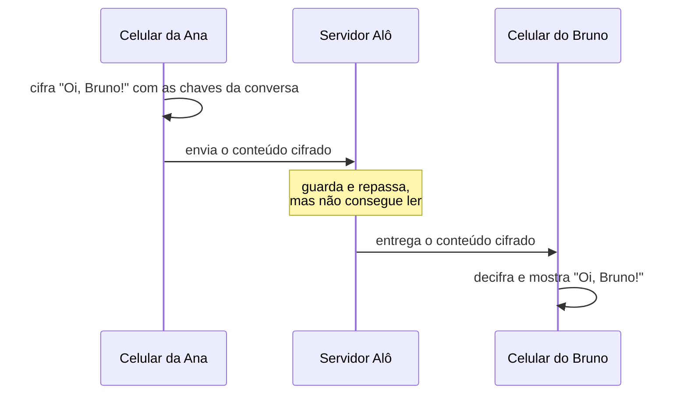
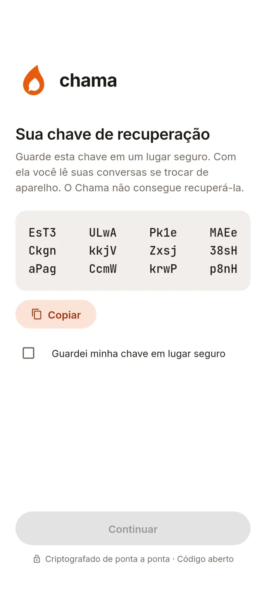
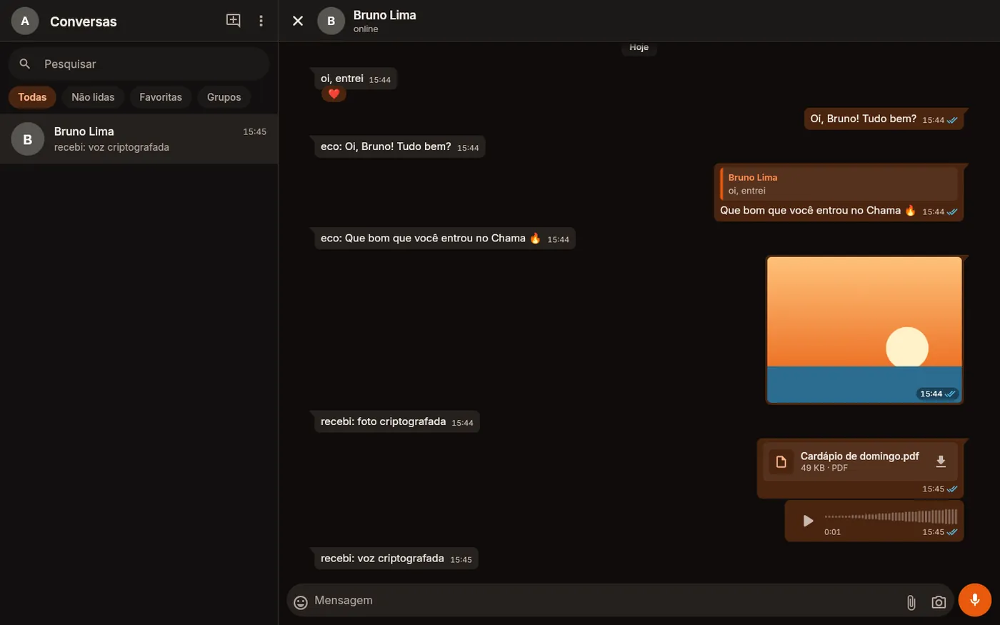
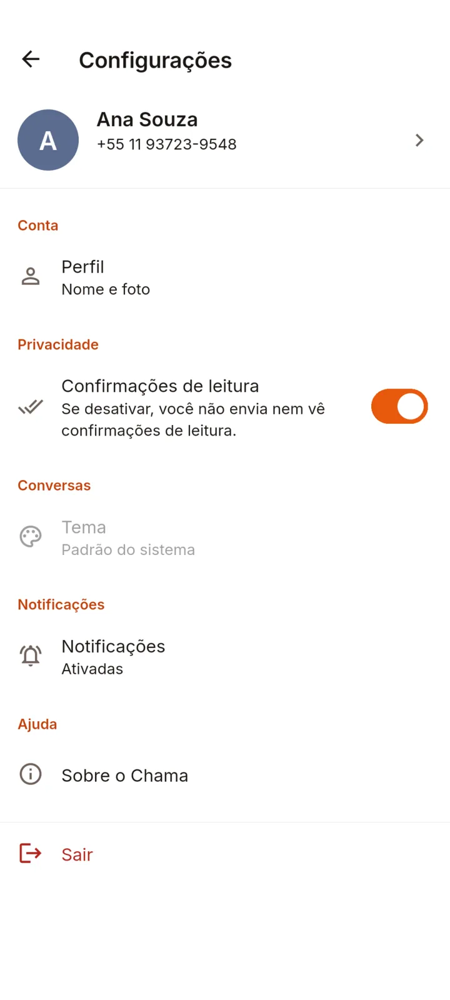

# Perguntas frequentes

Respostas diretas sobre o Alô, para quem usa, para quem quer apoiar e para quem só quer
entender. Quando uma resposta tem um "mas", ele está escrito aqui. Os detalhes técnicos ficam em
[segurança e privacidade](seguranca-e-privacidade.md) e na
[arquitetura](design/2026-10-24-architecture.md).

**Nesta página**

- [Sobre o Alô](#sobre-o-alô)
- [Privacidade e segurança](#privacidade-e-segurança)
- [Conta, número e celular](#conta-número-e-celular)
- [Aparelhos e plataformas](#aparelhos-e-plataformas)
- [Quem mantém e quem paga](#quem-mantém-e-quem-paga)
- [Bloqueios e falta de internet](#bloqueios-e-falta-de-internet)

---

## Sobre o Alô

### O que é o Alô?

Um aplicativo de mensagens gratuito e de código aberto, feito para o Brasil. Você entra com o
número do celular, encontra quem já está na sua agenda e conversa, sozinho ou em grupo, com
texto, fotos, documentos e mensagens de voz. Todas as conversas são criptografadas de ponta a
ponta: só quem participa da conversa consegue ler.

### É igual ao WhatsApp?

No uso do dia a dia, é parecido de propósito: lista de conversas, tiques azuis, mensagens de
voz, grupos, versão para o computador. Quem sabe usar o WhatsApp sabe usar o Alô.

As diferenças estão por trás:

| | WhatsApp | Alô |
|---|---|---|
| Dono | Uma empresa privada (Meta) | Ninguém em particular: código aberto, pensado para ser operado por instituições públicas ou sem fins lucrativos |
| Código | Fechado | Aberto (AGPL-3.0), qualquer pessoa pode auditar |
| Anúncios e uso de dados | Anúncios na aba Atualizações (desde 2025) e dados compartilhados com a Meta | Sem venda de dados. Anúncio nunca nas conversas; na Rede (planejada), só marcado e limitado (veja abaixo) |
| Algoritmo, feed ou recomendação | Há conteúdo recomendado em algumas áreas | Nada ranqueado em segredo. As conversas seguem só a ordem da última mensagem; na Rede (planejada), cada recomendação diz por que aparece e você escolhe o algoritmo |
| Protocolo | Fechado | Aberto (Matrix). Outros servidores compatíveis podem existir |
| Criptografia de ponta a ponta | Sim | Sim, em todas as conversas, sem exceção |

O Alô não usa código, marca, ícones, textos nem cores do WhatsApp, e não tem ligação com o
WhatsApp nem com a Meta.

### Consigo conversar com quem usa WhatsApp?

Não. São redes diferentes, e o WhatsApp não permite que outros aplicativos se conectem a ele.
Para conversar pelo Alô, a outra pessoa também precisa ter o Alô. O app ajuda nisso: na tela
de nova conversa, mostra quem da sua agenda já usa o Alô e tem um botão para convidar os
outros.

   
  "Contatos no Alô" e "Convidar para o Alô"

### Já posso usar?

Ainda não. O Alô está em desenvolvimento: o servidor, o app Android e a versão web já
funcionam no ambiente de testes, mas ainda não existe um servidor público nem o app nas lojas. O
lançamento depende da etapa M7 (produção), que inclui o envio de SMS de verdade e os testes de
carga. Veja o [roadmap](roadmap.md).

Quem é desenvolvedor já pode rodar tudo no próprio computador, seguindo o
[guia de desenvolvimento](desenvolvimento.md).

### Já tem ligação de voz e vídeo? Status? Canais?

Ainda não. Hoje o Alô tem conversas, grupos, fotos, documentos, mensagens de voz, reações,
respostas, edição e exclusão de mensagens. Status, canais, comunidades, enquetes e mensagens
temporárias vêm na etapa M5; ligações de voz e vídeo, na M6. As abas "Atualizações",
"Comunidades" e "Ligações" já aparecem no app com o aviso "em breve".

### E as abas Momentos, Rede e Voz que aparecem nos vídeos?

São um **protótipo**: telas que já dá para navegar no modo demonstração, com pessoas, posts e
políticos inventados, mas que ainda não estão ligadas a nenhum servidor. **Momentos** são
fotos e textos que somem em 24 horas, só para os seus contatos. **Rede** é um feed em que
cada recomendação diz por que aparece. **Voz** é um espaço de participação cidadã, do país ao
bairro. Há também o **Bem-estar**, contra o uso compulsivo, e o **Modo simples**, com letras
maiores e menos botões. Ainda não há data para virarem recursos de verdade; veja o
[roadmap](roadmap.md#abas-novas-protótipo).

---

## Privacidade e segurança

### O governo pode ler minhas mensagens?

**Não.** Cada mensagem é cifrada (embaralhada) no seu celular antes de sair dele, e só os
aparelhos das pessoas da conversa têm as chaves para abrir. O servidor guarda e repassa apenas
esse conteúdo embaralhado. Isso vale para qualquer pessoa ou órgão que tenha acesso ao servidor:
quem opera o servidor, um invasor ou um governo, inclusive quando o próprio operador for um
órgão público.

Se uma ordem judicial pedir as mensagens, o operador só tem como entregar o que guarda: texto
cifrado que ele não consegue abrir, mais os dados de uso descritos na próxima pergunta. Fotos,
documentos e mensagens de voz são cifrados do mesmo jeito. Até as notificações levam só um
identificador, nunca o texto; o celular busca a mensagem e a decifra sozinho.

O teste automático do projeto (`make smoke`) confere isso a cada execução: depois de enviar uma
mensagem, ele procura o texto dela no banco de dados do servidor e verifica que só existe a
versão cifrada.

**O que a criptografia não protege:** um celular desbloqueado nas mãos de outra pessoa, ou um
celular com vírus ou programa espião instalado. Nesses casos quem tem o aparelho vê o que você
vê na tela. Isso vale para qualquer mensageiro.

### Então o que o servidor sabe sobre mim?

Para entregar mensagens, todo servidor precisa saber algumas coisas. O Alô tenta guardar o
mínimo.

| O servidor **não** sabe | O servidor sabe |
|---|---|
| O texto das mensagens | Seu número de celular (para a entrada por SMS) |
| O conteúdo de fotos, documentos e áudios | Seu nome e foto de perfil, se você colocar |
| O que aparece nas notificações | De quais conversas e grupos você participa |
| | Quando você manda mensagens e o tamanho delas |
| | Seu endereço IP, apagado depois de 7 dias (regra do projeto) |
| | Quais números da sua agenda estão sendo conferidos no momento da busca de contatos (veja abaixo) |

Sobre a agenda: para mostrar quem já usa o Alô, o app manda ao servidor um resumo matemático
(hash) de cada número, e não o número em si. Mas como a quantidade de números de celular
possíveis é pequena, quem opera o servidor conseguiria descobrir os números a partir desses
resumos. O Alô não guarda nem registra esses resumos, mas isso é uma promessa do operador, não
uma garantia técnica. Antes de pedir acesso, o app explica que só envia os números em forma codificada (hash) e que
você pode negar. Sem o acesso, dá para iniciar conversas digitando o número. Um método de busca mais privado está planejado
antes do lançamento ([#7](https://github.com/kaiomp/alo/issues/7)).

### Quem administra o servidor pode ler minhas conversas?

Não, pelo mesmo motivo da pergunta sobre o governo: as chaves ficam só nos aparelhos. Essa é a
promessa central do Alô e precisa continuar verdadeira em todas as etapas. O operador pode
moderar conteúdo público (como os canais, quando existirem) e agir sobre denúncias, mas não lê
conversas privadas.

O que o operador **pode** fazer, e por isso o Alô se protege:

- **Tentar entrar na sua conta com o seu número.** Quem controla o SMS (o operador, ou um
  golpista que clonou seu chip) consegue fazer login, mas um aparelho novo não recebe nenhuma
  chave de mensagem até ser confirmado com a sua chave de recuperação. Se ele "redefinir" a
  conta para seguir sem a chave, todos os seus aparelhos são desconectados na hora (você
  percebe), ele não lê nenhuma mensagem antiga, e seus contatos veem o aviso "O código de
  segurança mudou".
- **Bloquear sua entrada.** Como o operador controla a entrada no servidor, ele pode impedir
  alguém de usar aquele servidor. A federação, explicada mais abaixo, espalha esse poder entre
  várias instituições, mas não o elimina dentro de cada servidor.

Mais proteções chegam na etapa M4: PIN da conta, lista de aparelhos conectados, aviso de "novo
aparelho" aos contatos e um alerta dentro da conversa para mensagens vindas de um aparelho não
confirmado ([#11](https://github.com/kaiomp/alo/issues/11)). Detalhes em
[segurança e privacidade](seguranca-e-privacidade.md).

### O servidor guarda minhas mensagens para sempre?

A decisão do projeto é que **não**: como no WhatsApp, o servidor vai guardar as mensagens e
mídias (cifradas) só até serem entregues, por no máximo 30 dias. O histórico fica nos celulares.
Menos dado guardado é menos dado para vazar, ser apreendido ou ser decifrado no futuro.

Esse limite ainda não está ligado: ele faz parte da etapa M5
([#12](https://github.com/kaiomp/alo/issues/12)). Hoje, no ambiente de desenvolvimento, o
servidor guarda as mensagens cifradas sem prazo.

### Tem algoritmo escolhendo o que eu vejo?

**Nas conversas, não.** A lista de conversas segue só a ordem da última atividade, sem
ranking, recomendação ou anúncio. Quando existirem canais (M5), eles também não terão
recomendação, e a busca será só por nome exato ou número.

**Na Rede, sim, mas nunca em segredo.** A Rede é o feed planejado do Alô (hoje só existe no
protótipo). A regra é que nada seja ranqueado às escondidas:

- cada post recomendado diz por que está ali ("Porque você segue…", "Perto de você",
  "Tema: comida"), e você pode pedir mais ou menos daquilo;
- em "Escolha seu algoritmo" você troca o algoritmo, inclusive por feeds feitos pela
  comunidade, e liga ou desliga temas;
- a aba **Seguindo** mostra só quem você segue, do mais novo ao mais antigo, e tem fim
  ("Você está em dia").

### Vai ter anúncio?

**Nas conversas e nos Momentos, nunca.** Na Rede (planejada), pode haver, com regras fixas:
marcado como "Patrocinado", no máximo 1 a cada 10 posts, escolhido só pelo tema do que você
está vendo, nunca pelo conteúdo das suas conversas, e sem rastrear você em outros apps ou
sites. Post pago por uma marca leva o selo "Parceria paga". E o Alô não vende dados de
ninguém.

### O código é aberto mesmo? Alguém confere?

Sim. Todo o código do servidor e do app está sob a licença AGPL-3.0, que obriga quem modificar e
oferecer o serviço a publicar as mudanças. A criptografia não foi inventada pelo projeto: vem do
padrão Matrix e da biblioteca vodozemac, que já passou por auditoria independente. Estão nos
planos auditorias independentes do próprio Alô, builds do Android que qualquer pessoa possa
reproduzir e relatórios de transparência do operador.

---

## Conta, número e celular

### Por que o Alô usa número de telefone?

Porque é assim que os brasileiros já se encontram: todo mundo tem a agenda do celular cheia de
números e sabe entrar num app com um código por SMS. Sem senha para esquecer, sem nome de
usuário para inventar.

Mas o número **não é** a sua identidade dentro do Alô. Cada conta tem um identificador
aleatório (algo como `@u7k3m5q2x4w6a2b5c:usealo.app`), e o número serve só para entrar e para seus
contatos acharem você. Isso tem duas vantagens:

- Seu número não fica gravado nos grupos e conversas.
- Se a operadora passar seu número antigo para outra pessoa, ela não herda suas conversas
  (próxima pergunta).

### E se eu trocar de número, ou a operadora der meu número antigo para outra pessoa?

As operadoras brasileiras repassam números cancelados para novos clientes depois de alguns
meses (a Anatel define uma quarentena mínima). No Alô:

- Se o número entrar de novo em até 45 dias desde o último uso, é a mesma conta (e o aparelho
  novo ainda precisa ser confirmado com a chave de recuperação).
- Se a conta ficou 45 dias sem nenhum aparelho ativo, quem entrar com aquele número recebe uma
  **conta nova e vazia**. A conta antiga é encerrada e os contatos veem que ela saiu, e também o
  aviso "O número de … agora é de outra conta". O novo dono do número não vê nada da conta
  antiga e não consegue se passar pelo dono anterior.

Mudar a conta para um número novo, mantendo as conversas, ainda não existe.

### O que acontece se eu perder o celular?

Depende de você ter guardado a **chave de recuperação**, que o app mostra quando você cria a
conta.

   
  A chave de recuperação é criada no seu celular. Só você tem.

| Situação | O que acontece |
|---|---|
| **Você tem a chave** | Recupere o chip com a operadora, instale o Alô no celular novo, entre com o número e o código do SMS e digite a chave. Suas conversas antigas voltam a ser lidas. |
| **Você não tem a chave** | Você entra com o número e o SMS e escolhe "Não tenho a chave". A conta continua (mesmos contatos e grupos), mas as mensagens antigas ficam ilegíveis no celular novo, os outros aparelhos da conta são desconectados e seus contatos veem "O código de segurança mudou". |

Ninguém, nem o operador do servidor, consegue recuperar a chave para você: é justamente isso
que impede outras pessoas de ler suas conversas.

Dois cuidados:

- **Quem achar o celular perdido** vê o que estiver na tela se o aparelho estiver desbloqueado.
  Use bloqueio de tela. Quando você entra no celular novo sem a chave, o aparelho perdido é
  desconectado. Com a chave, o aparelho antigo continua conectado; a opção de ver e remover
  aparelhos chega na etapa M4.
- **Com o limite de 30 dias no servidor** (planejado para a M5), um celular novo vai receber só
  as mensagens dos últimos 30 dias. Um backup cifrado controlado por você, para restaurar o
  histórico completo, será desenhado à parte ([#12](https://github.com/kaiomp/alo/issues/12)).

### Onde guardo a chave de recuperação?

Num lugar seguro e fora do celular: um gerenciador de senhas, um papel guardado em casa, um cofre.
Não mande a chave para ninguém e não a guarde em fotos ou conversas. Ninguém do Alô vai pedir
sua chave.

### Meu número aparece para todo mundo?

Seu número não aparece no seu identificador nem fica gravado nas conversas. Dentro do app, uma
pessoa aparece com o nome que você salvou na agenda ou, se não estiver salva, com o nome que ela
escolheu no perfil.

### Preciso dar acesso à minha agenda?

Não. O acesso serve só para mostrar quem da sua agenda já usa o Alô, com os nomes que você
salvou. Sem ele, você inicia conversas digitando o número. Antes de o Android pedir a permissão,
o app explica o que é enviado ao servidor.

---

## Aparelhos e plataformas

### Funciona no iPhone?

**Ainda não.** O app é feito com Flutter, uma tecnologia que gera apps para Android, iPhone,
navegador e computador a partir do mesmo código. Por isso uma versão para iPhone é possível sem
reescrever o app, mas ela vem depois do lançamento no Android e ainda não tem data.

### E no computador?

Sim, pelo navegador. A versão web mostra a lista de conversas e a conversa lado a lado, como o
WhatsApp Web. Hoje ela entra com o número e o código do SMS. Na etapa M4, vai dar para
conectar o computador lendo um QR code com o celular e ver o histórico já existente.

   
  Versão web em tela larga

Apps instalados para Windows, macOS e Linux também são possíveis com o mesmo código e vêm depois
do Android.

### Por que existem duas versões para Android?

| Versão | Onde baixar | Notificações |
|---|---|---|
| **F-Droid** | Loja F-Droid, só de software livre | Sem nenhum código do Google. As notificações precisam de um app UnifiedPush, como o ntfy. |
| **Google Play** | Google Play | Funcionam direto, pelo serviço de notificações do Google (FCM), sem instalar nada a mais. |

Nas duas, a notificação que sai do servidor leva só um identificador da mensagem, cifrado. O
Google ou o ntfy não veem o texto, nem quem mandou.

### Por que meu celular diz que preciso instalar o ntfy?

Você está com a versão F-Droid, que não usa os serviços do Google. Para receber notificações,
ela precisa de um app que entregue notificações de forma aberta (padrão UnifiedPush), como o
ntfy. Sem ele, o Alô funciona normalmente, mas você só vê mensagens novas com o app aberto. Em
Configurações → Notificações o app mostra se as notificações estão ativas.

   
  Configurações: "Notificações · Ativadas"

---

## Quem mantém e quem paga

### Quem faz o Alô?

O Alô é um projeto de código aberto, feito para ser operado por uma instituição pública ou sem
fins lucrativos. Qualquer pessoa pode ler o código, apontar problemas e contribuir. Para começar,
veja o [guia de contribuição](../CONTRIBUTING.md). Instituições e financiadores que queiram
apoiar ou operar um servidor encontram o caminho em [Como ajudar](../README.md#como-ajudar).

### Quem paga os servidores?

**Isso ainda não está definido.** O Alô ainda não tem um operador em produção. O modelo
pensado é este:

- **Sem venda de dados**, nunca, e **nenhum anúncio nas conversas**. O custo é de
  infraestrutura, e quem opera é uma instituição sem fins lucrativos ou pública, com apoio de
  parceiros e financiadores. As regras para anúncios na Rede (planejada) estão em
  [Vai ter anúncio?](#vai-ter-anúncio).
- **Os principais custos** são os servidores e o envio dos SMS de entrada (milhões de códigos
  custam dinheiro de verdade). O serviço de SMS foi feito para trocar de provedor sem mudar o
  app, para usar sempre o mais barato.
- **Custo dividido entre instituições.** Na proposta de federação, cada região do país teria seu
  próprio servidor, mantido por uma instituição diferente (universidade, instituto federal,
  governo estadual, ONG, cooperativa). A estimativa do projeto é de algo como US$ 2 a 5 mil por
  mês por região em plena escala, em vez de uma conta única grande.

Veja os números e as perguntas em aberto no [roadmap](roadmap.md) e na
[arquitetura](design/2026-10-24-architecture.md).

### Se uma instituição pública operar o Alô, ela não vira "dona" das conversas?

Não das conversas: elas são criptografadas e o operador não lê. O operador controla a entrada no
servidor (pode bloquear alguém) e a moderação de conteúdo público. Para que nenhuma instituição
tenha esse poder sobre o país inteiro, a proposta é a federação: vários servidores de
instituições independentes, conectados entre si, seguindo um regulamento comum
([#13](https://github.com/kaiomp/alo/issues/13)).

### Como funcionaria essa federação para quem usa?

De forma invisível. O app escolhe o servidor pelo **DDD** do seu número; você só digita o número,
como hoje. Conversas entre pessoas de regiões diferentes funcionam como qualquer outra. Se um
servidor falhar, for bloqueado ou agir mal, isso afeta só a região dele. É uma proposta, ainda com
perguntas em aberto (como uma busca de contatos compartilhada entre servidores e a mudança de
DDD). O padrão Matrix já permite isso, e as contas do Alô já foram desenhadas para não depender
de um servidor específico.

---

## Bloqueios e falta de internet

### Funciona sem internet?

Não, ainda não. Como o WhatsApp, o Alô precisa de internet (dados móveis ou Wi-Fi). Mensagens
enviadas sem conexão ficam com um reloginho enquanto o app tenta enviar (até 30 segundos); depois aparece um aviso
vermelho e basta tocar para tentar de novo. Sem conexão, o app mostra "Conectando…".

Um "modo sem internet", para celulares próximos trocarem mensagens por Bluetooth ou Wi-Fi Direct
em protestos, apagões ou bloqueios, está na lista de pesquisa para depois do lançamento
([#14](https://github.com/kaiomp/alo/issues/14)). Seria um complemento: uma rede só entre
celulares, sem servidor, não funciona bem como base para milhões de pessoas (celulares
desligados, bateria, atraso na entrega).

### E se a Justiça mandar bloquear o Alô, como já fez com o WhatsApp?

O WhatsApp foi bloqueado no país inteiro em 2015 e 2016, e o X em 2024. O Alô não tem uma
solução pronta para isso hoje. Duas ideias do projeto reduzem o risco:

- **Federação** ([#13](https://github.com/kaiomp/alo/issues/13)): com vários servidores de
  instituições diferentes, uma ordem contra um operador não derruba a rede toda.
- **Modo sem internet** ([#14](https://github.com/kaiomp/alo/issues/14)): celulares próximos
  continuariam conversando mesmo sem acesso à internet.

---

## Não achou sua pergunta?

- O que é o Alô e em que pé está: [README do projeto](../README.md) e [roadmap](roadmap.md).
- Segurança em detalhe: [segurança e privacidade](seguranca-e-privacidade.md).
- Como tudo funciona por dentro: [arquitetura](design/2026-10-24-architecture.md).
- Rodar e contribuir: [desenvolvimento](desenvolvimento.md); operar um servidor:
  [operação](operacao.md); serviço de entrada: [API do alo-id](alo-id-api.md).
- Todos os documentos: [índice da documentação](README.md).
