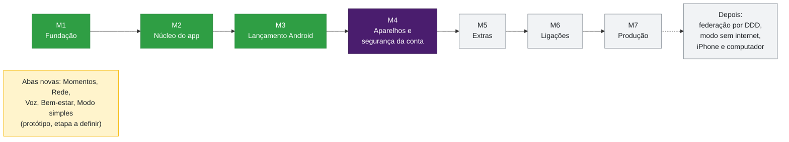
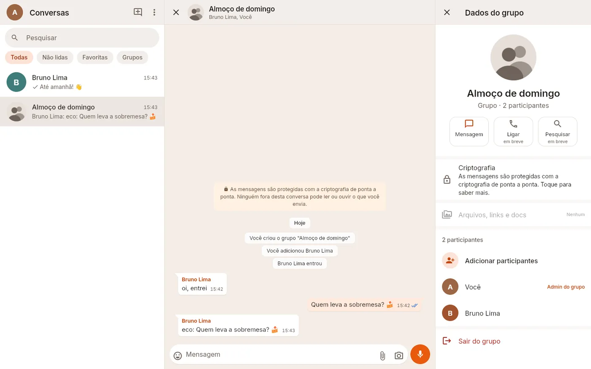
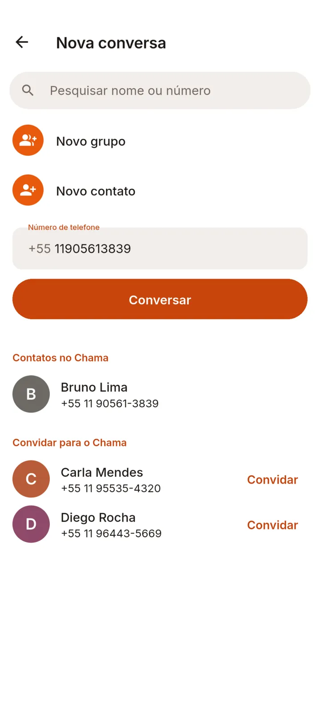
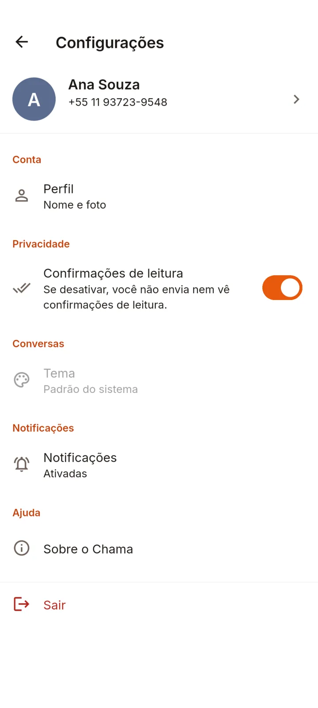
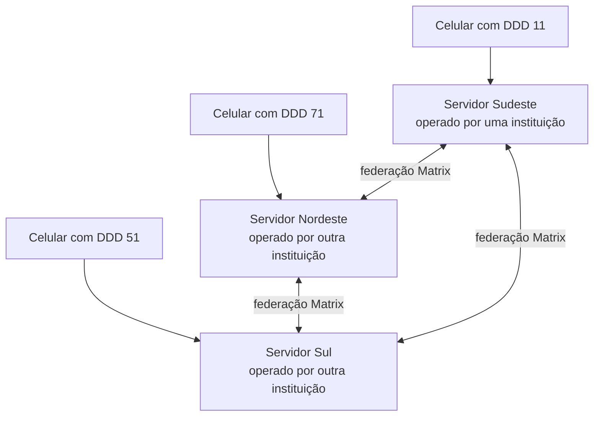

# Roadmap do Alô

O Alô é construído em sete etapas, chamadas de M1 a M7 (M de *milestone*, marco). Cada etapa
tem um critério claro de "pronto", conferido por um teste automático. As três primeiras já
estão concluídas: o servidor, o app Android e a versão web funcionam no ambiente de
desenvolvimento. A M4 está em andamento: a parte do servidor está pronta e faltam as telas do
app. O lançamento ao público vem com a M7.

Além das conversas, o app terá as abas **Momentos**, **Rede**, **Voz** e **Perfil** (com o
**Bem-estar**), mais o **Modo simples**. Hoje elas existem só como protótipo navegável, no
modo demonstração, e ainda não têm etapa definida (veja [Abas novas](#abas-novas-protótipo)).

Cada etapa tem uma *issue* (um registro de tarefa) no GitHub, com a lista do que falta.

Legenda: verde = concluída, roxo = em andamento, cinza = planejada, amarelo = só protótipo.

## Resumo

| Etapa | Situação | Pronto quando | Issue |
|---|---|---|---|
| M1 · Fundação | ✅ Concluída | `make up` sobe o servidor e um script faz dois usuários de teste entrarem com o código `000000` e trocarem uma mensagem criptografada. | — |
| M2 · Núcleo do app | ✅ Concluída | Teste integrado no Chrome e no emulador Android: o usuário do app conversa com um usuário de teste, vê os tiques ficarem azuis, envia foto e mensagem de voz. | [#1](https://github.com/kaiomp/alo/issues/1) |
| M3 · Lançamento Android | ✅ Concluída | Teste no emulador: o usuário Android conversa com um usuário web nos dois sentidos, e uma mensagem chega como notificação com o app em segundo plano. | [#2](https://github.com/kaiomp/alo/issues/2) |
| M4 · Aparelhos e segurança da conta | 🔨 Em andamento (servidor pronto, app por fazer) | A versão web, conectada lendo o QR code com o emulador, consegue ler o histórico anterior. | [#3](https://github.com/kaiomp/alo/issues/3), [#11](https://github.com/kaiomp/alo/issues/11) |
| M5 · Extras | ⏳ Planejada | Cada recurso tem um teste de ponta a ponta. | [#4](https://github.com/kaiomp/alo/issues/4) |
| M6 · Ligações | ⏳ Planejada | Dois clientes fazem uma ligação no ambiente local. | [#5](https://github.com/kaiomp/alo/issues/5) |
| M7 · Produção | ⏳ Planejada | Um teste de carga atinge as metas de escala (abaixo). | [#6](https://github.com/kaiomp/alo/issues/6) |
| Abas novas (Momentos, Rede, Voz, Perfil, Bem-estar, Modo simples) | 🧪 Protótipo | A definir. | — |

## Etapas concluídas

### M1 · Fundação ✅

A base do servidor, que sobe inteira com um único comando (`make up`).

- **Synapse**, o servidor Matrix, já organizado em *workers* (processos separados por tarefa)
  desde o primeiro dia: um principal, um para sincronização (`sync1`), um para mídia (`media1`)
  e, a partir da M3, um para notificações (`pusher1`). Em produção é o mesmo desenho, com mais
  cópias de cada um.
- **PostgreSQL** (banco de dados), **Redis** (comunicação entre os workers) e **Caddy** (proxy
  reverso, que encaminha cada pedido ao serviço certo e bloqueia a API de administração de
  fora).
- **alo-id**, o serviço de entrada pelo celular: código de 6 dígitos por SMS, contas com
  identificador aleatório (o número não faz parte do ID), troca automática de conta quando um
  número reciclado pela operadora entra de novo depois de 45 dias sem uso, limites contra
  abuso por número e por IP.
- **Teste de fumaça** (`make smoke`): dois usuários entram, um encontra o outro pelo número (busca de contatos por hash),
  trocam uma mensagem criptografada, e o teste confere que o banco do servidor guarda só texto
  cifrado.

### M2 · Núcleo do app ✅ · [#1](https://github.com/kaiomp/alo/issues/1)

O app Alô em Flutter, um único código para Android e web.

- Entrada por número e SMS, com a chave de recuperação criada no aparelho e a confirmação de um
  aparelho novo com essa chave. Quem perdeu a chave pode redefinir a identidade: as mensagens
  antigas ficam ilegíveis no aparelho novo, os outros aparelhos são desconectados e os
  contatos veem "O código de segurança mudou".
- Lista de conversas com filtros (Todas, Não lidas, Favoritas, Grupos), busca, fixar,
  arquivar, silenciar e contador de não lidas.
- Conversas individuais e em grupo: texto, respostas, reações, edição, apagar para todos ou
  para mim, tiques de envio, entrega e leitura, "digitando…", online e visto por último.
- Fotos, documentos e mensagens de voz, todos cifrados.
- Português do Brasil e inglês, temas claro e escuro, layout de tela larga na web (lista e
  conversa lado a lado).

   
  Versão web em três painéis: lista, conversa em grupo e dados do grupo

Pendências pequenas, que não impedem o uso, estão em
[#9](https://github.com/kaiomp/alo/issues/9).

### M3 · Lançamento Android ✅ · [#2](https://github.com/kaiomp/alo/issues/2)

O que faltava para o app Android ser usável no dia a dia.

- **Contatos:** o app lê a agenda (pedindo permissão e explicando o motivo antes), mostra quem
  já usa o Alô com o nome salvo e oferece convite para quem não usa. Só resumos (hashes) dos
  números saem do celular, cada número no máximo uma vez por dia.
- **Notificações:** o servidor manda só identificadores para o **Sygnal** (gateway de push),
  que entrega uma notificação cifrada ao app de notificações do usuário (ntfy, via UnifiedPush)
  ou, na versão Google Play, ao FCM. O celular busca a mensagem, decifra e mostra nome e texto.
  Dá para abrir a conversa e responder pela notificação. Conversas silenciadas não geram push.
- **Builds de release:** duas versões, `fdroid` (sem nenhum código do Google) e `play` (com
  FCM). APKs separados por tipo de processador, chave de assinatura lida do ambiente e nunca
  do repositório, e conexão só por HTTPS.

  
  &nbsp;&nbsp;
   
  Contatos no Alô e convites · Configurações com as notificações ativadas

Pendências pequenas estão em [#10](https://github.com/kaiomp/alo/issues/10).

## Etapa em andamento

### M4 · Aparelhos e segurança da conta 🔨 · [#3](https://github.com/kaiomp/alo/issues/3)

Usar o Alô em mais de um aparelho e proteger a conta contra quem tenta se passar pelo dono.
A parte do servidor está pronta e testada; as telas do app ainda não começaram.

| Recurso | Servidor (alo-id e Synapse) | App |
|---|---|---|
| **Conectar a versão web por QR code**, como os "Aparelhos conectados" do WhatsApp. O navegador mostra um QR code, o celular lê, e o computador recebe as chaves para ler o histórico. O alo-id só vê dados cifrados nesse processo, que expira em 2 minutos. | ✅ Rotas `/id/v1/link*` e tokens de login de uso único | ⏳ Por fazer |
| **Lista de aparelhos** conectados, com a opção de remover qualquer um. | ✅ Rota `/id/v1/devices/remove` | ⏳ Por fazer |
| **PIN da conta** (confirmação em duas etapas). Além de proteger a redefinição de identidade, impede que o número seja cadastrado de novo por 7 dias. | ✅ Rotas `/id/v1/pin/*`, bloqueio por tentativas, espera de 7 dias no "Esqueci meu PIN" | ⏳ Por fazer |
| **Aviso de "novo aparelho"** para os contatos. | — | ⏳ Por fazer |
| **Aviso na conversa** sobre mensagens vindas de um aparelho não verificado ou sem criptografia ([#11](https://github.com/kaiomp/alo/issues/11)). As notificações já escondem nome e texto nesses casos; a conversa ainda não marca essas mensagens. Isso fecha o caminho do golpe "troquei de número, me manda um PIX" feito com um chip clonado. | — | ⏳ Por fazer |

As rotas do servidor estão descritas na [API do alo-id](alo-id-api.md).

## Etapas planejadas

### M5 · Extras ⏳ · [#4](https://github.com/kaiomp/alo/issues/4)

Os recursos que completam a experiência do WhatsApp:

| Recurso | Como fica no Alô |
|---|---|
| Status | Fotos e textos que somem em 24 horas, vistos só pelos contatos. No protótipo, é a aba **Momentos** (veja abaixo). |
| Canais | Salas públicas em que só os administradores publicam, sem ranking de recomendação. |
| Comunidades | Vários grupos do mesmo assunto reunidos, como os da escola ou do bairro. |
| Enquetes e localização | Novos tipos de mensagem. |
| Mensagens temporárias | Mensagens que somem depois de um tempo escolhido. |
| Mensagens favoritas | Mensagens marcadas com estrela para achar depois. |
| Listas de transmissão | Enviar a mesma mensagem para vários contatos, cada um na sua conversa. |
| Privacidade | Controles de privacidade, como quem vê o seu "online" e o "visto por último". |
| Recado | O texto curto do perfil (o "recado" ou "sobre"). |

**Retenção mínima no servidor** ([#12](https://github.com/kaiomp/alo/issues/12)). Decisão já
tomada: como no WhatsApp, o servidor vai guardar as mensagens e mídias cifradas só até serem
entregues, por no máximo 30 dias. O histórico fica nos celulares. Menos dado guardado é menos
dado para vazar, ser apreendido ou decifrado no futuro, e a conta de armazenamento fica menor.
Aparelhos novos e a versão web passam a ver só os últimos 30 dias, e um backup cifrado
controlado pelo próprio usuário será desenhado à parte. Hoje esse limite ainda não está ligado
no servidor.

### Abas novas (protótipo)

O app vai além das conversas. As telas abaixo já existem e podem ser navegadas no
[modo demonstração](desenvolvimento.md#modo-demonstração-sem-servidor), com serviços falsos e
dados inventados. Nada delas está ligado a um servidor, e ainda não há etapa nem desenho
técnico definido para torná-las reais.

| Aba | Como deve ser | O que existe hoje |
|---|---|---|
| **Momentos** | Fotos e textos que somem em 24 horas, vistos só pelos contatos, criptografados de ponta a ponta como as conversas, sem anúncios. | Protótipo |
| **Rede** | Feed com duas abas. **Para você** recomenda, mas sempre diz por que cada post aparece ("Porque você segue…", "Perto de você", "Tema: comida") e tem "Mostrar mais/menos disso". **Escolha seu algoritmo** deixa a pessoa trocar o algoritmo (inclusive por feeds feitos pela comunidade) e os temas. **Seguindo** mostra só quem você segue, do mais novo ao mais antigo, e termina em "Você está em dia". Vídeos curtos (reels) começam sem som. Perfis de criadores e de negócios locais, selo "Parceria paga". Anúncios marcados "Patrocinado", no máximo 1 a cada 10 posts, escolhidos só pelo tema, nunca pelas conversas, sem rastrear a pessoa em outros apps e nunca nas conversas nem nos Momentos. | Protótipo; a regra de 1 anúncio a cada 10 itens já tem teste (`app/lib/feed/ads.dart`) |
| **Voz** | Participação cidadã do país ao bairro (Brasil → estado → cidade → bairro): representantes com dados abertos, consultas com identidade verificada e voto anônimo, abaixo-assinados, problemas do bairro com foto e apoio dos vizinhos, orçamento participativo. Apartidária: fatos com fonte, nada ordenado por relevância, nenhuma cor de partido. | Protótipo; políticos, projetos e números são fictícios e as telas mostram "Dados de exemplo" |
| **Perfil** | "Seus dados são seus": exportar tudo e levar os seguidores para outro servidor. | Protótipo |
| **Bem-estar** | Contra o uso compulsivo: a Rede tem fim, limite diário com cartão de pausa, Modo descanso, Resumo de notificações, curtidas escondidas, modo cinza. Sem sequências, medalhas ou culpa. | Protótipo |
| **Modo simples** | Para todas as idades: letras 25% maiores, só três abas (Conversas, Rede, Voz), botões maiores, sem animações decorativas. | Protótipo |

Perguntas em aberto para tornar essas abas reais: onde e como guardar posts e seguidores
sem quebrar a promessa de privacidade, como verificar que alguém mora num bairro sem expor a
identidade no voto, de onde vêm os dados abertos de cada nível de governo e como moderar
conteúdo público às claras.

### M6 · Ligações ⏳ · [#5](https://github.com/kaiomp/alo/issues/5)

Ligações de voz e vídeo, individuais e em grupo, com a mesma criptografia das mensagens. Usa o
padrão MatrixRTC com o servidor de mídia LiveKit e um servidor TURN (Coturn) para atravessar
redes que bloqueiam conexões diretas.

### M7 · Produção ⏳ · [#6](https://github.com/kaiomp/alo/issues/6)

Tudo o que é preciso para abrir o Alô ao público, com escala para milhões de pessoas desde o
primeiro dia.

- **SMS de verdade:** um adaptador para um provedor real (por exemplo Zenvia, Infobip, Twilio
  ou chamada rápida), trocável sem mudar o app. Milhões de códigos de entrada custam dinheiro,
  então o provedor mais barato precisa poder ser escolhido.
- **Infraestrutura:** alo-id em PostgreSQL com limites no Redis e várias cópias; mídia em
  armazenamento compatível com S3 atrás de uma CDN (que só vê dados cifrados); PgBouncer e
  réplicas do banco.
- **Monitoramento, guia de implantação e teste de carga.**
- **Busca de contatos mais privada** ([#7](https://github.com/kaiomp/alo/issues/7)). Os
  resumos (hashes) dos números não têm "sal", e como existem poucos números de celular
  possíveis, dá para reverter os resumos. Hoje a busca já exige login e tem limites por conta;
  antes do lançamento, o plano é avaliar um esquema de descoberta de contatos privada.

**Metas de escala dos primeiros meses:**

| Métrica | Meta |
|---|---|
| Contas | 5 milhões |
| Usuários ativos por dia | 1 milhão |
| Conexões simultâneas | 100 mil |
| Pico de mensagens | 2.000 por segundo |

Limite conhecido: uma única instalação do Synapse já foi comprovada com centenas de milhares de
usuários ativos, não com dezenas de milhões. Para ir além, a ideia é dividir os usuários entre
vários servidores Alô que se federam (veja abaixo).

## Trabalho contínuo

| Issue | O que é |
|---|---|
| [#8](https://github.com/kaiomp/alo/issues/8) | Inventário de recursos e telas do WhatsApp, ligado às etapas M2 a M7. Só comportamento e experiência de uso; nunca código, marca, ícones ou textos. |
| [#9](https://github.com/kaiomp/alo/issues/9) | Pendências pequenas da M2 (acabamento, testes, limites). |
| [#10](https://github.com/kaiomp/alo/issues/10) | Pendências pequenas da M3. |

## Depois do lançamento

### Federação invisível por DDD · [#13](https://github.com/kaiomp/alo/issues/13)

Proposta para que o Alô **não tenha um dono único**. Vários servidores regionais, cada um
operado por uma instituição brasileira independente (universidades e institutos federais,
governos estaduais, ONGs, cooperativas), todos seguindo um mesmo regulamento (retenção,
moderação, relatórios de transparência, segurança mínima).

O usuário nunca escolhe servidor: o app usa o **DDD** do número para decidir em qual servidor a
conta mora. Conversas entre regiões funcionam como qualquer outra conversa.

*As regiões e os DDDs do desenho são só um exemplo; a divisão real ainda não foi definida.*

- **Por quê:** um operador com problema (que falha, é bloqueado ou age mal) afeta só a sua
  região; o custo de hospedagem se divide, algo como US$ 2 a 5 mil por mês por região em plena
  escala, em vez de uma conta única grande; órgãos públicos podem participar sem ser donos da
  rede toda.
- **Já é compatível:** os IDs das contas são aleatórios e não contêm o número, então uma conta
  pode morar em qualquer servidor.
- **Perguntas em aberto:** um diretório de números compartilhado entre servidores (quem roda e
  como fica privado), mudança de DDD, a carga de grupos grandes que atravessam regiões e a
  governança do regulamento comum.
- **Limite honesto:** a federação espalha o poder, mas não protege os usuários de um servidor
  contra o operador daquele servidor, que ainda controla a entrada. A portabilidade de contas
  entre servidores é um objetivo para depois.

Detalhes na [arquitetura](design/2026-10-24-architecture.md), na seção sobre o modelo de federação.

### Modo sem internet · [#14](https://github.com/kaiomp/alo/issues/14)

A Justiça brasileira já bloqueou o WhatsApp no país inteiro (2015 e 2016) e o X (2024). Um modo
"sem internet" permitiria que celulares próximos continuassem trocando mensagens por Bluetooth
ou Wi-Fi Direct, em protestos, apagões ou bloqueios. É um tema de pesquisa para depois do
lançamento: bateria, descoberta de aparelhos próximos, reaproveitar a mesma criptografia,
repassar mensagens de celular em celular e uma experiência simples para quem não é da área
técnica. Uma rede só entre celulares, sem nenhum servidor, não serve como base para milhões de
pessoas (celulares desligados, bateria, atrasos na entrega); seria um complemento.

### iPhone e computador

O app é escrito em Flutter, que funciona em Android, iPhone, web e computador a partir do mesmo
código. Os lançamentos nas lojas de iPhone e de computador vêm depois do Android; ainda não há
data.
