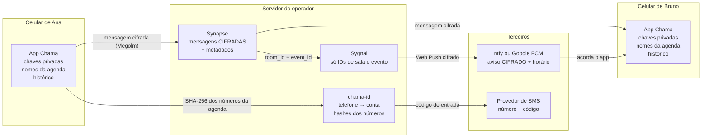
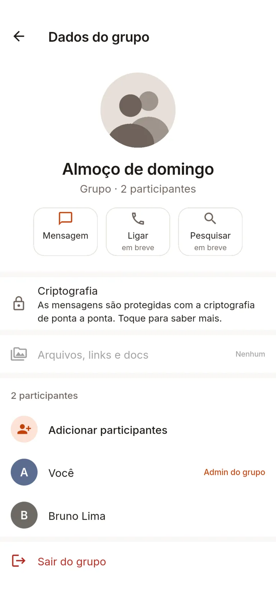
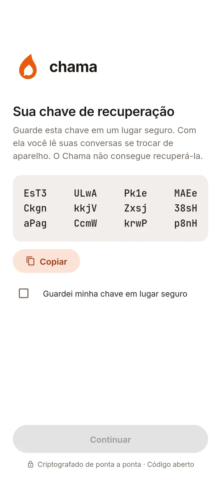
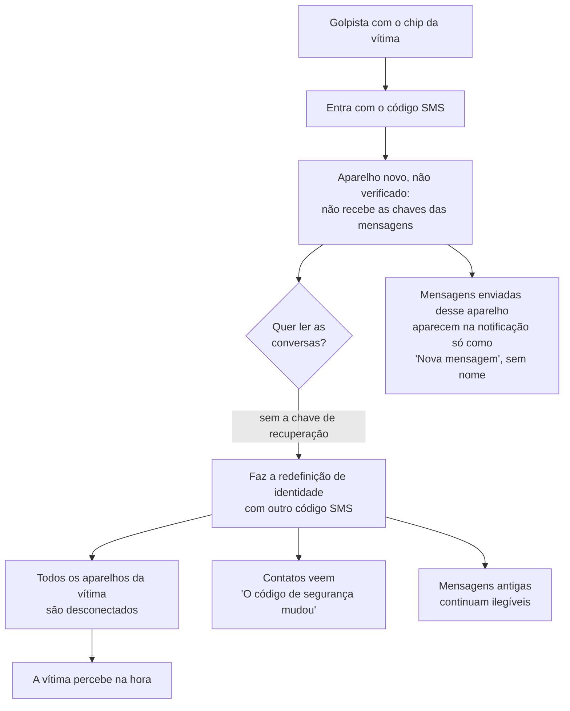

# Segurança e privacidade no Chama

Este documento explica, em linguagem simples, **o que o Chama protege, de quem, e onde estão
os limites**. Foi escrito para quem vai operar, financiar ou apoiar o Chama (instituições,
órgãos públicos, financiadores) e também para desenvolvedores. Os detalhes técnicos estão na
[arquitetura](design/2026-10-24-architecture.md) e na [API do chama-id](chama-id-api.md).

Situação: reflete o código depois da etapa M3 (2026-10-24). Onde algo ainda é plano, o texto diz em
qual marco ele entra.

## Resumo em uma frase

O conteúdo das conversas (texto, fotos, arquivos, áudios e os nomes salvos na agenda) fica só
nos aparelhos de quem conversa; **o operador do servidor não consegue ler**, mas consegue ver
**metadados**: quem tem conta, quem conversa com quem, em que grupos, e quando.

## Quem é quem

| Ator | Quem é | O que pode tentar |
|---|---|---|
| **Operador** | Quem roda o servidor do Chama (Synapse, chama-id, Sygnal). | Ler mensagens, entrar como alguém, mapear quem fala com quem. |
| **Provedor de SMS e operadora de celular** | Quem entrega o código de entrada. | Ver o número e o código; uma operadora pode transferir o número para outro chip. |
| **Distribuidor de push** | O ntfy (ou outro app UnifiedPush) ou o Google (FCM) no build da Play Store. | Ver quando chegam notificações para um aparelho. |
| **Golpista com SIM swap** | Alguém que consegue um chip com o número da vítima. | Entrar na conta da vítima e falar em nome dela (o golpe do "troquei de número, me faz um PIX"). |
| **Novo dono de um número reciclado** | Quem recebe da operadora um número que já foi de outra pessoa. | Herdar, sem querer, as conversas do dono anterior. |
| **Quem invade o servidor ou o apreende** | Atacante, ou uma ordem judicial. | Copiar tudo que está guardado no servidor. |

## Para onde vão os dados

O que atravessa o servidor em texto legível são os **metadados**: quem é membro de qual sala,
quando um evento foi enviado, o tamanho dos dados, e assim por diante. O **conteúdo** atravessa
sempre cifrado e só é decifrado nos aparelhos.

## O que o operador vê e o que não vê

| Dado | O operador vê? | Por quê |
|---|---|---|
| Texto das mensagens | **Não** | Cifrado de ponta a ponta (Megolm) no aparelho de quem envia. |
| Fotos, vídeos, arquivos, mensagens de voz | **Não** (só o tamanho e o horário do envio) | Anexos são cifrados antes do envio; o nome do arquivo e o tipo vão dentro da mensagem cifrada. |
| Emoji de uma reação | **Não** | O Chama coloca o emoji dentro da parte cifrada. O servidor vê só que alguém reagiu a uma mensagem. |
| Nomes salvos na agenda | **Não** | Nunca saem do celular. O mapa número → conta fica no armazenamento seguro do sistema. |
| Conteúdo das notificações | **Não** | O push leva só os IDs da sala e do evento (`event_id_only`); o celular busca e decifra a mensagem. |
| Confirmações de entrega (✓✓ cinza) | **Não** o conteúdo; vê que houve uma | Vão como mensagem cifrada (Olm) direto entre aparelhos. |
| Chaves privadas e chave de recuperação | **Não** | Criadas no aparelho; só as chaves públicas vão para o servidor. |
| Número de telefone de cada conta | **Sim** | O chama-id guarda `telefone → conta` para a entrada e para a busca de contatos. |
| Quem conversa com quem, e em quais grupos | **Sim** | A participação nas salas é estado do Matrix, sem criptografia. |
| Quando cada mensagem foi enviada, e de qual conta | **Sim** | O servidor precisa disso para ordenar e entregar. |
| Nome e foto do perfil, nome e foto dos grupos | **Sim** | São campos de perfil e de estado da sala no Matrix, sem criptografia de ponta a ponta. |
| Qual mensagem responde ou edita qual | **Sim** | A ligação entre mensagens (`m.relates_to`) fica fora da parte cifrada, como exige o Matrix. |
| Leitura (✓✓ azul), "digitando…", online | **Sim** | São sinais do Matrix que passam pelo servidor. Com as confirmações de leitura desligadas, o recibo vira privado: o servidor ainda vê, os contatos não. |
| Endereço IP | **Sim**, por até 7 dias | O Synapse apaga os registros de IP depois de 7 dias (`user_ips_max_age: 7d`). |
| Números da agenda de quem usa a busca de contatos | **Pode descobrir** | Vão como hash SHA-256, que pode ser revertido (ver "Limites conhecidos"). O chama-id não guarda nem registra esses hashes, mas isso é uma promessa do operador, não uma garantia técnica. |

## Proteções

### 1. Nenhuma conversa sem criptografia

Toda sala é criada com criptografia, e o servidor liga a criptografia por padrão. Se o app
encontrar uma conversa sem criptografia, liga a criptografia quando pode; quando não pode,
mostra "Esta conversa não é criptografada. O Chama não envia mensagens nela." e não envia nada,
nem por resposta rápida na notificação.

<em>Dados do grupo: participantes, administrador e o aviso de criptografia.</em>

### 2. Chaves só para aparelhos verificados

Entrar com o código SMS **não basta para ler mensagens**. Um aparelho novo só recebe as chaves
das mensagens depois de provar que é do dono, com a chave de recuperação (e, a partir da etapa M4,
também por outro aparelho do mesmo dono). O app nunca compartilha chaves com aparelhos não
verificados (`ShareKeysWith.crossVerifiedIfEnabled`). Isso vale contra o golpista do SIM swap
e contra o próprio operador, que controla a entrada e poderia entrar como qualquer pessoa.

### 3. Aviso de "código de segurança mudou"

Cada app guarda a última chave mestra vista de cada contato. Quando ela muda (por exemplo, num
redefinição de identidade), o app grava "O código de segurança de {nome} mudou" em todas as conversas
com essa pessoa. A comparação é feita **no aparelho**, então o operador não consegue esconder o
aviso.

<em>A chave de recuperação é gerada no aparelho e só o usuário a guarda.</em>

### 4. A redefinição de identidade desconecta os outros aparelhos

Quem perdeu o celular e a chave de recuperação pode redefinir a identidade com um segundo código
SMS. A redefinição **desconecta todos os outros aparelhos da conta**. Assim, um golpista que fizer a
redefinição depois de um SIM swap derruba o dono verdadeiro, que percebe na hora, e os contatos
recebem o aviso de código de segurança. As mensagens antigas continuam ilegíveis no aparelho
novo.

### 5. Números reciclados

O ID da conta é aleatório (`@u` + 16 caracteres) e não contém o número. Se um número entra e a
conta ligada a ele está parada há 45 dias, o chama-id desativa a conta antiga e cria uma nova:
quem recebeu o número da operadora não herda as conversas e os grupos do dono anterior. Nos
celulares dos contatos, o nome salvo não passa para a conta nova, e as conversas com a conta
antiga avisam "O número de {nome} agora é de outra conta".

### 6. Notificações sem conteúdo

O servidor manda ao Sygnal só os IDs da sala e do evento. O Sygnal cifra esse aviso com Web Push
para as chaves do aparelho. O distribuidor (ntfy, ou o Google no build da Play Store) vê só dados
cifrados e o horário. O celular busca e decifra a mensagem e só então mostra nome e texto, e só
se a mensagem veio cifrada de um aparelho que o remetente verificou. Caso contrário, a
notificação diz apenas "Nova mensagem". Conversas silenciadas não geram push.

### 7. Dados guardados no celular

No Android, o banco local do app é cifrado (SQLCipher), com a chave no armazenamento seguro do
sistema. O mapa número → conta da agenda também fica no armazenamento seguro.

### 8. Pouca retenção no servidor

- Registros de IP: apagados depois de 7 dias (configurado).
- Hashes enviados na busca de contatos: não são guardados nem registrados; o chama-id guarda só
  uma contagem por conta para o limite diário.
- Códigos SMS: guardados só como hash; valem 5 minutos e são apagados quando usados (um código
  não usado pode ficar no banco por mais de 24 horas).
- Mensagens e mídia: **decidido** guardar só até a entrega, no máximo 30 dias, com o histórico
  vivendo nos celulares ([issue #12](https://github.com/kaiomp/chama/issues/12), M5). **Ainda não
  está configurado:** hoje o servidor guarda as mensagens cifradas sem prazo.

### 9. Defesas da entrada

- Sem senhas: só o chama-id emite logins, com um bilhete (JWT) que vale 120 segundos.
- Limites contra tentativa e erro: 5 tentativas por código, 10 erros por número por dia,
  5 códigos por número por dia, 10 pedidos de código por IP por hora.
- O modo de desenvolvimento, que aceita o código `000000`, só liga em servidores com nome
  `.test` ou `.localhost`.
- A API de administração do Synapse é bloqueada para quem vem de fora.

### 10. Transparência

Código aberto sob AGPL-3.0 (inclusive os forks continuam abertos). Estão previstos auditorias
independentes, builds Android reproduzíveis e relatórios de transparência.

## Limites conhecidos

Nenhum sistema protege contra tudo. Estes são os limites que conhecemos hoje, com o que já
reduz cada risco e o plano.

| Limite | O que significa | O que já ajuda | Plano |
|---|---|---|---|
| **Metadados visíveis** | O operador sabe quem tem conta, quem conversa com quem, em quais grupos e quando. Nomes e fotos de perfil e de grupos não são cifrados. | Registros de IP por 7 dias; retenção curta decidida. | Retenção de 30 dias (M5). Metadados são inerentes ao modelo com servidor; a federação (seção 13 da arquitetura) evita que um único operador veja tudo. |
| **Hashes de contatos podem ser revertidos** | Há poucos números de celular possíveis, então um hash SHA-256 pode ser revertido testando todos. O operador pode ver quais números estão na agenda de um usuário durante a consulta. Quem tiver muitas contas verificadas pode testar 10.000 números por conta por dia para descobrir quem usa o Chama. | Consultas exigem conta verificada por SMS; 30 consultas por hora e 10.000 hashes por dia por conta; os hashes não são guardados. Listar todos os celulares do Brasil exigiria centenas de milhares de contas-dia, cada uma com seu próprio chip. | Descoberta privada de contatos (por exemplo, enclave seguro ou interseção privada de conjuntos), [issue #7](https://github.com/kaiomp/chama/issues/7), M7. |
| **SIM swap até o PIN da etapa M4** | Com o chip da vítima, um golpista entra na conta. Sem a chave de recuperação ele não lê nada, mas pode fazer a redefinição de identidade e passar a falar em nome da vítima dali em diante. | A redefinição derruba os aparelhos da vítima e mostra "código de segurança mudou" aos contatos; mensagens antigas continuam protegidas. | PIN da conta (verificação em duas etapas, que também bloqueia o novo registro do número por 7 dias), [issue #3](https://github.com/kaiomp/chama/issues/3), M4. |
| **Mensagens de aparelho não verificado aparecem normalmente na conversa** | Um aparelho que entrou só com SMS (SIM swap ou operador) não lê nada, mas pode enviar mensagens. A notificação já esconde nome e texto, mas dentro da conversa a mensagem aparece como as outras. Hoje o dono também não recebe aviso de "aparelho novo". | Notificação genérica "Nova mensagem" para esses casos. | Aviso na conversa ("Enviada por um aparelho não verificado"), [issue #11](https://github.com/kaiomp/chama/issues/11), e avisos de aparelho novo, M4. |
| **O operador controla a entrada** | Quem roda o chama-id pode emitir logins e, mexendo no próprio servidor, instalar chaves novas numa conta ou incluir um participante falso num grupo. | Esses ataques deixam rastro que o servidor não esconde: "código de segurança mudou" (comparação local) e o aviso de "entrou" no grupo. O operador também pode bloquear usuários. | Avisos de aparelho novo e PIN (M4); federação para não depender de um único operador. |
| **Lei de outro país, se hospedado em nuvem dos EUA** | O CLOUD Act (lei dos EUA de 2018) permite que autoridades dos EUA exijam dados de empresas americanas, mesmo guardados fora dos EUA. Num servidor em AWS, Google Cloud ou Azure, inclusive na região de São Paulo, os metadados e as mensagens cifradas podem ser entregues. O conteúdo continua cifrado. | A criptografia de ponta a ponta protege o conteúdo em qualquer hospedagem. | Recomendação para operadores: hospedar em infraestrutura própria ou de provedores sob jurisdição brasileira. |
| **Retenção ainda não configurada** | Hoje o servidor guarda as mensagens cifradas sem prazo. Se um dia uma chave vazar, mais histórico estaria exposto. | Conteúdo cifrado; registros de IP por 7 dias. | Retenção de 30 dias, [issue #12](https://github.com/kaiomp/chama/issues/12), M5. |
| **Web: dados locais sem cifra própria** | Na web, o app guarda dados e chaves no IndexedDB do navegador, sem a cifra extra que o Android tem (SQLCipher). | A proteção é a do perfil do navegador e do computador. | Vinculação da web pelo QR (M4). Para computadores compartilhados, sair da conta ao terminar. |
| **Push no build da Play Store passa pelo Google** | O Google não vê o conteúdo (vai cifrado), mas vê quando um aparelho recebe notificações. | Conteúdo cifrado; o build F-Droid não usa nenhum serviço do Google. | — |
| **Reciclagem de número: caso raro** | Quem saiu da conta e ficou de 8 a 45 dias sem abrir o app, com a última entrada há mais de 45 dias, pode ganhar uma conta nova ao voltar. | A regra protege o caso comum (número repassado pela operadora). | O PIN da etapa M4 impede a troca automática para quem tiver PIN. |
| **Registros de acesso e a lei brasileira** | O Marco Civil da Internet (art. 15) exige que provedores de aplicação com fins econômicos guardem registros de acesso por 6 meses. Um operador sem fins lucrativos pode não se enquadrar, mas isso precisa ser confirmado. | — | Cada operador deve confirmar com sua assessoria jurídica antes do lançamento. |

## O que cada pessoa pode fazer

**Usuários**

- Guarde a chave de recuperação fora do celular (papel, gerenciador de senhas). Sem ela, um
  celular novo não recupera as conversas antigas.
- Se aparecer "O código de segurança de {nome} mudou" e logo depois um pedido de dinheiro,
  confirme por outro meio (ligação, pessoalmente) antes de qualquer PIX.
- Se você for desconectado do Chama sem ter feito nada, alguém pode ter entrado com o seu
  número. Entre de novo e fale com a sua operadora.

**Operadores e instituições parceiras**

- Não mudar o comportamento de segurança do código (por exemplo, compartilhar chaves com
  aparelhos não verificados). Os apps oficiais seguem o código aberto.
- Manter a retenção curta (IPs por 7 dias, mensagens até 30 dias quando a etapa M5 entrar).
- Preferir hospedagem sob jurisdição brasileira.
- Publicar relatórios de transparência e permitir auditorias independentes.

## Referências

- [Arquitetura do Chama](design/2026-10-24-architecture.md), principalmente as seções 4
  (identidade), 5 (criptografia), 6 (contatos e push) e 13 (federação).
- [API do chama-id](chama-id-api.md), inclusive a seção sobre a privacidade da busca de contatos.
- [README do app](../app/README.md): contatos, notificações push e builds de release.
- Issues abertas de segurança: [#3 PIN e vinculação](https://github.com/kaiomp/chama/issues/3),
  [#7 hashes de contatos](https://github.com/kaiomp/chama/issues/7),
  [#11 aviso de aparelho não verificado](https://github.com/kaiomp/chama/issues/11),
  [#12 retenção](https://github.com/kaiomp/chama/issues/12).
