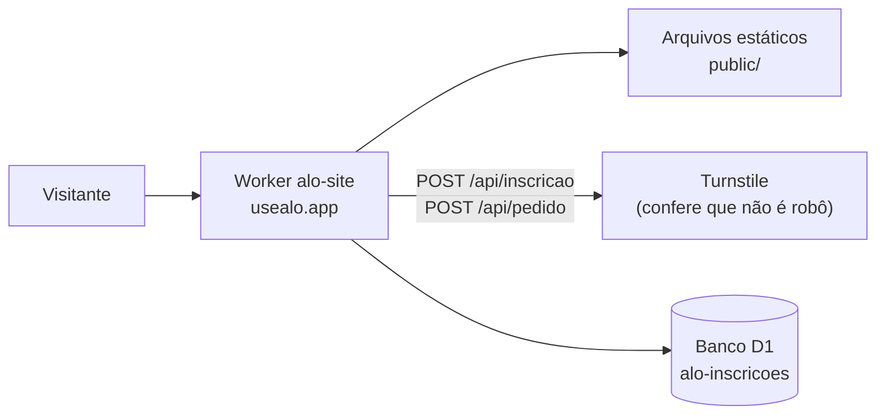

# Site do Alô (usealo.app)

O site público do Alô: uma página principal, **Como funciona** e **Privacidade**, mais o
formulário **Quero ajudar**. Tudo roda num único *Worker* da Cloudflare (um pequeno programa
que roda na rede da Cloudflare), que entrega os arquivos estáticos e recebe os formulários.



Sem *framework*: HTML, CSS e um pouco de JavaScript. Sem cookies de rastreamento e sem
ferramentas de análise de audiência.

## Estrutura

| Caminho | O que é |
|---|---|
| `public/` | O site: `index.html`, `como-funciona.html`, `privacidade.html`, `404.html` |
| `public/config.js` | Configurações que você muda à mão (link da comunidade) |
| `public/css/site.css` | Todo o estilo. As cores da marca estão no topo, em `:root` |
| `public/js/site.js` | Vídeo, link da comunidade e envio dos formulários |
| `public/img/`, `public/video/`, `public/fonts/` | Telas do app (webp), vídeo, fonte Inter |
| `src/worker.ts` | Redireciona `www` e `http`, recebe os formulários, põe os cabeçalhos de segurança |
| `src/validar.ts` | Regras de cada campo (tamanhos, formatos) |
| `src/intervalo.ts` | Entrega o vídeo em pedaços, como o iPhone exige |
| `migrations/` | Tabelas do banco D1 |
| `test/` | Testes (`pnpm --filter alo-site test`) |

## Rodar no computador

```sh
cd site
printf 'TURNSTILE_SECRET=1x0000000000000000000000000000000AA\n' > .dev.vars   # chave de teste pública, sempre aprova
wrangler d1 migrations apply alo-inscricoes --local
wrangler dev
```

Abra `http://localhost:8787`. Em `localhost` o site usa a chave de teste do Turnstile, então o
formulário funciona sem verificação de verdade, e grava num banco local (`site/.wrangler/`).

## Publicar

```sh
cd site
pnpm --filter alo-site test   # ou: node --test test/
wrangler deploy
```

O `wrangler deploy` envia os arquivos de `public/` e o Worker, e liga os domínios `usealo.app`
e `www.usealo.app` (o `www` redireciona para `usealo.app`).

## Ligar o botão da comunidade no WhatsApp

1. Abra `public/config.js`.
2. Cole o link de convite em `comunidade`, entre aspas:
   ```js
   comunidade: 'https://chat.whatsapp.com/SEU-CONVITE',
   ```
3. Rode `wrangler deploy`.

Com o campo vazio, o site mostra "Comunidade no WhatsApp: em breve". Com o link, aparece o
botão amarelo **Entrar na comunidade no WhatsApp**.

## Trocar o vídeo (por exemplo, a versão com narração)

O site usa `public/video/visao-geral.mp4` (vertical, 720×1280) e a imagem de capa
`public/video/poster.webp`. Para trocar, gere o arquivo novo com o **mesmo nome** e publique:

```sh
ffmpeg -i NOVO-VIDEO.mp4 -vf scale=720:1280 -c:v libx264 -preset slow -crf 26 \
  -maxrate 1200k -bufsize 2400k -pix_fmt yuv420p -c:a aac -b:a 96k \
  -movflags +faststart site/public/video/visao-geral.mp4 -y
cd site && wrangler deploy
```

Mantenha o arquivo abaixo de 10 MB (o atual tem 5,9 MB). O navegador guarda o vídeo por até
1 hora, então quem já viu pode levar esse tempo para receber a versão nova.

## Ler as inscrições

```sh
cd site
wrangler d1 execute alo-inscricoes --remote --json \
  --command "SELECT id, criado_em, nome, email, whatsapp, ajuda, cidade, mensagem FROM inscricoes ORDER BY id"
```

Para uma planilha, troque por `--command "SELECT ..."` e salve a saída: `... --json > inscricoes.json`.
Esse arquivo tem dados pessoais: não envie para o Git nem deixe em pastas compartilhadas.

## Pedidos de privacidade (ver, corrigir, apagar)

O formulário da página **Privacidade** grava na tabela `pedidos`. Mensagem vazia quer dizer
"apagar tudo". A página promete resposta em até 15 dias.

```sh
wrangler d1 execute alo-inscricoes --remote --json --command "SELECT * FROM pedidos ORDER BY id"
# apagar os dados de uma pessoa (confira o contato antes):
wrangler d1 execute alo-inscricoes --remote \
  --command "DELETE FROM inscricoes WHERE email = 'pessoa@exemplo.com' OR whatsapp = '5581999999999'"
wrangler d1 execute alo-inscricoes --remote --command "DELETE FROM pedidos WHERE id = 1"
```

## Proteção contra abuso

- **Turnstile** (verificação anti-robô da Cloudflare), modo "gerenciado": a maioria das pessoas
  não vê nada; só aparece uma caixinha quando a Cloudflare desconfia. O *sitekey* público está em
  `public/js/site.js`; o segredo fica só no Worker (`wrangler secret put TURNSTILE_SECRET`).
- **Limite de envios:** 5 por minuto por endereço IP. O IP é usado em forma de resumo só para
  contar, e nunca é gravado.
- **Tamanhos:** cada campo tem um limite (veja `src/validar.ts`) e o pedido inteiro, 10 KB.

## Mudou o texto da Privacidade?

Atualize a data no fim de `privacidade.html` e a constante `POLITICA` em `src/validar.ts`. Cada
inscrição guarda a versão que a pessoa aceitou.
