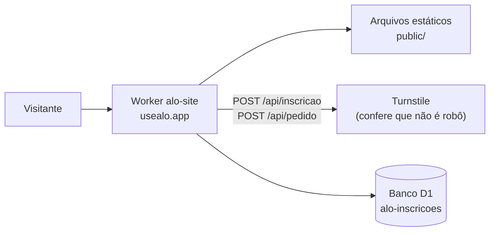

# Site do Alô (usealo.app)

O site público do Alô: uma página principal, **Como funciona** e **Privacidade**, mais o
formulário **Quero ajudar**, que também tem página própria para compartilhar:
`https://usealo.app/participe` (os endereços `/ajudar`, `/vem`, `/time`, `/quero-ajudar` e
`/form` levam para ela). Tudo roda num único *Worker* da Cloudflare (um pequeno programa
que roda na rede da Cloudflare), que entrega os arquivos estáticos e recebe os formulários.



Sem *framework*: HTML, CSS e um pouco de JavaScript. Sem cookies de rastreamento e sem
ferramentas de análise de audiência.

## Estrutura

| Caminho | O que é |
|---|---|
| `public/` | O site: `index.html`, `como-funciona.html`, `privacidade.html`, `404.html` |
| `public/config.js` | Configurações que você muda à mão (link da comunidade) |
| `public/css/site.css` | Todo o estilo. As cores da marca estão no topo, em `:root` |
| `public/js/site.js` | Vídeo, link da comunidade e envio dos formulários |
| `public/img/`, `public/video/`, `public/fonts/` | Telas do app (webp), vídeo, fonte Inter |
| `src/worker.ts` | Redireciona `www` e `http`, recebe os formulários, põe os cabeçalhos de segurança |
| `src/validar.ts` | Regras de cada campo (tamanhos, formatos) |
| `src/intervalo.ts` | Entrega o vídeo em pedaços, como o iPhone exige |
| `src/convite.ts`, `src/imagem.ts` | Links de convite (`/convite?de=Ana`) e a imagem de prévia gerada na hora |
| `og/modelo.html`, `og/gerar.sh` | Modelo e gerador das imagens de prévia fixas (`public/img/og-*.jpg`) |
| `migrations/` | Tabelas do banco D1 |
| `test/` | Testes (`pnpm --filter alo-site test`) |

## Rodar no computador

```sh
cd site
printf 'TURNSTILE_SECRET=1x0000000000000000000000000000000AA\n' > .dev.vars   # chave de teste pública, sempre aprova
wrangler d1 migrations apply alo-inscricoes --local
wrangler dev
```

Abra `http://localhost:8787`. Em `localhost` o site usa a chave de teste do Turnstile, então o
formulário funciona sem verificação de verdade, e grava num banco local (`site/.wrangler/`).

## Publicar

```sh
pnpm install                  # na raiz do repositório, uma vez (traz o @resvg/resvg-wasm)
cd site
pnpm --filter alo-site test   # ou: node --test test/
wrangler deploy
```

O `wrangler deploy` envia os arquivos de `public/` e o Worker, e liga os domínios `usealo.app`
e `www.usealo.app` (o `www` redireciona para `usealo.app`).

## Ligar o botão da comunidade no WhatsApp

1. Abra `public/config.js`.
2. Cole o link de convite em `comunidade`, entre aspas:
   ```js
   comunidade: 'https://chat.whatsapp.com/SEU-CONVITE',
   ```
3. Rode `wrangler deploy`.

Com o campo vazio, o site mostra "Comunidade no WhatsApp: em breve". Com o link, aparece o
botão amarelo **Entrar na comunidade no WhatsApp**.

## Trocar o vídeo (por exemplo, a versão com narração)

O site usa `public/video/visao-geral.mp4` (vertical, 720×1280) e a imagem de capa
`public/video/poster.webp`. Para trocar, gere o arquivo novo com o **mesmo nome** e publique:

```sh
ffmpeg -i NOVO-VIDEO.mp4 -vf scale=720:1280 -c:v libx264 -preset slow -crf 26 \
  -maxrate 1200k -bufsize 2400k -pix_fmt yuv420p -c:a aac -b:a 96k \
  -movflags +faststart site/public/video/visao-geral.mp4 -y
cd site && wrangler deploy
```

Antes do `wrangler deploy`, aumente o número em `visao-geral.mp4?v=3` no `public/index.html`
(por exemplo, `?v=4`), para que quem já visitou o site receba o vídeo novo na hora. Mantenha o
arquivo abaixo de 10 MB (o atual, com narração e música, tem 6,2 MB).

## Vídeos curtos dos cartões

Cada parte (na página inicial e em **Como funciona**) mostra um vídeo curto, sem som, em
loop, recortado só na tela do celular: `public/video/partes/<nome>.webm` (AV1, menor),
`<nome>.mp4` (H.264, para quem não tem AV1) e `<nome>.webp` (capa).

Como os vídeos se comportam:

- começam sozinhos, sem som, quando aparecem na tela, e pausam quando saem, como num feed;
- no máximo 2 cartões tocam ao mesmo tempo (os mais visíveis);
- só baixam quando tocam pela primeira vez (`preload="none"`);
- com **movimento reduzido** ligado no aparelho ou com **economia de dados**, nada começa
  sozinho: fica a capa, e o vídeo de 90 segundos mantém o botão de tocar.

Para gerar de novo a partir de `pitch/out/` (exemplo: Conversas, de 7,5 s a 15,5 s):

```sh
cd site/public/video/partes
V="crop=568:1304:256:496,setsar=1"   # a área da tela do celular nos vídeos 1080x1920
ffmpeg -ss 7.5 -to 15.5 -i ../../../../pitch/out/conversa.mp4 -an -vf "$V" -c:v libx264 -preset slow \
  -crf 27 -maxrate 1100k -bufsize 2200k -pix_fmt yuv420p -movflags +faststart conversas.mp4 -y
ffmpeg -ss 7.5 -to 15.5 -i ../../../../pitch/out/conversa.mp4 -an -vf "$V" -c:v libsvtav1 -preset 5 \
  -crf 40 -pix_fmt yuv420p conversas.webm -y
ffmpeg -ss 7.5 -i ../../../../pitch/out/conversa.mp4 -vf "$V" -frames:v 1 conversas.png -y \
  && cwebp -q 75 conversas.png -o conversas.webp && rm conversas.png
```

Trechos usados: conversas 7,5–15,5 s (`conversa.mp4`), momentos 4,5–13,5 s, rede 3,5–11,5 s,
voz 9–16 s, bem-estar 10,5–17,5 s (`calma.mp4`), simples 3–8 s, algoritmo 6–12 s (em Como
funciona, na Rede). Escolha trechos em que o celular está parado no lugar de sempre, sem zoom.
Cada arquivo deve ficar abaixo de 1,5 MB.

## Ler as inscrições

```sh
cd site
wrangler d1 execute alo-inscricoes --remote --json \
  --command "SELECT id, criado_em, nome, email, whatsapp, ajuda, cidade, mensagem FROM inscricoes ORDER BY id"
```

Para uma planilha, troque por `--command "SELECT ..."` e salve a saída: `... --json > inscricoes.json`.
Esse arquivo tem dados pessoais: não envie para o Git nem deixe em pastas compartilhadas.

## Aviso por e-mail

Cada inscrição nova e cada pedido de privacidade geram um e-mail curto para **hi@kaio.mp**, de
`inscricoes@usealo.app` (assuntos "Nova inscrição no Alô: <nome>" e "Pedido de privacidade").
Responder ao e-mail de uma inscrição responde direto para o e-mail que a pessoa deixou.

- Usa o Email Routing da Cloudflare (gratuito), ligado no domínio `usealo.app`, e o
  `send_email` do Worker, que só pode mandar para o endereço em `wrangler.jsonc`.
- O envio acontece depois de gravar no banco e nunca derruba a inscrição: se falhar, a
  inscrição continua salva e o erro aparece em `wrangler tail` (sem dados pessoais).
- Para mudar o destino: troque `destination_address` em `wrangler.jsonc` e `DESTINO` em
  `src/aviso.ts`; o endereço novo precisa estar verificado no Email Routing da Cloudflare.

## Pedidos de privacidade (ver, corrigir, apagar)

O formulário da página **Privacidade** grava na tabela `pedidos`. Mensagem vazia quer dizer
"apagar tudo". A página promete resposta em até 15 dias.

```sh
wrangler d1 execute alo-inscricoes --remote --json --command "SELECT * FROM pedidos ORDER BY id"
# apagar os dados de uma pessoa (confira o contato antes):
wrangler d1 execute alo-inscricoes --remote \
  --command "DELETE FROM inscricoes WHERE email = 'pessoa@exemplo.com' OR whatsapp = '5581999999999'"
wrangler d1 execute alo-inscricoes --remote --command "DELETE FROM pedidos WHERE id = 1"
```

## Proteção contra abuso

- **Turnstile** (verificação anti-robô da Cloudflare), modo "gerenciado": a maioria das pessoas
  não vê nada; só aparece uma caixinha quando a Cloudflare desconfia. O *sitekey* público está em
  `public/js/site.js`; o segredo fica só no Worker (`wrangler secret put TURNSTILE_SECRET`).
- **Limite de envios:** 5 por minuto por endereço IP. O IP é usado em forma de resumo só para
  contar, e nunca é gravado.
- **Tamanhos:** cada campo tem um limite (veja `src/validar.ts`) e o pedido inteiro, 10 KB.

## Mudou o texto da Privacidade?

Atualize a data no fim de `privacidade.html` e a constante `POLITICA` em `src/validar.ts`. Cada
inscrição guarda a versão que a pessoa aceitou.

## Prévias de link (WhatsApp, Telegram, redes sociais)

Cada página tem a sua imagem de prévia, em dois formatos: 1200×630 (`og-<página>.jpg`) e
quadrada 600×600 (`og-<página>-quadrado.jpg`), todas abaixo de 300 KB, porque o WhatsApp
ignora imagens grandes. A página inicial também aponta o vídeo (`og:video`) para quem toca
vídeo na prévia.

Para mudar o desenho, edite `og/modelo.html` e gere de novo (precisa do Google Chrome):

```sh
cd site && sh og/gerar.sh && wrangler deploy
```

## Links de convite

Depois de enviar o formulário, a pessoa vê **Convide alguém** com botões de compartilhar. O link
é `https://usealo.app/convite?de=<primeiro nome>`. O Worker:

- limpa o nome (só letras, espaço, apóstrofo ou hífen; de 2 a 24 caracteres); qualquer coisa
  estranha cai na versão genérica ("Te chamaram para o Alô");
- reescreve título e prévias da página `/convite` com o nome;
- desenha a imagem `/og/convite.png?de=Ana` (e `/og/convite-quadrado.png`) na hora e guarda no
  cache da Cloudflare por 7 dias.

A página `/convite` tem `noindex`, para não aparecer em buscadores.

## A prévia antiga continua aparecendo?

Os aplicativos guardam a prévia de cada link. Para forçar a atualização:

| Onde | Como |
|---|---|
| WhatsApp, Facebook, Instagram | [Sharing Debugger](https://developers.facebook.com/tools/debug/): cole o link e clique em **Scrape Again**. Conversas antigas mantêm a prévia antiga. |
| LinkedIn | [Post Inspector](https://www.linkedin.com/post-inspector/): cole o link. |
| Telegram | Mande o link para o robô **@WebpageBot** no Telegram. |
| X | Não há botão; a prévia expira em cerca de 7 dias. |
| Qualquer um, na hora | Compartilhe o link com um parâmetro novo, por exemplo `https://usealo.app/?v=2`. |
